# 关卡（Levels）

[原文与贡献者记录](https://ballxpit.wiki.gg/wiki/Levels) · [修订 3721](https://ballxpit.wiki.gg/index.php?oldid=3721) · [返回目录](../%E7%90%83%E6%AF%94%E4%BC%A6%E6%88%98%E8%AE%B0%20Wiki.md)

目前有8个级别: *[球比伦战记](Ball_x_Pit.md)*后面，每一个表现出一个不同层的坑。 [骸骨墓园](The_BONExYARD.md) ,每个后续级别要求收集一定数量的齿轮，然后插入管道电梯，以便解锁，供玩耍。在任何速度级上，根据每个字符为第一个清空级别给出了齿轮，但只能用于在清除级别之后解锁下一层(从锁定级别上移一个以上层的清晰度不计在内)。

基底等级各要求不同数目的齿轮来解锁，然而，所有新游戏+级别各需要8个齿轮(清楚说明 [浩瀚虚空](The_VASTxVOID.md)  在下面的新游戏+级别上，将BONExYARD解锁。

每个级别都有多个独特的蓝图, [建筑](Buildings.md) 通过击败敌人和老板的随机落下来, [浩瀚虚空](The_VASTxVOID.md) ) 有任何字符的解锁 [圆球](Balls.md) 及 [被动道具](Passives.md).

| 层 | 名称 | 标志 | 开锁基层仪器 | 建筑蓝图 | 总计#蓝图 | 基本级别的开锁 |
| --- | --- | --- | --- | --- | --- | --- |
| 1 | [骸骨墓园（The BONExYARD）](The_BONExYARD.md) |  | - (默认解锁) | [诊所（Clinic）](Clinic.md) ；[兵营（Barracks）](Barracks.md) ；[鞋匠（Shoemaker）](Shoemaker.md) ；[领事馆（Consulate）](Consulate.md) ；[校园（Schoolhouse）](Schoolhouse.md) ；[枪手（Gunsmith）](Gunsmith.md) ；[驱魔者（Exorcist）](Exorcist.md) ；[舒适的家（Cozy Home）](Cozy_Home.md) [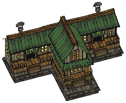](Cozy_Home.md)；[警长办公室（Sheriff's Office）](Sheriff_s_Office.md) ；[鬼鬼之家（Haunted House）](Haunted_House.md) ；[骸骨墓园奖杯（Boneyard Trophy）](Boneyard_Trophy.md)  | 11 | [黑暗（Dark）](Dark.md) ；[诅咒的精液（Cursed Elixir）](Cursed_Elixir.md) [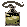](Cursed_Elixir.md)；[伏都娃娃（Voodoo Doll）](Voodoo_Doll.md) [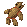](Voodoo_Doll.md)；[压力阀（Pressure Valve）](Pressure_Valve.md)  |
| 2 | [白雪海岸（The SNOWYxSHORES）](The_SNOWYxSHORES.md) |  |  | [农场（Farm）](Farm.md) ；[木工场（Lumberyard）](Lumberyard.md) ；[石矿（Stone Mine）](Stone_Mine.md) ；[卫报（Watch Tower）](Watch_Tower.md) ；[化学家（Alchemist）](Alchemist.md) ；[车手（Wheelwright）](Wheelwright.md) ；[大学（University）](University.md) ；[退伍军人小屋（Veteran's Hut）](Veteran_s_Hut.md) ；[单身家庭（Single Family Home）](Single_Family_Home.md) ；[别墅（Villa）](Villa.md) ；[雪杯（Snowy Trophy）](Snowy_Trophy.md) ；[冒险家协会（Adventurer's Guild）](Adventurer_s_Guild.md)  | 12 |  [黄金牛](https://ballxpit.wiki.gg/wiki/Golden_Bull?action=edit&redlink=1)； [医生的效果](https://ballxpit.wiki.gg/wiki/Healer%27s_Effigy?action=edit&redlink=1)；[弓箭手雕像（Archer's Effigy）](Archer_s_Effigy.md) ；[石头（Stone）](Stone.md)  |
| 3 | [边境沙漠（The LIMINALxDESERT）](The_LIMINALxDESERT.md) |  |  | [金矿（Gold Mine）](Gold_Mine.md) ；[市场（Market）](Market.md) ；[热水池（Spa）](Spa.md) ；[军事学院（Military Academy）](Military_Academy.md) [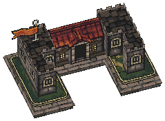](Military_Academy.md)；[外交厅（Diplomacy Hall）](Diplomacy_Hall.md) ；[射箭射击范围（Archery Range）](Archery_Range.md) ；[银行（Bank）](Bank.md) [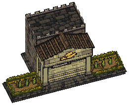](Bank.md)；[磁铁工厂（Magnet Factory）](Magnet_Factory.md) ；[洛基山（Rocky Hill）](Rocky_Hill.md) [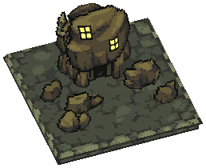](Rocky_Hill.md)；[陵墓（Mausoleum）](Mausoleum.md) ；[协会厅（Guild Hall）](Guild_Hall.md) [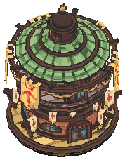](Guild_Hall.md)；[沙漠奖杯（Desert Trophy）](Desert_Trophy.md) [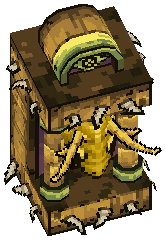](Desert_Trophy.md) | 12 | [光（Light）](Light.md) ；[吸血鬼剑（Vampiric Sword）](Vampiric_Sword.md) [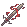](Vampiric_Sword.md)；[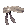](https://ballxpit.wiki.gg/wiki/Silver_Blindfold) [银眼罩](https://ballxpit.wiki.gg/wiki/Silver_Blindfold?action=edit&redlink=1)；[死亡眼睛的宝藏（Deadeye's Amulet）](Deadeye_s_Amulet.md)  |
| 4 | [真菌森林（The FUNGALxFOREST）](The_FUNGALxFOREST.md) |  |  | [道路守护者（Road Keeper）](Road_Keeper.md) [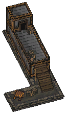](Road_Keeper.md)；[修道院（Abbey）](Abbey.md) [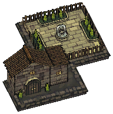](Abbey.md)；[匹配机（Matchmaker）](Matchmaker.md) ；[死灵法师（Necromancer）](Necromancer.md) ；[赌场（Casino）](Casino.md) ；[珠宝家（Jeweler）](Jeweler.md) ；[豪宅（Mansion）](Mansion.md) ；[铁堡垒（Iron Fortress）](Iron_Fortress.md) ；[实验室（Laboratory）](Laboratory.md) ；[蘑菇奖杯（Shroom Trophy）](Shroom_Trophy.md) [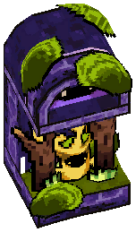](Shroom_Trophy.md) | 10 | [细胞（Cell）](Cell.md) ； [可怜洋葱（Wretched Onion）](https://ballxpit.wiki.gg/wiki/Wretched_Onion?action=edit&redlink=1)； [尖刺项圈（Spiked Collar）](https://ballxpit.wiki.gg/wiki/Spiked_Collar?action=edit&redlink=1)； [保护的魅力](https://ballxpit.wiki.gg/wiki/Protective_Charm?action=edit&redlink=1) |
| 5 | [血腥草原（The GORYxGRASSLANDS）](The_GORYxGRASSLANDS.md) |  |  | [密集的小麦（Dense Wheat）](Dense_Wheat.md) [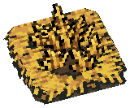](Dense_Wheat.md)；[大树（Grand Tree）](Grand_Tree.md) ；[收藏家的小屋（Gatherer's Hut）](Gatherer_s_Hut.md) ；[赌徒巢穴（Gambler's Den）](Gambler_s_Den.md) ；[古董店（Antique Shop）](Antique_Shop.md) ；[石家庄（Gemsmith）](Gemsmith.md) ；[剧院（Theater）](Theater.md) [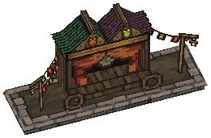](Theater.md)；[修道院（Monastery）](Monastery.md) ；[戈里奖杯（Gory Trophy）](Gory_Trophy.md) [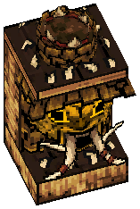](Gory_Trophy.md) | 9 |  [手镜](https://ballxpit.wiki.gg/wiki/Hand_Mirror?action=edit&redlink=1)； [手机风扇](https://ballxpit.wiki.gg/wiki/Hand_Fan?action=edit&redlink=1)； [恋人的箭袋（Lover's Quiver）](https://ballxpit.wiki.gg/wiki/Lover%27s_Quiver?action=edit&redlink=1)；[肉类（Flesh）](Flesh.md)  |
| 6 | [阴燃深渊（The SMOLDERINGxDEPTHS）](The_SMOLDERINGxDEPTHS.md) |  |  | [花岗岩板（Granite Slab）](Granite_Slab.md) ；[蜡烛作坊（Candle Maker）](Candle_Maker.md) ；[愿意好好（Wishing Well）](Wishing_Well.md) [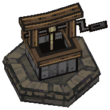](Wishing_Well.md)；[冥想帐篷（Meditation Tent）](Meditation_Tent.md) ；[战争室（War Room）](War_Room.md) ；[队长的四处（Captain's Quarters）](Captain_s_Quarters.md) ；[石域（Stone Domain）](Stone_Domain.md) ；[隐秘神殿（Hidden Temple）](Hidden_Temple.md) ；[生动的奖杯（Smoldering Trophy）](Smoldering_Trophy.md)  | 9 | [时间（Time）](Time.md) ； [宝石之春](https://ballxpit.wiki.gg/wiki/Gemspring?action=edit&redlink=1)；[动力石（Dynamite）](Dynamite.md) [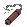](Dynamite.md)； [车轮](https://ballxpit.wiki.gg/wiki/Wagon_Wheel?action=edit&redlink=1) |
| 7 | [天堂之门（The HEAVENLYxGATES）](The_HEAVENLYxGATES.md) |  |  | [工人协会（Worker's Guild）](Worker_s_Guild_Building.md) ；[木匠](Carpenter_Building.md) ；[包装机器](Bag_Maker_Building.md) ；[进化室](Evolution_Chamber_Building.md) ；[遗物收藏家](Relic_Collector_Building.md) ；[露营场（Campground）](Campground.md) ；[驯鹰小屋（Falconry Hut）](Falconry_Hut.md) ；[不稳定的塔楼（Unstable Tower）](Unstable_Tower.md) ；[天上的奖杯（Heavenly Trophy）](Heavenly_Trophy.md) [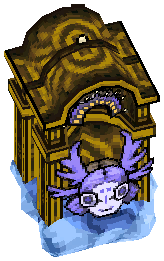](Heavenly_Trophy.md) | 9 | [迷人（Charm）](Charm.md) ； [幽灵盾牌](https://ballxpit.wiki.gg/wiki/Ghostly_Shield?action=edit&redlink=1)；[叛徒的外套（Traitor's Cowl）](Traitor_s_Cowl.md) ； [幽灵的皮套](https://ballxpit.wiki.gg/wiki/Ghostly_Corset?action=edit&redlink=1) |
| 8 | [浩瀚虚空（The VASTxVOID）](The_VASTxVOID.md) |  |  | [战士协会（Warrior's Guild）](Warrior_s_Guild.md) ；[医院（Hospital）](Hospital.md) ；[射手协会（Marksman's Guild）](Marksman_s_Guild.md) ；[大博物馆（Grand Museum）](Grand_Museum.md) ；[车车工厂（Wagon Factory）](Wagon_Factory.md) ；[资本中心（Capitolium）](Capitolium.md) ；[聚会之家（Party House）](Party_House.md) ；[球场（Ball House）](Ball_House.md) ；[虚空奖杯（Void Trophy）](Void_Trophy.md)  | 9 | 标签 |

[返回总入口](../%E7%90%83%E6%AF%94%E4%BC%A6%E6%88%98%E8%AE%B0%20Wiki.md) · [返回本分目录](%E7%9B%AE%E5%BD%95.md)
