# 关卡（Levels）

[原文与贡献者记录](https://ballxpit.wiki.gg/wiki/Levels) · [修订 3721](https://ballxpit.wiki.gg/index.php?oldid=3721) · [返回目录](../%E7%90%83%E6%AF%94%E4%BC%A6%E6%88%98%E8%AE%B0%20Wiki.md)

*[《球比伦战记》](Ball_x_Pit.md)*目前有 8 个关卡，分别对应深坑的一层。[骸骨墓园](The_BONExYARD.md) 之后，每开一层都要收集指定数量的齿轮，并装入深坑升降梯。每名角色首次通关某一层都会获得齿轮，任何速度档都可。齿轮只计入该层紧接着下一层的解锁进度，通关更靠上的层数不计入。

各基础关卡需要的解锁齿轮数不同。新游戏＋（New Game+）的每一层都需要 8 枚齿轮。通关[浩瀚虚空](The_VASTxVOID.md) 获得的齿轮，可计入下一轮新游戏＋的骸骨墓园解锁进度。

每个关卡都有独有的[建筑](Buildings.md)蓝图。击败敌人或首领时有机会掉落这些蓝图。首次使用任何角色通关该关卡时，还会解锁特定[圆球](Balls.md)和[被动道具](Passives.md)。[浩瀚虚空](The_VASTxVOID.md) 不适用首次通关解锁奖励。

| 层 | 名称 | 图标 | 解锁基础关卡 | 建筑蓝图 | 总建筑蓝图数量 | 基础等级首次通关解锁内容 |
| --- | --- | --- | --- | --- | --- | --- |
| 1 | [骸骨墓园（The BONExYARD）](The_BONExYARD.md) |  | - （默认解锁） | [诊所（Clinic）](Clinic.md) ；[兵营（Barracks）](Barracks.md) [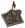](Barracks.md)；[鞋匠（Shoemaker）](Shoemaker.md) ；[领事馆（Consulate）](Consulate.md) ；[学堂（Schoolhouse）](Schoolhouse.md) ；[枪匠（Gunsmith）](Gunsmith.md) ；[驱魔人（Exorcist）](Exorcist.md) ；[舒适的家（Cozy Home）](Cozy_Home.md) [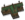](Cozy_Home.md)；[警长办公室（Sheriff's Office）](Sheriff_s_Office.md) [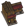](Sheriff_s_Office.md)；[鬼屋（Haunted House）](Haunted_House.md) ；[骸骨墓园奖杯（Boneyard Trophy）](Boneyard_Trophy.md)  | 11 | [黑暗（Dark）](Dark.md) ；[诅咒灵药（Cursed Elixir）](Cursed_Elixir.md) ；[巫毒娃娃（Voodoo Doll）](Voodoo_Doll.md) ；[压力阀（Pressure Valve）](Pressure_Valve.md)  |
| 2 | [白雪海岸（The SNOWYxSHORES）](The_SNOWYxSHORES.md) |  | [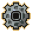](../files/Gear_slotted_.png.md) | [农场（Farm）](Farm.md) ；[伐木场（Lumberyard）](Lumberyard.md) ；[石矿场（Stone Mine）](Stone_Mine.md) [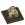](Stone_Mine.md)；[守望塔（Watch Tower）](Watch_Tower.md) ；[炼金术士（Alchemist）](Alchemist.md) ；[车轮匠（Wheelwright）](Wheelwright.md) ；[大学（University）](University.md) ；[老兵小屋（Veteran's Hut）](Veteran_s_Hut.md) ；[独栋住宅（Single Family Home）](Single_Family_Home.md) ；[别墅（Villa）](Villa.md) ；[白雪海岸奖杯（Snowy Trophy）](Snowy_Trophy.md) [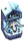](Snowy_Trophy.md)；[冒险者公会（Adventurer's Guild）](Adventurer_s_Guild.md)  | 12 |  [金牛座](https://ballxpit.wiki.gg/wiki/Golden_Bull?action=edit&redlink=1)； [治疗者的雕像](https://ballxpit.wiki.gg/wiki/Healer%27s_Effigy?action=edit&redlink=1)；[弓箭手雕像（Archer's Effigy）](Archer_s_Effigy.md) ；[石头（Stone）](Stone.md)  |
| 3 | [边境沙漠（The LIMINALxDESERT）](The_LIMINALxDESERT.md) |  |  | [金矿（Gold Mine）](Gold_Mine.md) [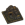](Gold_Mine.md)；[市场（Market）](Market.md) ；[温泉浴场（Spa）](Spa.md) [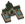](Spa.md)；[军事学院（Military Academy）](Military_Academy.md) ；[外交厅（Diplomacy Hall）](Diplomacy_Hall.md) ；[射箭场（Archery Range）](Archery_Range.md) ；[银行（Bank）](Bank.md) [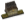](Bank.md)；[磁铁工厂（Magnet Factory）](Magnet_Factory.md) ；[岩石山丘（Rocky Hill）](Rocky_Hill.md) ；[陵墓（Mausoleum）](Mausoleum.md) ；[公会大厅（Guild Hall）](Guild_Hall.md) ；[沙漠奖杯（Desert Trophy）](Desert_Trophy.md) [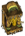](Desert_Trophy.md) | 12 | [光（Light）](Light.md) ；[吸血剑（Vampiric Sword）](Vampiric_Sword.md) ； [银色蒙眼](https://ballxpit.wiki.gg/wiki/Silver_Blindfold?action=edit&redlink=1)；[神射手护符（Deadeye's Amulet）](Deadeye_s_Amulet.md)  |
| 4 | [真菌森林（The FUNGALxFOREST）](The_FUNGALxFOREST.md) | [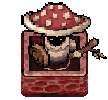](The_FUNGALxFOREST.md) |  | [道路守护者（Road Keeper）](Road_Keeper.md) [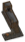](Road_Keeper.md)；[修道院（Abbey）](Abbey.md) ；[匹配机（Matchmaker）](Matchmaker.md) ；[死灵法师（Necromancer）](Necromancer.md) [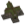](Necromancer.md)；[赌场（Casino）](Casino.md) [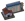](Casino.md)；[珠宝匠（Jeweler）](Jeweler.md) ；[豪宅（Mansion）](Mansion.md) ；[铁堡（Iron Fortress）](Iron_Fortress.md) ；[实验室（Laboratory）](Laboratory.md) ；[蘑菇奖杯（Shroom Trophy）](Shroom_Trophy.md) [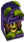](Shroom_Trophy.md) | 10 | [细胞（Cell）](Cell.md) ； [可怜洋葱（Wretched Onion）](https://ballxpit.wiki.gg/wiki/Wretched_Onion?action=edit&redlink=1)； [尖刺项圈（Spiked Collar）](https://ballxpit.wiki.gg/wiki/Spiked_Collar?action=edit&redlink=1)； [防护魅惑](https://ballxpit.wiki.gg/wiki/Protective_Charm?action=edit&redlink=1) |
| 5 | [血腥草原（The GORYxGRASSLANDS）](The_GORYxGRASSLANDS.md) |  |  | [密集小麦（Dense Wheat）](Dense_Wheat.md) ；[大树（Grand Tree）](Grand_Tree.md) [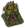](Grand_Tree.md)；[采集者小屋（Gatherer's Hut）](Gatherer_s_Hut.md) ；[赌徒巢穴（Gambler's Den）](Gambler_s_Den.md) ；[古董店（Antique Shop）](Antique_Shop.md) ；[宝石匠（Gemsmith）](Gemsmith.md) [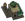](Gemsmith.md)；[剧场（Theater）](Theater.md) ；[修道院（Monastery）](Monastery.md) [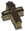](Monastery.md)；[血腥草原奖杯（Gory Trophy）](Gory_Trophy.md) [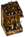](Gory_Trophy.md) | 9 | [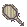](https://ballxpit.wiki.gg/wiki/Hand_Mirror) [手镜](https://ballxpit.wiki.gg/wiki/Hand_Mirror?action=edit&redlink=1)； [手扇](https://ballxpit.wiki.gg/wiki/Hand_Fan?action=edit&redlink=1)； [恋人的箭袋（Lover's Quiver）](https://ballxpit.wiki.gg/wiki/Lover%27s_Quiver?action=edit&redlink=1)；[肉身（Flesh）](Flesh.md)  |
| 6 | [阴燃深渊（The SMOLDERINGxDEPTHS）](The_SMOLDERINGxDEPTHS.md) |  |  | [花岗岩板（Granite Slab）](Granite_Slab.md) [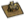](Granite_Slab.md)；[蜡烛作坊（Candle Maker）](Candle_Maker.md) ；[许愿池（Wishing Well）](Wishing_Well.md) ；[冥想帐篷（Meditation Tent）](Meditation_Tent.md) ；[作战室（War Room）](War_Room.md) [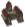](War_Room.md)；[队长宿舍（Captain's Quarters）](Captain_s_Quarters.md) ；[石之领域（Stone Domain）](Stone_Domain.md) ；[隐秘神殿（Hidden Temple）](Hidden_Temple.md) ；[阴燃深渊奖杯（Smoldering Trophy）](Smoldering_Trophy.md)  | 9 | [时间（Time）](Time.md) ； [Gemspring](https://ballxpit.wiki.gg/wiki/Gemspring?action=edit&redlink=1)；[炸药（Dynamite）](Dynamite.md) ； [Wagon Wheel](https://ballxpit.wiki.gg/wiki/Wagon_Wheel?action=edit&redlink=1) |
| 7 | [天堂之门（The HEAVENLYxGATES）](The_HEAVENLYxGATES.md) |  |  | [工人工会（Worker's Guild）](Worker_s_Guild_Building.md) ；[木匠](Carpenter_Building.md) ；[包制师](Bag_Maker_Building.md) ；[进化室](Evolution_Chamber_Building.md) ；[遗迹收集者](Relic_Collector_Building.md) [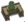](Relic_Collector_Building.md)；[露营地（Campground）](Campground.md) [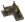](Campground.md)；[驯鹰小屋（Falconry Hut）](Falconry_Hut.md) [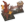](Falconry_Hut.md)；[不稳定塔（Unstable Tower）](Unstable_Tower.md) ；[天堂之门奖杯（Heavenly Trophy）](Heavenly_Trophy.md)  | 9 | [魅惑（Charm）](Charm.md) ； [幽灵护盾](https://ballxpit.wiki.gg/wiki/Ghostly_Shield?action=edit&redlink=1)；[叛徒斗篷（Traitor's Cowl）](Traitor_s_Cowl.md) ；[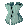](https://ballxpit.wiki.gg/wiki/Ghostly_Corset) [幽灵紧身衣](https://ballxpit.wiki.gg/wiki/Ghostly_Corset?action=edit&redlink=1) |
| 8 | [浩瀚虚空（The VASTxVOID）](The_VASTxVOID.md) |  |  | [战士公会（Warrior's Guild）](Warrior_s_Guild.md) ；[医院（Hospital）](Hospital.md) ；[射手公会（Marksman's Guild）](Marksman_s_Guild.md) ；[大博物馆（Grand Museum）](Grand_Museum.md) ；[马车工厂（Wagon Factory）](Wagon_Factory.md) ；[议事殿（Capitolium）](Capitolium.md) [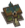](Capitolium.md)；[派对之家（Party House）](Party_House.md) [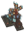](Party_House.md)；[圆球屋（Ball House）](Ball_House.md) [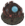](Ball_House.md)；[虚空奖杯（Void Trophy）](Void_Trophy.md)  | 9 | 不适用 |

[返回总入口](../%E7%90%83%E6%AF%94%E4%BC%A6%E6%88%98%E8%AE%B0%20Wiki.md) · [返回本分目录](%E7%9B%AE%E5%BD%95.md)
