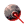
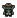
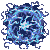

# 光（Light）

命中时使敌人失明 3/5/7 秒。被失明的单位很难发现你，且攻击时有 50% 的概率落空。

[原文与贡献者记录](https://ballxpit.wiki.gg/wiki/Light) · [修订 4212](https://ballxpit.wiki.gg/index.php?oldid=4212) · [返回目录](../%E7%90%83%E6%AF%94%E4%BC%A6%E6%88%98%E8%AE%B0%20Wiki.md)

## 基本信息

### 初始角色（Starting Character）

[物理学家](The_Physicist.md) 

### 解锁

通关边境沙漠

### 状态效果（Status Effects）

[盲视](https://ballxpit.wiki.gg/wiki/Status_Effects?action=edit&redlink=1)

### 由状态效果触发

命中时

## 进化（Evolutions）

### 进化成

[闪光](Flash.md) , [闪烁](Flicker.md) , [激光束](Laser_Beam.md) , [迷恋](Lovestruck.md) , [太阳](Sun.md) , [扭曲](Warp.md) 

**光** 是 *[球比伦战记](Ball_x_Pit.md)* 基础游戏版本中引入的 [基础圆球](Balls.md#%E5%9F%BA%E7%A1%80%E5%9C%86%E7%90%83)，通关 [边境沙漠](The_LIMINALxDESERT.md) 后解锁，也是 [物理学家](The_Physicist.md)  的初始圆球。

## 关卡

| 等级 | 伤害 | 效果 |
| --- | --- | --- |
| 1 |  x(3.5 至 6.5) | 命中时使敌人失明 3 秒。被失明的单位很难发现你，且攻击时有 50% 的概率落空。 |
| 2 |  x(3.5 至 6.5) | 命中时使敌人失明 5 秒。被失明的单位很难发现你，且攻击时有 50% 的概率落空。 |
| 3 |  x(3.5 至 6.5) | 命中时使敌人失明 7 秒。被失明的单位很难发现你，且攻击时有 50% 的概率落空。 |

## 进化

| 组合 | 进化 |
| --- | --- |
|  光（Light） + [闪电（Lightning）](Lightning.md)  | [闪光（Flash）](Flash.md)  |
|  光（Light） + [黑暗（Dark）](Dark.md)  | [闪烁（Flicker）](Flicker.md)  |
|  光（Light） + [激光（水平）（Laser (Horizontal)）](Laser_Horizontal.md)  ／  光（Light） + [激光（垂直）（Laser (Vertical)）](Laser_Vertical.md)  | [激光束（Laser Beam）](Laser_Beam.md) （\*） |
|  光（Light） + [魅惑（Charm）](Charm.md)  | [迷恋（Lovestruck）](Lovestruck.md)  |
|  光（Light） + [灼烧（Burn）](Burn.md)  | [太阳（Sun）](Sun.md) （\*） |
|  光（Light） + [时间（Time）](Time.md)  | [扭曲（Warp）](Warp.md)  |

* 可以进一步进化。

## 策略

## 更新记录

## 冷知识

## 图片库

[共享导航](../navigation/nav-63012059ef49.md)

**分类**　[分类 · 基础圆球](../categories/Base_Balls.md) · [分类 · 圆球](../categories/Balls.md) · [分类 · 带有导航框的页面](../categories/Pages_with_navboxes.md)

[返回总入口](../%E7%90%83%E6%AF%94%E4%BC%A6%E6%88%98%E8%AE%B0%20Wiki.md) · [返回本分目录](%E7%9B%AE%E5%BD%95.md)
