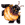
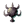
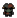

# 闪电（Lightning）

对最多 3/3/5 个附近的敌人造成 1-20/1-30/1-30 的伤害

[原文与贡献者记录](https://ballxpit.wiki.gg/wiki/Lightning) · [修订 4213](https://ballxpit.wiki.gg/index.php?oldid=4213) · [返回目录](../%E7%90%83%E6%AF%94%E4%BC%A6%E6%88%98%E8%AE%B0%20Wiki.md)

## 基本信息

### 初始角色（Starting Characters）

[杂耍者](The_Juggler.md) 
[驯鹰人](The_Falconer.md) 

### 解锁

默认解锁

### 状态效果（Status Effects）

-

## 进化（Evolutions）

### 进化成

[暴风雪](Blizzard.md) , [闪光](Flash.md) , [闪电虫](Lightning_Bug.md) , [避雷针](Lightning_Rod.md) , [迷恋](Lovestruck.md) , [风暴](Storm.md) 

**闪电** 是 [基础圆球](Balls.md#%E5%9F%BA%E7%A1%80%E5%9C%86%E7%90%83) 在基础游戏版本中引入 *[球比伦战记](Ball_x_Pit.md)*. 默认即可解锁。这是起始球。 [杂耍者](The_Juggler.md)  和 [驯鹰人](The_Falconer.md) .

## 关卡

| 等级 | 伤害 | 效果 |
| --- | --- | --- |
| 1 |  x(3.5 至 6.5) | 对最多3个附近的敌人造成1-20点伤害 |
| 2 |  x(3.5 至 6.5) | 对最多3个附近的敌人造成1-30的伤害 |
| 3 |  x(3.5 至 6.5) | 对最多5个附近的敌人造成1-30点伤害 |

## 进化

| 组合 | 进化 |
| --- | --- |
|  闪电（Lightning） + [冻结（Freeze）](Freeze.md)  | [暴风雪（Blizzard）](Blizzard.md)  |
|  闪电（Lightning） + [光（Light）](Light.md)  | [闪光（Flash）](Flash.md)  |
|  闪电（Lightning） + [育巢母体（Brood Mother）](Brood_Mother.md)  | [闪电虫（Lightning Bug）](Lightning_Bug.md)  |
|  闪电（Lightning） + [铁（Iron）](Iron.md)  | [避雷针（Lightning Rod）](Lightning_Rod.md)  |
|  闪电（Lightning） + [魅惑（Charm）](Charm.md)  | [迷恋（Lovestruck）](Lovestruck.md)  |
|  闪电（Lightning） + [风（Wind）](Wind.md)  | [风暴（Storm）](Storm.md) （\*） |

* 可以进一步进化。

## 策略

## 更新记录

## 冷知识

## 图片库

[共享导航](../navigation/nav-63012059ef49.md)

**分类**　[分类 · 基础圆球](../categories/Base_Balls.md) · [分类 · 圆球](../categories/Balls.md) · [分类 · 带有导航框的页面](../categories/Pages_with_navboxes.md)

[返回总入口](../%E7%90%83%E6%AF%94%E4%BC%A6%E6%88%98%E8%AE%B0%20Wiki.md) · [返回本分目录](%E7%9B%AE%E5%BD%95.md)
