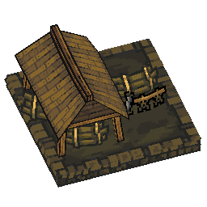
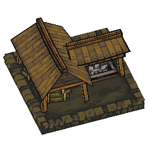
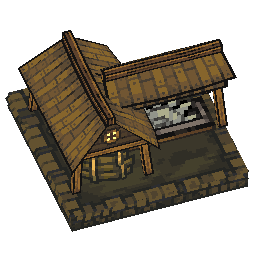

# 木工场（Lumberyard）

给一个角色来收获。  取自邻近的森林瓷砖。

[原文与贡献者记录](https://ballxpit.wiki.gg/wiki/Lumberyard) · [修订 3336](https://ballxpit.wiki.gg/index.php?oldid=3336) · [返回目录](../%E7%90%83%E6%AF%94%E4%BC%A6%E6%88%98%E8%AE%B0%20Wiki.md)

#### 信息（Information）

##### 分类（Category）

经济

##### 子类（Subcategory）

聚会

##### 蓝图位置（Blueprint location）

[白雪海岸](The_SNOWYxSHORES.md) 

##### 基础资源消耗（Base resource cost）

 100  5

##### 建造点消耗（Build point cost）

5

其他 **木工场** 是一个聚会。 [建筑物](Buildings.md) 在 *[球比伦战记](Ball_x_Pit.md)*Lumberyard 被动收获  装饰木材 [森林](Forest.md) 及 [大树](Grand_Tree.md) 该区在建筑效应区内，按固定费率，可通过建筑物升级加以改进，再从卢伯园向每个方向，包括对角，再延伸2块小瓦。 [性格](Characters.md) 必须指派到此建筑才能收获资源， 但是指定的字符在收割模式下仍然可以使用。 默认情况下， 此建筑不会在游戏关闭时收获资源， 除非 [工人协会](Worker_s_Guild_Building.md) 与大多数建筑物不同，资源和收集子类别中的这类和其他建筑物可以建造多次，只要玩家有必要的资源和空间。

被动效果与升级

| 等级 | 图片 | 描述 | 资源消耗 | 建造点消耗 | 拆除 | 资源收集 | 收藏率 |
| --- | --- | --- | --- | --- | --- | --- | --- |
| 1 |  | 在这里分配一个字符来收获到1  每9分钟就从每一个邻近的森林。 |  75  5 | 5 |  75  5 |  木材 |  1分钟/9分钟 |
| 2 |  | 在这里分配一个字符来收获到2个  每8分钟就从每一个邻近的森林。 |  150  10 | 5 |  75  15 |  木材 |  2 / 8分钟 |
| 3 |  | 在这里分配一个字符来收获到3  每7分钟就从每一个邻近的森林。 |  225  15 | 15 |  450  30 |  木材 |  3 / 7分钟 |

[共享导航](../navigation/nav-d4956b01aa56.md)

**分类**　[分类 · 建筑](../categories/Buildings.md) · [分类 · 经济](../categories/Economy.md) · [分类 · 聚会](../categories/Gathering.md) · [分类 · 页面有导航框](../categories/Pages_with_navboxes.md)

[返回总入口](../%E7%90%83%E6%AF%94%E4%BC%A6%E6%88%98%E8%AE%B0%20Wiki.md) · [返回本分目录](%E7%9B%AE%E5%BD%95.md)
