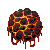

# 马格玛（Magma）

随着时间的推移岩浆会喷出薄膜进入熔岩块的敌人被处理15-30/15-30/20-35伤害，并获得1堆燃烧物(最大3堆)。燃烧持续3秒，每秒损伤3-8/5-10/5-10这颗球和它的熔岩洞也给附近单位造成6-12个伤害。

[原文与贡献者记录](https://ballxpit.wiki.gg/wiki/Magma) · [修订 4123](https://ballxpit.wiki.gg/index.php?oldid=4123) · [返回目录](../%E7%90%83%E6%AF%94%E4%BC%A6%E6%88%98%E8%AE%B0%20Wiki.md)

#### 一般信息

##### 由

[灼烧](Burn.md)  + [地震](Earthquake.md) 

##### 开始的性格

-

##### 状态效果（Status Effects）

[灼烧](https://ballxpit.wiki.gg/wiki/Status_Effects?action=edit&redlink=1)

##### 由于状态影响

快速，快速，快速

#### 进化配方

|  |  |  |  |  |  |  |
| --- | --- | --- | --- | --- | --- | --- |
|  |  |  |  |  |  |  |
| [灼烧（Burn）](Burn.md)  |  |  |  | [地震（Earthquake）](Earthquake.md)  |  |  |
|  |  |  |  |  |  |  |
|  |  | 马格玛（Magma） |  |  |  |  |

#### 关卡

| 等级 | 伤害 | 影响 |
| --- | --- | --- |
| 1 |  x(3.6至6.8) | 随时间推移释放熔岩块。走进熔岩块的敌人将受到15 - 30次的伤害，并获得1堆燃烧(最大3堆)，燃烧持续3秒，每堆每秒处理3 - 8次伤害。这个球及其熔岩块还处理附近单位的6 - 12次伤害。 ／ |
| 2 |  x(3.6至6.8) | 进入熔岩槽的敌人将遭受15 - 30次伤害，并获得1堆烧伤(最大3堆)，烧得持续3秒钟，每堆伤害5 - 10次，每堆每秒。这个球及其熔岩槽也给附近单位造成6 - 12次伤害。 ／ |
| 3 |  x(3.6至6.8) | 进入熔岩槽的敌人将受到20-35次伤害和1堆烧伤(最大3堆)，烧得持续3秒钟，每堆每秒5-10次伤害。这个球及其熔岩槽也给附近的单位造成6-12次伤害。 ／ |

#### 发展情况

*这个球不能进一步发展。*

#### 策略

#### 更新记录

#### 冷知识

#### 图片库

[共享导航](../navigation/nav-63012059ef49.md)

**分类**　[分类 · 进化圆球](../categories/Evolved_Balls.md) · [分类 · 圆球](../categories/Balls.md) · [分类 · 页面有导航框](../categories/Pages_with_navboxes.md)

[返回总入口](../%E7%90%83%E6%AF%94%E4%BC%A6%E6%88%98%E8%AE%B0%20Wiki.md) · [返回本分目录](%E7%9B%AE%E5%BD%95.md)
