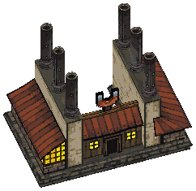
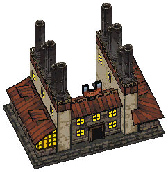

# 磁铁工厂（Magnet Factory）

增加接收距离。

[原文与贡献者记录](https://ballxpit.wiki.gg/wiki/Magnet_Factory) · [修订 3377](https://ballxpit.wiki.gg/index.php?oldid=3377) · [返回目录](../%E7%90%83%E6%AF%94%E4%BC%A6%E6%88%98%E8%AE%B0%20Wiki.md)

#### 信息（Information）

##### 分类（Category）

战争

##### 子类（Subcategory）

总

##### 蓝图位置（Blueprint location）

[LIMINALxDESERT](The_LIMINALxDESERT.md)

##### 基础资源消耗（Base resource cost）

 10  20

##### 建造点消耗（Build point cost）

5

构建磁铁工厂增加了玩家角色在水平运行期间可以收集取取物的距离。默认情况下，只有在与角色的击中框交叉时才会收集 pickups,但这个建筑允许在该击中框的某个半径内收集 pickups, 随着建筑升级，其长度可以进一步增加。

被动效果与升级

| 等级 | 图片 | 描述 | 资源消耗 | 建造点消耗 | 拆除 |
| --- | --- | --- | --- | --- | --- |
| 1 |  | 增加0.5瓷砖的接驳幅度。 |  10  20 | 5 |  10  20 |
| 2 |  | 增加1.0瓷砖的接驳范围。 |  20  40 | 5 |  30  60 |
| 3 |  | 增加1.5瓷砖的接驳幅度。 |  30  60 | 15 |  60  120 |

[共享导航](../navigation/nav-d4956b01aa56.md)

**分类**　[分类 · 建筑](../categories/Buildings.md) · [分类 · 战争](../categories/Warfare.md) · [分类 · 总](../categories/General.md) · [分类 · 页面有导航框](../categories/Pages_with_navboxes.md)

[返回总入口](../%E7%90%83%E6%AF%94%E4%BC%A6%E6%88%98%E8%AE%B0%20Wiki.md) · [返回本分目录](%E7%9B%AE%E5%BD%95.md)
