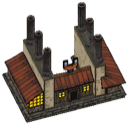

# 磁铁工厂（Magnet Factory）

增加拾取范围。

[原文与贡献者记录](https://ballxpit.wiki.gg/wiki/Magnet_Factory) · [修订 3377](https://ballxpit.wiki.gg/index.php?oldid=3377) · [返回目录](../%E7%90%83%E6%AF%94%E4%BC%A6%E6%88%98%E8%AE%B0%20Wiki.md)

## 信息（Information）

### 分类（Category）

战争

### 子类（Subcategory）

将军

### 蓝图位置（Blueprint location）

[LIMINALxDESERT](The_LIMINALxDESERT.md)

### 基础资源消耗（Base resource cost）

 10  20

### 建造点消耗（Build point cost）

5

建造磁体工厂会增加玩家角色在等级提升过程中收集物品的距离。默认情况下，物品仅在与角色碰撞区域相交时才能被收集，但建造此工厂后，玩家可以在该碰撞区域一定半径范围内收集物品，该半径可以通过升级进一步扩大。

被动效果与升级

| 等级 | 图片 | 说明 | 资源消耗 | 建造点消耗 | 拆除 |
| --- | --- | --- | --- | --- | --- |
| 1 |  | 拾取范围增加0.5格。 |  10  20 | 5 |  10  20 |
| 2 |  | 将拾取范围增加 1.0 格。 |  20  40 | 5 |  30  60 |
| 3 |  | 拾取范围增加 1.5 格。 |  30  60 | 15 |  60  120 |

[共享导航](../navigation/nav-d4956b01aa56.md)

**分类**　[分类 · 建筑](../categories/Buildings.md) · [分类 · 战争](../categories/Warfare.md) · [分类 · 通用](../categories/General.md) · [分类 · 带有导航框的页面](../categories/Pages_with_navboxes.md)

[返回总入口](../%E7%90%83%E6%AF%94%E4%BC%A6%E6%88%98%E8%AE%B0%20Wiki.md) · [返回本分目录](%E7%9B%AE%E5%BD%95.md)
