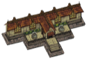

# 豪宅（Mansion）

[原文与贡献者记录](https://ballxpit.wiki.gg/wiki/Mansion) · [修订 4231](https://ballxpit.wiki.gg/index.php?oldid=4231) · [返回目录](../%E7%90%83%E6%AF%94%E4%BC%A6%E6%88%98%E8%AE%B0%20Wiki.md)

[挥霍者](The_Spendthrift.md)  的房子。

## 信息（Information）

### 分类（Category）

住房

### 子类（Subcategory）

住房

### 蓝图位置（Blueprint location）

[真菌森林](The_FUNGALxFOREST.md) 

### 基础资源消耗（Base resource cost）

 500  30  10

### 建造点消耗（Build point cost）

30

建造豪宅将解锁[挥霍者](The_Spendthrift.md)  作为可玩角色。当该角色获得足够的经验值达到4级时，这座建筑将解锁一项被动技能：每当其作用区域内有其他建筑时，豪宅会自动被动收集金币（注意，此技能不需要指定角色，但无法享受[工人工会](Worker_s_Guild_Building.md)提供的离线收获奖励）。通过将该角色升级到7级，而非直接升级建筑本身，可以进一步提升该建筑的技能。达到此等级后，该建筑的技能范围将扩大。注意，拆除角色的住宅将使该角色无法用于收获模式或等级提升，并将其从所有建筑任务中移除，直到其住宅重建为止（尽管该角色仍保留之前的所有进度）。

被动效果与升级

| 等级 | 图片 | 说明 | 资源消耗 | 建造点消耗 | 拆除 | 角色等级要求 |
| --- | --- | --- | --- | --- | --- | --- |
| 1 |  | 一个适合挥霍者的房子 |  500  30  10 | 30 |  500  30  10 | - |
| 2 |  |  | - | - |  500  30  10 |  |
| 3 |  | 一个适合挥霍者的房子 每靠近一座建筑，每分钟被动获得 1 。 | - | - |  500  30  10 |  |

[共享导航](../navigation/nav-d4956b01aa56.md)

**分类**　[分类 · 建筑](../categories/Buildings.md) · [分类 · 住房](../categories/Housing.md) · [分类 · 带有导航框的页面](../categories/Pages_with_navboxes.md)

[返回总入口](../%E7%90%83%E6%AF%94%E4%BC%A6%E6%88%98%E8%AE%B0%20Wiki.md) · [返回本分目录](%E7%9B%AE%E5%BD%95.md)
