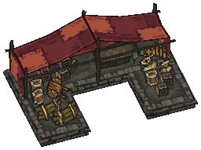
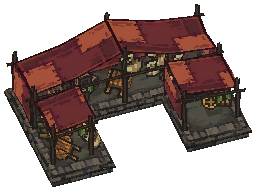

# 市场（Market）

释放了交易黄金的能力。

[原文与贡献者记录](https://ballxpit.wiki.gg/wiki/Market) · [修订 4281](https://ballxpit.wiki.gg/index.php?oldid=4281) · [返回目录](../%E7%90%83%E6%AF%94%E4%BC%A6%E6%88%98%E8%AE%B0%20Wiki.md)

#### 信息（Information）

##### 分类（Category）

经济

##### 子类（Subcategory）

多种类型

##### 蓝图位置（Blueprint location）

[边境沙漠](The_LIMINALxDESERT.md) 

##### 基础资源消耗（Base resource cost）

 500

##### 建造点消耗（Build point cost）

5

待补充条目

*这是一个 [待补充条目](../categories/Stubs.md)你可以帮助BALL xPIT Wiki通过 [补充此条目](https://ballxpit.wiki.gg/wiki/Market?action=edit).*

其他 **市场** 是一个多元经济 [建筑物](Buildings.md) 在 *[球比伦战记](Ball_x_Pit.md)*一旦建成，进入市场可以让你买卖  麦子,  树木和  石头以换取  黄金:购买和销售资源将分别增加和减少购买黄金所需的黄金量，通过建筑升级，这些增长和下降的速度以及基汇率可以得到改善。

被动效果与升级

| 等级 | 图片 | 描述 | 资源消耗 | 建造点消耗 | 拆除 | 基本汇率 | 购买/出售单位的成本变化 |
| --- | --- | --- | --- | --- | --- | --- | --- |
| 1 |  | 释放了交换黄金的能力 |  500 | 5 |  500 | ? | ? |
| 2 |  | 释放了交换黄金的能力 改善汇率 |  500 | 5 |  1,000 | ? | ? |
| 3 |  | 释放了交换黄金的能力 改善汇率 |  750 | 15 |  1,750 | ? | ? |

#### 市场机械

{?要做:更深入地确定，衍生基本汇率}
每种资源可以按 1、5、10、25、100、500、1,000、2,500 或 10,000 单位成批购买或出售，交易规模会按比例影响后续买入价格。各资源的起始价格如下：
  小麦=18买/4卖
  木材 = 45买/10卖
  石头=180买/40卖
销售价格不能低于1个资源。
售价随着时间的推移/每轮之后的增长。 价格可能是十分数，但只有购买一次性卖出足够的东西时才会看到这一点。
购买最多需要的资源是最佳的，因为每个单位的价格是固定的，并且每次交易后才会调整。
销售一次性消耗最大的资源是最佳的，因为每个单位的价格是固定的，并且只会在每个交易后调整。
销售1个单位似乎不经常调整价格,
交易前和交易后的价格数据
 测试:
以每块10块售出25块木材，给250块黄金，并将价格降低到每块7.5块。

销售价格的降低率似乎不是线性的，所以也许像销售价格 = 圆到0.5 ((初始销售价格\_木/销售\_木)

[共享导航](../navigation/nav-d4956b01aa56.md)

**分类**　[分类 · 建筑](../categories/Buildings.md) · [分类 · 经济](../categories/Economy.md) · [分类 · 多种类型](../categories/Miscellaneous.md) · [分类 · 坚力](../categories/Stubs.md) · [分类 · 页面有导航框](../categories/Pages_with_navboxes.md)

[返回总入口](../%E7%90%83%E6%AF%94%E4%BC%A6%E6%88%98%E8%AE%B0%20Wiki.md) · [返回本分目录](%E7%9B%AE%E5%BD%95.md)
