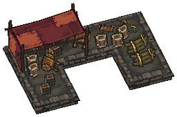

# 市场（Market）

解锁用金币兑换其他资源的功能。

[原文与贡献者记录](https://ballxpit.wiki.gg/wiki/Market) · [修订 4281](https://ballxpit.wiki.gg/index.php?oldid=4281) · [返回目录](../%E7%90%83%E6%AF%94%E4%BC%A6%E6%88%98%E8%AE%B0%20Wiki.md)

## 信息（Information）

### 分类（Category）

经济

### 子类（Subcategory）

其他信息

### 蓝图位置（Blueprint location）

[边境沙漠](The_LIMINALxDESERT.md) 

### 基础资源消耗（Base resource cost）

 500

### 建造点消耗（Build point cost）

5

待完善

*此条目为 [待完善](../categories/Stubs.md). 你可以通过帮助 BALL x PIT 维基贡献一份力量。 [补充内容](https://ballxpit.wiki.gg/wiki/Market?action=edit).*

**市场**是*[《球比伦战记》](Ball_x_Pit.md)*中的经济类[建筑](Buildings.md)。建成后，可在市场用金币买卖小麦、木材和石材。买入一种资源会抬高它之后的买入价，卖出会压低买入价。升级市场可改善基础兑换价和交易产生的价格涨跌幅度。

被动效果与升级

| 等级 | 图片 | 说明 | 资源消耗 | 建造点消耗 | 拆除 | 基础汇率 | 每购买/出售单位的价格变动 |
| --- | --- | --- | --- | --- | --- | --- | --- |
| 1 |  | 解锁用金币兑换其他资源的功能 |  500 | 5 |  500 | ? | ? |
| 2 |  | 解锁用金币兑换其他资源的功能 提高汇率 |  500 | 5 |  1,000 | ? | ? |
| 3 |  | 解锁用金币兑换其他资源的功能 提高汇率 |  750 | 15 |  1,750 | ? | ? |

## 市场机制

待补充：深入测试并推算基础兑换价。
 每次可以买卖 1、5、10、25、100、500、1,000、2,500 或 10,000 单位的同种资源。交易的数量会按比例影响之后的买入价。资源的初始单价如下。
 小麦，买入 18，卖出 4。
 木材，买入 45，卖出 10。
 石材，买入 180，卖出 40。
 每单位资源的卖出价最低为 1。
 卖出价随时间推移或每轮结束而上涨。价格可以有小数，交易量足够大时才看得出来。
 买入所需资源时，一笔交易买足最划算，单价会在交易结束后调整。
 卖出多余资源时也是如此，尽量一次卖出。
 卖出 1 单位通常看不出价格变化，重复多次后可能会变。
 待补充：采集交易前后的价格。
 测试记录
 以每单位 10 金币卖出 25 木材，获得 250 金币，之后的卖出价降至每单位 7.5 金币。

 卖出价的降幅似乎并非线性。可能的公式为：卖出价 = 木材初始卖出价 ÷ 已卖木材量，结果按 0.5 取整。

[共享导航](../navigation/nav-d4956b01aa56.md)

**分类**　[分类 · 建筑](../categories/Buildings.md) · [分类 · 经济](../categories/Economy.md) · [分类 · 其他信息](../categories/Miscellaneous.md) · [分类 · 待完善](../categories/Stubs.md) · [分类 · 带有导航框的页面](../categories/Pages_with_navboxes.md)

[返回总入口](../%E7%90%83%E6%AF%94%E4%BC%A6%E6%88%98%E8%AE%B0%20Wiki.md) · [返回本分目录](%E7%9B%AE%E5%BD%95.md)
