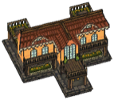
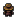
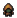
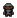
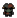
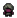
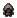
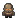

# 匹配机（Matchmaker）

允许你带入两个角色进行单局游戏，结合他们的能力。

[原文与贡献者记录](https://ballxpit.wiki.gg/wiki/Matchmaker) · [修订 4344](https://ballxpit.wiki.gg/index.php?oldid=4344) · [返回目录](../%E7%90%83%E6%AF%94%E4%BC%A6%E6%88%98%E8%AE%B0%20Wiki.md)

## 信息（Information）

### 分类（Category）

战争

### 子类（Subcategory）

将军

### 蓝图位置（Blueprint location）

[FUNGALxFOREST](The_FUNGALxFOREST.md)

### 基础资源消耗（Base resource cost）

 200  40

### 建造点消耗（Build point cost）

20

**匹配机**是一个[建筑](Buildings.md)，允许玩家选择最多两个角色带入单局游戏。当选择了两个角色后，这两个角色的能力将合并为同一个可玩实体，该局游戏期间获得的全部经验值将完全分配给这两个角色，同时玩家在游戏开始时将获得这两个角色的初始球。某些角色组合是[不允许的](#%E4%B8%8D%E5%85%BC%E5%AE%B9%E7%9A%84%E9%85%8D%E5%AF%B9)。

对该建筑进行后续升级将提高次要角色初始球的起始等级。媒人不会提高主要角色初始球的起始等级（后者需要[珠宝匠](Jeweler.md)）。

被动效果与升级

| 等级 | 图片 | 说明 | 资源消耗 | 建造点消耗 | 拆除 |
| --- | --- | --- | --- | --- | --- |
| 1 |  | 允许你带入两个角色进行单局游戏，结合他们的能力。 |  200  40 | 20 |  200  40 |
| 2 |  | 允许你带入两个角色进行单局游戏，结合他们的能力。 次要角色的角色球起始等级为 2 级。 |  300  120 | 20 |  500  160 |
| 3 |  | 允许你带入两个角色进行单局游戏，结合他们的能力。 次要角色的球起始等级为3级。 |  450  180 | 60 |  950  340 |

## 不兼容的配对

这些角色无法相互配对。

[伪救世主](The_False_Messiah.md)  在运行模式下无法拥有第二个角色，除非启用角色选择投票功能；且他们也不能被选为任何其他角色的第二个角色。

| 角色 | 配对 |
| --- | --- |
| [战士（The Warrior）](The_Warrior.md)  |  |
| [快枪手（The Itchy Finger）](The_Itchy_Finger.md)  | [战术家（The Tactician）](The_Tactician.md)  |
| [忏悔者（The Repentant）](The_Repentant.md)  | [持盾者（The Shieldbearer）](The_Shieldbearer.md)  ／ [自笞者（The Flagellant）](The_Flagellant.md)  ／ [掘地者（The Tunneller）](The_Tunneller.md)  ／ [回忆者](https://ballxpit.wiki.gg/wiki/The_Recollector?action=edit&redlink=1) |
| [同居者（The Cohabitants）](The_Cohabitants.md)  | [挥霍者（The Spendthrift）](The_Spendthrift.md)  ／ [杂耍者（The Juggler）](The_Juggler.md)  ／ [临时西西弗斯（The Makeshift Sisyphus）](The_Makeshift_Sisyphus.md)  ／ [驯鹰人（The Falconer）](The_Falconer.md)  ／ [回忆者](https://ballxpit.wiki.gg/wiki/The_Recollector?action=edit&redlink=1) |
| [沉思者（The Cogitator）](The_Cogitator.md)  |  |
| [潜伏者（The Embedded）](The_Embedded.md)  | [The Recollector](https://ballxpit.wiki.gg/wiki/The_Recollector?action=edit&redlink=1) |
| [暗影（The Shade）](The_Shade.md)  | [临时西西弗斯（The Makeshift Sisyphus）](The_Makeshift_Sisyphus.md)  ／ [驯鹰人（The Falconer）](The_Falconer.md)  ／ [哨兵](https://ballxpit.wiki.gg/wiki/The_Sentinel?action=edit&redlink=1) |
| [持盾者（The Shieldbearer）](The_Shieldbearer.md)  | [忏悔者（The Repentant）](The_Repentant.md)  ／ [自笞者（The Flagellant）](The_Flagellant.md)  ／ [物理学家（The Physicist）](The_Physicist.md)  ／ [战术家（The Tactician）](The_Tactician.md)  ／ [掘地者（The Tunneller）](The_Tunneller.md)  ／ [The Recollector](https://ballxpit.wiki.gg/wiki/The_Recollector?action=edit&redlink=1) |
| [挥霍者（The Spendthrift）](The_Spendthrift.md)  | [同居者（The Cohabitants）](The_Cohabitants.md)  ／ [临时西西弗斯（The Makeshift Sisyphus）](The_Makeshift_Sisyphus.md)  ／ [菜园](https://ballxpit.wiki.gg/wiki/The_Potager?action=edit&redlink=1) ／ [回忆者](https://ballxpit.wiki.gg/wiki/The_Recollector?action=edit&redlink=1) |
| [杂耍者（The Juggler）](The_Juggler.md)  | [同居者（The Cohabitants）](The_Cohabitants.md)  ／ [回忆者](https://ballxpit.wiki.gg/wiki/The_Recollector?action=edit&redlink=1) ／ [哨兵](https://ballxpit.wiki.gg/wiki/The_Sentinel?action=edit&redlink=1) |
| [空巢者（The Empty Nester）](The_Empty_Nester.md)  | [波塔格尔](https://ballxpit.wiki.gg/wiki/The_Potager?action=edit&redlink=1) |
| [自笞者（The Flagellant）](The_Flagellant.md)  | [忏悔者（The Repentant）](The_Repentant.md)  ／ [持盾者（The Shieldbearer）](The_Shieldbearer.md)  ／ [物理学家（The Physicist）](The_Physicist.md)  ／ [战术家（The Tactician）](The_Tactician.md)  ／ [掘地者（The Tunneller）](The_Tunneller.md)  ／ [The Recollector](https://ballxpit.wiki.gg/wiki/The_Recollector?action=edit&redlink=1) |
| [临时西西弗斯（The Makeshift Sisyphus）](The_Makeshift_Sisyphus.md)  | [同居者（The Cohabitants）](The_Cohabitants.md)  ／ [暗影（The Shade）](The_Shade.md)  ／ [挥霍者（The Spendthrift）](The_Spendthrift.md)  |
| [物理学家（The Physicist）](The_Physicist.md)  | [持盾者（The Shieldbearer）](The_Shieldbearer.md)  ／ [自笞者（The Flagellant）](The_Flagellant.md)  ／ [回忆者](https://ballxpit.wiki.gg/wiki/The_Recollector?action=edit&redlink=1) ／ [丑闻传播者](https://ballxpit.wiki.gg/wiki/The_Scandalmonger?action=edit&redlink=1) ／ [谨小慎微的恶棍](https://ballxpit.wiki.gg/wiki/The_Scrupulous_Scoundrel?action=edit&redlink=1) |
| [战术家（The Tactician）](The_Tactician.md)  | [快枪手（The Itchy Finger）](The_Itchy_Finger.md)  ／ [持盾者（The Shieldbearer）](The_Shieldbearer.md)  ／ [自笞者（The Flagellant）](The_Flagellant.md)  ／ [畅饮者（The Carouser）](The_Carouser.md)  ／ [丑闻传播者](https://ballxpit.wiki.gg/wiki/The_Scandalmonger?action=edit&redlink=1) |
| [激进者（The Radical）](The_Radical.md)  |  |
| [驯鹰人（The Falconer）](The_Falconer.md)  | [同居者（The Cohabitants）](The_Cohabitants.md)  ／ [暗影（The Shade）](The_Shade.md)  ／ [哨兵](https://ballxpit.wiki.gg/wiki/The_Sentinel?action=edit&redlink=1) |
| [畅饮者（The Carouser）](The_Carouser.md)  | [战术家（The Tactician）](The_Tactician.md)  ／ [丑闻传播者](https://ballxpit.wiki.gg/wiki/The_Scandalmonger?action=edit&redlink=1) |
| [掘地者（The Tunneller）](The_Tunneller.md)  | [忏悔者（The Repentant）](The_Repentant.md)  ／ [持盾者（The Shieldbearer）](The_Shieldbearer.md)  ／ [自笞者（The Flagellant）](The_Flagellant.md)  ／ [回忆者](https://ballxpit.wiki.gg/wiki/The_Recollector?action=edit&redlink=1) |
| [蹑足者（The Tiptoer）](The_Tiptoer.md)  |  |
| [白发囤积者（The Hoary Hoarder）](The_Hoary_Hoarder.md)  | [持球者（The Ballbearer）](The_Ballbearer.md)  |
| [持球者（The Ballbearer）](The_Ballbearer.md)  | [白发囤积者（The Hoary Hoarder）](The_Hoary_Hoarder.md)  |
| [导管](https://ballxpit.wiki.gg/wiki/The_Conduit?action=edit&redlink=1) |  |
| [波塔格尔](https://ballxpit.wiki.gg/wiki/The_Potager?action=edit&redlink=1) | [挥霍者（The Spendthrift）](The_Spendthrift.md)  ／ [空巢者（The Empty Nester）](The_Empty_Nester.md)  |
| [The Recollector](https://ballxpit.wiki.gg/wiki/The_Recollector?action=edit&redlink=1) | [忏悔者（The Repentant）](The_Repentant.md)  ／ [同居者（The Cohabitants）](The_Cohabitants.md)  ／ [潜伏者（The Embedded）](The_Embedded.md)  ／ [持盾者（The Shieldbearer）](The_Shieldbearer.md)  ／ [挥霍者（The Spendthrift）](The_Spendthrift.md)  ／ [杂耍者（The Juggler）](The_Juggler.md)  ／ [自笞者（The Flagellant）](The_Flagellant.md)  ／ [物理学家（The Physicist）](The_Physicist.md)  ／ [掘地者（The Tunneller）](The_Tunneller.md)  ／ [右手人](https://ballxpit.wiki.gg/wiki/The_Right_Hand_Man?action=edit&redlink=1) ／ [严谨的恶棍](https://ballxpit.wiki.gg/wiki/The_Scrupulous_Scoundrel?action=edit&redlink=1) ／ [哨兵](https://ballxpit.wiki.gg/wiki/The_Sentinel?action=edit&redlink=1) ／ [破墙者](https://ballxpit.wiki.gg/wiki/The_Wallbreaker?action=edit&redlink=1) |
| [右手人](https://ballxpit.wiki.gg/wiki/The_Right_Hand_Man?action=edit&redlink=1) | [The Recollector](https://ballxpit.wiki.gg/wiki/The_Recollector?action=edit&redlink=1) |
| [丑闻传播者](https://ballxpit.wiki.gg/wiki/The_Scandalmonger?action=edit&redlink=1) | [物理学家（The Physicist）](The_Physicist.md)  ／ [战术家（The Tactician）](The_Tactician.md)  ／ [畅饮者（The Carouser）](The_Carouser.md)  ／ [哨兵](https://ballxpit.wiki.gg/wiki/The_Sentinel?action=edit&redlink=1) |
| [严谨的恶棍](https://ballxpit.wiki.gg/wiki/The_Scrupulous_Scoundrel?action=edit&redlink=1) | [物理学家（The Physicist）](The_Physicist.md)  ／ [回忆者](https://ballxpit.wiki.gg/wiki/The_Recollector?action=edit&redlink=1) |
| [哨兵](https://ballxpit.wiki.gg/wiki/The_Sentinel?action=edit&redlink=1) | [暗影（The Shade）](The_Shade.md)  ／ [杂耍者（The Juggler）](The_Juggler.md)  ／ [驯鹰人（The Falconer）](The_Falconer.md)  ／ [回忆者](https://ballxpit.wiki.gg/wiki/The_Recollector?action=edit&redlink=1) ／ [丑闻传播者](https://ballxpit.wiki.gg/wiki/The_Scandalmonger?action=edit&redlink=1) |
| [破墙者](https://ballxpit.wiki.gg/wiki/The_Wallbreaker?action=edit&redlink=1) | [The Recollector](https://ballxpit.wiki.gg/wiki/The_Recollector?action=edit&redlink=1) |

[共享导航](../navigation/nav-d4956b01aa56.md)

**分类**　[分类 · 建筑](../categories/Buildings.md) · [分类 · 战争](../categories/Warfare.md) · [分类 · 通用](../categories/General.md) · [分类 · 带有导航框的页面](../categories/Pages_with_navboxes.md)

[返回总入口](../%E7%90%83%E6%AF%94%E4%BC%A6%E6%88%98%E8%AE%B0%20Wiki.md) · [返回本分目录](%E7%9B%AE%E5%BD%95.md)
