# 匹配机（Matchmaker）

让你把两个角色带到一起,

[原文与贡献者记录](https://ballxpit.wiki.gg/wiki/Matchmaker) · [修订 4344](https://ballxpit.wiki.gg/index.php?oldid=4344) · [返回目录](../%E7%90%83%E6%AF%94%E4%BC%A6%E6%88%98%E8%AE%B0%20Wiki.md)

#### 信息（Information）

##### 分类（Category）

战争

##### 子类（Subcategory）

总

##### 蓝图位置（Blueprint location）

[FUNGALxFOREST](The_FUNGALxFOREST.md)

##### 基础资源消耗（Base resource cost）

 200  40

##### 建造点消耗（Build point cost）

20

其他 **匹配机** 是一个 [建筑物](Buildings.md) 这允许玩家选择最多两个字符来运行。当选出两个角色时，这两个角色的能力将被组合到一个可播放的实体中，在运行期间获得的所有经验值都将全部给两个角色，并且在运行开始时，玩家都会得到两个角色的开机球。一些角色对是 [不允许](#%E4%B8%8D%E5%85%BC%E5%AE%B9%E7%9A%84%E5%AF%B9).

随后的升级将增加二级角色的起始球的起始水平。 Matchmaker不会增加主要角色的起始球的起始水平 (这需要[珠宝家](Jeweler.md))。

被动效果与升级

| 等级 | 图片 | 描述 | 资源消耗 | 建造点消耗 | 拆除 |
| --- | --- | --- | --- | --- | --- |
| 1 |  | 让你把两个角色带到一起, |  200  40 | 20 |  200  40 |
| 2 | [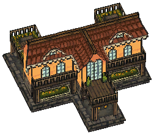](../files/Buildings_Matchmaker_Level2.png.md) | 让你把两个角色带到一起, 第二个角色的球从2级开始。 |  300  120 | 20 |  500  160 |
| 3 | [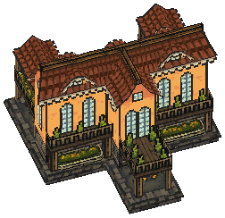](../files/Buildings_Matchmaker_Level3.png.md) | 让你把两个角色带到一起, 第二个角色的球从3级开始 |  450  180 | 60 |  950  340 |

#### 不兼容的对

这两个角色不能配对。

其他 [伪救世主](The_False_Messiah.md)  在不允许选择字符投票的情况下，不能在运行中具有第二个字符，并且不能被其他字符选择为第二个字符。

| 性格 | 双人 |
| --- | --- |
| [战士（The Warrior）](The_Warrior.md) [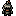](The_Warrior.md) |  |
| [快枪手（The Itchy Finger）](The_Itchy_Finger.md) [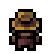](The_Itchy_Finger.md) | [战术家（The Tactician）](The_Tactician.md)  |
| [忏悔者（The Repentant）](The_Repentant.md) [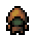](The_Repentant.md) | [持盾者（The Shieldbearer）](The_Shieldbearer.md) [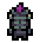](The_Shieldbearer.md) ／ [自笞者（The Flagellant）](The_Flagellant.md)  ／ [掘地者（The Tunneller）](The_Tunneller.md) [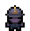](The_Tunneller.md) ／ [记忆者](https://ballxpit.wiki.gg/wiki/The_Recollector?action=edit&redlink=1) |
| [同居者（The Cohabitants）](The_Cohabitants.md)  | [挥霍者（The Spendthrift）](The_Spendthrift.md) [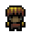](The_Spendthrift.md) ／ [杂耍者（The Juggler）](The_Juggler.md) [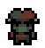](The_Juggler.md) ／ [临时西西弗斯（The Makeshift Sisyphus）](The_Makeshift_Sisyphus.md) [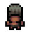](The_Makeshift_Sisyphus.md) ／ [驯鹰人（The Falconer）](The_Falconer.md)  ／ [记忆者](https://ballxpit.wiki.gg/wiki/The_Recollector?action=edit&redlink=1) |
| [沉思者（The Cogitator）](The_Cogitator.md) [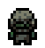](The_Cogitator.md) |  |
| [潜伏者（The Embedded）](The_Embedded.md) [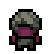](The_Embedded.md) | [记忆者](https://ballxpit.wiki.gg/wiki/The_Recollector?action=edit&redlink=1) |
| [暗影（The Shade）](The_Shade.md) [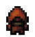](The_Shade.md) | [临时西西弗斯（The Makeshift Sisyphus）](The_Makeshift_Sisyphus.md)  ／ [驯鹰人（The Falconer）](The_Falconer.md)  ／ [卫兵](https://ballxpit.wiki.gg/wiki/The_Sentinel?action=edit&redlink=1) |
| [持盾者（The Shieldbearer）](The_Shieldbearer.md)  | [忏悔者（The Repentant）](The_Repentant.md)  ／ [自笞者（The Flagellant）](The_Flagellant.md)  ／ [物理学家（The Physicist）](The_Physicist.md) [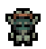](The_Physicist.md) ／ [战术家（The Tactician）](The_Tactician.md)  ／ [掘地者（The Tunneller）](The_Tunneller.md)  ／ [记忆者](https://ballxpit.wiki.gg/wiki/The_Recollector?action=edit&redlink=1) |
| [挥霍者（The Spendthrift）](The_Spendthrift.md)  | [同居者（The Cohabitants）](The_Cohabitants.md)  ／ [临时西西弗斯（The Makeshift Sisyphus）](The_Makeshift_Sisyphus.md)  ／ [波塔格](https://ballxpit.wiki.gg/wiki/The_Potager?action=edit&redlink=1) ／ [记忆者](https://ballxpit.wiki.gg/wiki/The_Recollector?action=edit&redlink=1) |
| [杂耍者（The Juggler）](The_Juggler.md)  | [同居者（The Cohabitants）](The_Cohabitants.md)  ／ [记忆者](https://ballxpit.wiki.gg/wiki/The_Recollector?action=edit&redlink=1) ／ [卫兵](https://ballxpit.wiki.gg/wiki/The_Sentinel?action=edit&redlink=1) |
| [空巢者（The Empty Nester）](The_Empty_Nester.md) [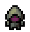](The_Empty_Nester.md) | [波塔格](https://ballxpit.wiki.gg/wiki/The_Potager?action=edit&redlink=1) |
| [自笞者（The Flagellant）](The_Flagellant.md)  | [忏悔者（The Repentant）](The_Repentant.md)  ／ [持盾者（The Shieldbearer）](The_Shieldbearer.md)  ／ [物理学家（The Physicist）](The_Physicist.md)  ／ [战术家（The Tactician）](The_Tactician.md)  ／ [掘地者（The Tunneller）](The_Tunneller.md)  ／ [记忆者](https://ballxpit.wiki.gg/wiki/The_Recollector?action=edit&redlink=1) |
| [临时西西弗斯（The Makeshift Sisyphus）](The_Makeshift_Sisyphus.md)  | [同居者（The Cohabitants）](The_Cohabitants.md)  ／ [暗影（The Shade）](The_Shade.md)  ／ [挥霍者（The Spendthrift）](The_Spendthrift.md)  |
| [物理学家（The Physicist）](The_Physicist.md)  | [持盾者（The Shieldbearer）](The_Shieldbearer.md)  ／ [自笞者（The Flagellant）](The_Flagellant.md)  ／ [记忆者](https://ballxpit.wiki.gg/wiki/The_Recollector?action=edit&redlink=1) ／ [扫描器](https://ballxpit.wiki.gg/wiki/The_Scandalmonger?action=edit&redlink=1) ／ [惊人的Scuruous Scoundrel](https://ballxpit.wiki.gg/wiki/The_Scrupulous_Scoundrel?action=edit&redlink=1) |
| [战术家（The Tactician）](The_Tactician.md)  | [快枪手（The Itchy Finger）](The_Itchy_Finger.md)  ／ [持盾者（The Shieldbearer）](The_Shieldbearer.md)  ／ [自笞者（The Flagellant）](The_Flagellant.md)  ／ [畅饮者（The Carouser）](The_Carouser.md)  ／ [扫描器](https://ballxpit.wiki.gg/wiki/The_Scandalmonger?action=edit&redlink=1) |
| [激进者（The Radical）](The_Radical.md) [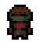](The_Radical.md) |  |
| [驯鹰人（The Falconer）](The_Falconer.md)  | [同居者（The Cohabitants）](The_Cohabitants.md)  ／ [暗影（The Shade）](The_Shade.md)  ／ [卫兵](https://ballxpit.wiki.gg/wiki/The_Sentinel?action=edit&redlink=1) |
| [畅饮者（The Carouser）](The_Carouser.md)  | [战术家（The Tactician）](The_Tactician.md)  ／ [扫描器](https://ballxpit.wiki.gg/wiki/The_Scandalmonger?action=edit&redlink=1) |
| [掘地者（The Tunneller）](The_Tunneller.md)  | [忏悔者（The Repentant）](The_Repentant.md)  ／ [持盾者（The Shieldbearer）](The_Shieldbearer.md)  ／ [自笞者（The Flagellant）](The_Flagellant.md)  ／ [记忆者](https://ballxpit.wiki.gg/wiki/The_Recollector?action=edit&redlink=1) |
| [蹑足者（The Tiptoer）](The_Tiptoer.md)  |  |
| [白发囤积者（The Hoary Hoarder）](The_Hoary_Hoarder.md) [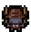](The_Hoary_Hoarder.md) | [持球者（The Ballbearer）](The_Ballbearer.md) [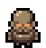](The_Ballbearer.md) |
| [持球者（The Ballbearer）](The_Ballbearer.md)  | [白发囤积者（The Hoary Hoarder）](The_Hoary_Hoarder.md)  |
| [行为](https://ballxpit.wiki.gg/wiki/The_Conduit?action=edit&redlink=1) |  |
| [波塔格](https://ballxpit.wiki.gg/wiki/The_Potager?action=edit&redlink=1) | [挥霍者（The Spendthrift）](The_Spendthrift.md)  ／ [空巢者（The Empty Nester）](The_Empty_Nester.md)  |
| [记忆者](https://ballxpit.wiki.gg/wiki/The_Recollector?action=edit&redlink=1) | [忏悔者（The Repentant）](The_Repentant.md)  ／ [同居者（The Cohabitants）](The_Cohabitants.md)  ／ [潜伏者（The Embedded）](The_Embedded.md)  ／ [持盾者（The Shieldbearer）](The_Shieldbearer.md)  ／ [挥霍者（The Spendthrift）](The_Spendthrift.md)  ／ [杂耍者（The Juggler）](The_Juggler.md)  ／ [自笞者（The Flagellant）](The_Flagellant.md)  ／ [物理学家（The Physicist）](The_Physicist.md)  ／ [掘地者（The Tunneller）](The_Tunneller.md)  ／ [右手的人](https://ballxpit.wiki.gg/wiki/The_Right_Hand_Man?action=edit&redlink=1) ／ [惊人的Scuruous Scoundrel](https://ballxpit.wiki.gg/wiki/The_Scrupulous_Scoundrel?action=edit&redlink=1) ／ [卫兵](https://ballxpit.wiki.gg/wiki/The_Sentinel?action=edit&redlink=1) ／ [破墙者](https://ballxpit.wiki.gg/wiki/The_Wallbreaker?action=edit&redlink=1) |
| [右手的人](https://ballxpit.wiki.gg/wiki/The_Right_Hand_Man?action=edit&redlink=1) | [记忆者](https://ballxpit.wiki.gg/wiki/The_Recollector?action=edit&redlink=1) |
| [扫描器](https://ballxpit.wiki.gg/wiki/The_Scandalmonger?action=edit&redlink=1) | [物理学家（The Physicist）](The_Physicist.md)  ／ [战术家（The Tactician）](The_Tactician.md)  ／ [畅饮者（The Carouser）](The_Carouser.md)  ／ [卫兵](https://ballxpit.wiki.gg/wiki/The_Sentinel?action=edit&redlink=1) |
| [惊人的Scuruous Scoundrel](https://ballxpit.wiki.gg/wiki/The_Scrupulous_Scoundrel?action=edit&redlink=1) | [物理学家（The Physicist）](The_Physicist.md)  ／ [记忆者](https://ballxpit.wiki.gg/wiki/The_Recollector?action=edit&redlink=1) |
| [卫兵](https://ballxpit.wiki.gg/wiki/The_Sentinel?action=edit&redlink=1) | [暗影（The Shade）](The_Shade.md)  ／ [杂耍者（The Juggler）](The_Juggler.md)  ／ [驯鹰人（The Falconer）](The_Falconer.md)  ／ [记忆者](https://ballxpit.wiki.gg/wiki/The_Recollector?action=edit&redlink=1) ／ [扫描器](https://ballxpit.wiki.gg/wiki/The_Scandalmonger?action=edit&redlink=1) |
| [破墙者](https://ballxpit.wiki.gg/wiki/The_Wallbreaker?action=edit&redlink=1) | [记忆者](https://ballxpit.wiki.gg/wiki/The_Recollector?action=edit&redlink=1) |

[共享导航](../navigation/nav-d4956b01aa56.md)

**分类**　[分类 · 建筑](../categories/Buildings.md) · [分类 · 战争](../categories/Warfare.md) · [分类 · 总](../categories/General.md) · [分类 · 页面有导航框](../categories/Pages_with_navboxes.md)

[返回总入口](../%E7%90%83%E6%AF%94%E4%BC%A6%E6%88%98%E8%AE%B0%20Wiki.md) · [返回本分目录](%E7%9B%AE%E5%BD%95.md)
