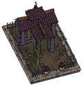

# 陵墓（Mausoleum）

[原文与贡献者记录](https://ballxpit.wiki.gg/wiki/Mausoleum) · [修订 3394](https://ballxpit.wiki.gg/index.php?oldid=3394) · [返回目录](../%E7%90%83%E6%AF%94%E4%BC%A6%E6%88%98%E8%AE%B0%20Wiki.md)

[暗影](The_Shade.md)  的房子。

## 信息（Information）

### 分类（Category）

住房

### 子类（Subcategory）

住房

### 蓝图位置（Blueprint location）

[边境沙漠](The_LIMINALxDESERT.md) 

### 基础资源消耗（Base resource cost）

 30

### 建造点消耗（Build point cost）

20

建造陵墓将解锁[暗影](The_Shade.md)  作为可玩角色。一旦该角色获得足够的经验值达到等级{？？？}，该建筑将解锁一项被动技能，即每当该角色死亡时，玩家将自动获得金币（注意，此效果在利用[死灵法师](Necromancer.md)技能复活角色后也会触发）。通过进一步将角色升级到{???}等级，而非直接升级建筑本身，可以进一步提升该技能的效果。请注意，拆除角色的住宅将使该角色在收获模式或等级提升中无法使用，并使其从所有建筑任务中移除，直到其住宅重建为止（尽管该角色仍会保留之前的所有进度）。

被动效果与升级

| 等级 | 图片 | 说明 | 资源消耗 | 建造点消耗 | 拆除 | 角色等级要求 |
| --- | --- | --- | --- | --- | --- | --- |
| 1 |  | 给暗影者的房子。 |  30 | 20 |  30 | - |
| 2 |  |  | - | - |  30 |  |
| 3 |  | 给暗影者的房子。 每当角色在某一等级中死亡时，将获得 100 。 | - | - |  30 |  |

[共享导航](../navigation/nav-d4956b01aa56.md)

**分类**　[分类 · 建筑](../categories/Buildings.md) · [分类 · 住房](../categories/Housing.md) · [分类 · 带有导航框的页面](../categories/Pages_with_navboxes.md)

[返回总入口](../%E7%90%83%E6%AF%94%E4%BC%A6%E6%88%98%E8%AE%B0%20Wiki.md) · [返回本分目录](%E7%9B%AE%E5%BD%95.md)
