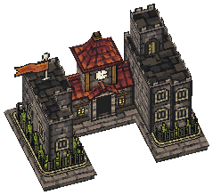
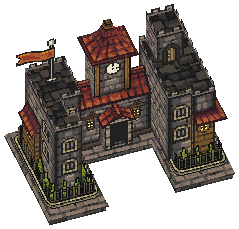
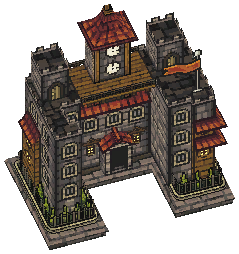

# 军事学院（Military Academy）

增加 <stat\_strength.png> 强度扩展等级。

[原文与贡献者记录](https://ballxpit.wiki.gg/wiki/Military_Academy) · [修订 3359](https://ballxpit.wiki.gg/index.php?oldid=3359) · [返回目录](../%E7%90%83%E6%AF%94%E4%BC%A6%E6%88%98%E8%AE%B0%20Wiki.md)

#### 信息（Information）

##### 分类（Category）

战争

##### 子类（Subcategory）

统计规模

##### 蓝图位置（Blueprint location）

[LIMINALxDESERT](The_LIMINALxDESERT.md)

##### 基础资源消耗（Base resource cost）

 200  50

##### 建造点消耗（Build point cost）

8

军事学院增加了所有字符的"stat\_strength.png> Strength"级别。这种数字扩展奖励从基层E级增加到D级，但随着建筑升级，可进一步增加到最高的S级。每个增加的统计规模级别都相当于对该统计中的每个点所应用的相关能力的比例奖励的增加。将这栋大楼全面升级为5级，从而获得了SRAK的成绩。

被动效果与升级

| 等级 | 图片 | 描述 | 资源消耗 | 建造点消耗 | 拆除 |
| --- | --- | --- | --- | --- | --- |
| 1 |  | 增加 \<stat\_strength.png\> 强度扩展到D (随着你的 \<stat\_strength.png\> 强度升高，基础伤害等相关统计数据将更快地改善) |  200  50 | 8 |  200  50 |
| 2 |  | 增加 \<stat\_strength.png\> 强度扩展到C (随着你的 \<stat\_strength.png\> 强度升高，基础损伤等相关统计数据将更快地改善) |  300  60 | 8 |  500  110 |
| 3 |  | 增加 \<stat\_strength.png\> 强度扩展到B (随着你的 \<stat\_strength.png\> 强度升高，基础损伤等相关统计数据将更快地改善) |  600  120 | 24 |  1,100  230 |
| 4 |  | 增加 \<stat\_strength.png\> 强度扩展到A (随着你的 \<stat\_strength.png\> 强度升高，基础损伤等相关统计数据将更快地改善) |  1,500  300 | 40 |  2,600  530 |
| 5 |  | 增加 \<stat\_strength.png\> 强度扩展到 S (随着你的 \<stat\_strength.png\> 强度升高，类似的数据数据数据如基础伤害将更快地改善) |  3,000  600 | 56 |  5,600  1,130 |

[共享导航](../navigation/nav-d4956b01aa56.md)

**分类**　[分类 · 建筑](../categories/Buildings.md) · [分类 · 战争](../categories/Warfare.md) · [分类 · 统计规模](../categories/Stat_Scaling.md) · [分类 · 页面有导航框](../categories/Pages_with_navboxes.md)

[返回总入口](../%E7%90%83%E6%AF%94%E4%BC%A6%E6%88%98%E8%AE%B0%20Wiki.md) · [返回本分目录](%E7%9B%AE%E5%BD%95.md)
