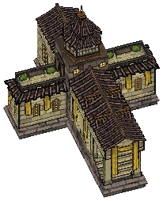
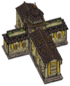

# 修道院（Monastery）

[原文与贡献者记录](https://ballxpit.wiki.gg/wiki/Monastery) · [修订 3401](https://ballxpit.wiki.gg/index.php?oldid=3401) · [返回目录](../%E7%90%83%E6%AF%94%E4%BC%A6%E6%88%98%E8%AE%B0%20Wiki.md)

[自笞者](The_Flagellant.md)  的房子。

## 信息（Information）

### 分类（Category）

住房

### 子类（Subcategory）

住房

### 蓝图位置（Blueprint location）

[血腥草原](The_GORYxGRASSLANDS.md) 

### 基础资源消耗（Base resource cost）

 50

### 建造点消耗（Build point cost）

25

建造修道院将解锁[自笞者](The_Flagellant.md)  作为可玩角色。一旦该角色获得足够的经验值达到等级{?TODO：查找房屋奖励所需的角色等级要求}，该建筑将解锁一项被动能力，即该角色会反弹撞击该建筑（?TODO：这是否包括采集者的小屋跑动？），这将增加收获时间（但每次收获最多只能反弹100次）。通过进一步提升该角色等级至{???}，可以进一步提升该建筑的能力。请注意，拆除角色的房屋将使该角色在收获模式或等级提升中无法使用，并使其从任何建筑任务中移除，直到其房屋重建为止（尽管该角色仍会保留之前的所有进度）。

被动效果与升级

| 等级 | 图片 | 说明 | 资源消耗 | 建造点消耗 | 拆除 | 角色等级要求 |
| --- | --- | --- | --- | --- | --- | --- |
| 1 |  | 一个供鞭笞者使用的房子。 |  50 | 25 |  50 | - |
| 2 |  |  | - | - |  50 |  |
| 3 |  | 一个供鞭笞者使用的房子。 从这座建筑物上弹跳会使收获时钟增加 0.07 秒（每次收获最多可弹跳 100 次）。 | - | - |  50 |  |

[共享导航](../navigation/nav-d4956b01aa56.md)

**分类**　[分类 · 建筑](../categories/Buildings.md) · [分类 · 住房](../categories/Housing.md) · [分类 · 带有导航框的页面](../categories/Pages_with_navboxes.md)

[返回总入口](../%E7%90%83%E6%AF%94%E4%BC%A6%E6%88%98%E8%AE%B0%20Wiki.md) · [返回本分目录](%E7%9B%AE%E5%BD%95.md)
