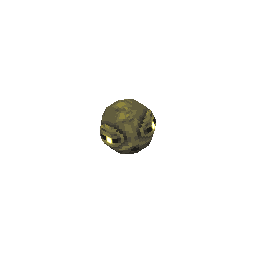
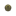

# 月岩（Moonrock）

[原文与贡献者记录](https://ballxpit.wiki.gg/wiki/Moonrock) · [修订 3572](https://ballxpit.wiki.gg/index.php?oldid=3572) · [返回目录](../%E7%90%83%E6%AF%94%E4%BC%A6%E6%88%98%E8%AE%B0%20Wiki.md)

## 信息（Information）

### 类型

[普通敌人](../categories/Normal_enemies.md)

### 生命值倍率（Health scale）

0.5x

### 等级（Level）

[浩瀚虚空](The_VASTxVOID.md) 

**月岩**是一种出现在 [浩瀚虚空](The_VASTxVOID.md)  中的[普通敌人](../categories/Normal_enemies.md)。其生命值倍率为 0.5x。

月岩是在击杀[月灵晶洞](Moonling_Geode.md)  时生成的。

## 冷知识

* Moonrock 和 [幼虫](Grub.md)  是生命值最低的敌人，其生命值倍率为 0.5x。

[共享导航](../navigation/nav-115867ac1be8.md)

**分类**　[分类 · 敌人](../categories/Enemies.md) · [分类 · 普通敌人](../categories/Normal_enemies.md) · [分类 · 带有导航框的页面](../categories/Pages_with_navboxes.md)

[返回总入口](../%E7%90%83%E6%AF%94%E4%BC%A6%E6%88%98%E8%AE%B0%20Wiki.md) · [返回本分目录](%E7%9B%AE%E5%BD%95.md)
