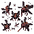
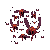

# 蚊子王（Mosquito King）

蚊子每次击中敌人都会喷出蚊子，蚊子会攻击随机的敌人，每人处理80-120/100-150/100-150的损伤，如果蚊子杀死敌人，它们会窃取1/1/2的健康。

[原文与贡献者记录](https://ballxpit.wiki.gg/wiki/Mosquito_King) · [修订 4124](https://ballxpit.wiki.gg/index.php?oldid=4124) · [返回目录](../%E7%90%83%E6%AF%94%E4%BC%A6%E6%88%98%E8%AE%B0%20Wiki.md)

#### 一般信息

##### 由

[吸血鬼](Vampire.md)  + [育巢母体](Brood_Mother.md) 

##### 开始的性格

-

##### 命中效果（On-Hit Effects）

生成

##### 状态效果（Status Effects）

养蚊、偷盗健康

##### 由于状态影响

命中时、生成时

#### 发展情况（Evolutions）

##### 演变为

[蚊子王国](Mosquito_Kingdom.md) 、 [诺斯法拉图](Nosferatu.md) 

#### 进化配方

|  |  |  |  |  |  |  |
| --- | --- | --- | --- | --- | --- | --- |
|  |  |  |  |  |  |  |
| [吸血鬼（Vampire）](Vampire.md)  |  |  |  | [育巢母体（Brood Mother）](Brood_Mother.md)  |  |  |
|  |  |  |  |  |  |  |
|  |  | 蚊子王（Mosquito King） |  |  |  |  |

#### 关卡

| 等级 | 伤害 | 影响 |
| --- | --- | --- |
| 1 |  x(3.6至6.8) | 蚊子每次击中敌人都会喷出一只蚊子，蚊子会攻击随机的敌人，每只可处理80到120个损伤，如果蚊子杀死敌人，它们会偷走1个健康。 ／ |
| 2 |  x(3.6至6.8) | 蚊子每次击中敌人都会喷出一只蚊子，蚊子会攻击随机的敌人，每只可处理100到150个损伤，如果蚊子杀死敌人，它们会偷走1个健康。 ／ |
| 3 |  x(3.6至6.8) | 蚊子每次击中敌人都会喷出一只蚊子，蚊子会攻击随机的敌人，每只可处理100到150个损伤，如果蚊子杀死敌人，它们会偷走2个健康。 ／ |

#### 发展情况

| 组合 | 进化 |
| --- | --- |
|  蚊子王（Mosquito King） + [蚊子群（Mosquito Swarm）](Mosquito_Swarm.md)  | [蚊子王国（Mosquito Kingdom）](Mosquito_Kingdom.md)  |
|  蚊子王（Mosquito King） + [吸血鬼主（Vampire Lord）](Vampire_Lord.md)  + [蜘蛛女王（Spider Queen）](Spider_Queen.md)  | [诺斯法拉图（Nosferatu）](Nosferatu.md)  |

#### 策略

#### 更新记录

#### 冷知识

#### 图片库

[共享导航](../navigation/nav-63012059ef49.md)

**分类**　[分类 · 进化圆球](../categories/Evolved_Balls.md) · [分类 · 圆球](../categories/Balls.md) · [分类 · 页面有导航框](../categories/Pages_with_navboxes.md)

[返回总入口](../%E7%90%83%E6%AF%94%E4%BC%A6%E6%88%98%E8%AE%B0%20Wiki.md) · [返回本分目录](%E7%9B%AE%E5%BD%95.md)
