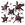

# 蚊王（Mosquito King）

每次命中敌人时生成一只蚊子。每只蚊子随机攻击一名敌人，造成 80–120/100–150/100–150 点伤害。蚊子击杀敌人时偷取 1/1/2 点生命值。

[原文与贡献者记录](https://ballxpit.wiki.gg/wiki/Mosquito_King) · [修订 4124](https://ballxpit.wiki.gg/index.php?oldid=4124) · [返回目录](../%E7%90%83%E6%AF%94%E4%BC%A6%E6%88%98%E8%AE%B0%20Wiki.md)

## 基本信息

### 由……创建

[吸血鬼](Vampire.md)  + [育巢母体](Brood_Mother.md) 

### 初始角色（Starting Character）

-

### 命中效果（On-Hit Effects）

生成

### 状态效果（Status Effects）

生成蚊子，偷取生命值

### 由状态效果触发

命中时、生成时

## 进化（Evolutions）

### 进化成

[蚊子王国](Mosquito_Kingdom.md) ，[诺斯费拉图](Nosferatu.md) 

## 进化配方

|  |  |  |  |  |  |  |
| --- | --- | --- | --- | --- | --- | --- |
|  |  |  |  |  |  |  |
| [吸血鬼（Vampire）](Vampire.md)  |  |  |  | [育巢母体（Brood Mother）](Brood_Mother.md)  |  |  |
|  |  |  |  |  |  |  |
|  |  | 蚊王（Mosquito King） |  |  |  |  |

## 关卡

| 等级 | 伤害 | 效果 |
| --- | --- | --- |
| 1 |  x(3.6 至 6.8) | 每次命中敌人时，会生成一只蚊子。蚊子会攻击随机的敌人，每次造成80至120点伤害。如果蚊子杀死了敌人，会窃取1点生命值。 |
| 2 |  x(3.6 至 6.8) | 每次命中敌人时，会生成一只蚊子。蚊子会攻击随机的敌人，每次造成100至150点伤害。如果蚊子杀死了敌人，它们会窃取1点生命值。 |
| 3 |  x(3.6 至 6.8) | 每次命中敌人时，会生成一只蚊子。蚊子会攻击随机的敌人，每次造成100至150点伤害。如果蚊子杀死了敌人，它们会窃取2点生命值。 |

## 进化

| 组合 | 进化 |
| --- | --- |
|  蚊王（Mosquito King） + [蚊群（Mosquito Swarm）](Mosquito_Swarm.md)  | [蚊子王国（Mosquito Kingdom）](Mosquito_Kingdom.md)  |
|  蚊王（Mosquito King） + [吸血鬼领主（Vampire Lord）](Vampire_Lord.md)  + [蜘蛛女王（Spider Queen）](Spider_Queen.md)  | [诺斯费拉图（Nosferatu）](Nosferatu.md)  |

## 策略

## 更新记录

## 冷知识

## 图片库

[共享导航](../navigation/nav-63012059ef49.md)

**分类**　[分类 · 进化圆球](../categories/Evolved_Balls.md) · [分类 · 圆球](../categories/Balls.md) · [分类 · 带有导航框的页面](../categories/Pages_with_navboxes.md)

[返回总入口](../%E7%90%83%E6%AF%94%E4%BC%A6%E6%88%98%E8%AE%B0%20Wiki.md) · [返回本分目录](%E7%9B%AE%E5%BD%95.md)
