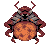

# 蚊子王国（Mosquito Kingdom）

每次命中敌人时，会生成1-2只/1-3只/2-3只蚊子。蚊子会随机攻击一个敌人，每次造成100-150点伤害。如果蚊子杀死了敌人，它们会窃取2点生命值。

[原文与贡献者记录](https://ballxpit.wiki.gg/wiki/Mosquito_Kingdom) · [修订 4125](https://ballxpit.wiki.gg/index.php?oldid=4125) · [返回目录](../%E7%90%83%E6%AF%94%E4%BC%A6%E6%88%98%E8%AE%B0%20Wiki.md)

## 基本信息

### 由……创建

[蚊王](Mosquito_King.md)  + [蚊群](Mosquito_Swarm.md) 

### 初始角色（Starting Character）

-

### 命中效果（On-Hit Effects）

生成

### 状态效果（Status Effects）

生成蚊子，偷取生命值

### 由状态效果触发

命中时、生成时

## 进化配方

|  |  |  |  |  |  |  |  |  |  |  |  |  |  |  |
| --- | --- | --- | --- | --- | --- | --- | --- | --- | --- | --- | --- | --- | --- | --- |
|  |  |  |  |  |  |  |  |  |  |  |  |  |  |  |
| [吸血鬼（Vampire）](Vampire.md)  |  |  |  | [育巢母体（Brood Mother）](Brood_Mother.md)  |  |  |  | [吸血鬼（Vampire）](Vampire.md)  |  |  |  | [卵囊（Egg Sac）](Egg_Sac.md)  |  |  |
|  |  |  |  |  |  |  |  |  |  |  |  |  |  |  |
|  |  | [蚊王（Mosquito King）](Mosquito_King.md)  |  |  |  |  |  |  |  | [蚊群（Mosquito Swarm）](Mosquito_Swarm.md)  |  |  |  |  |
|  |  |  |  |  |  |  |  |  |  |  |  |  |  |  |
|  |  |  |  |  |  | 蚊子王国（Mosquito Kingdom） |  |  |  |  |  |  |  |  |

## 关卡

| 等级 | 伤害 | 效果 |
| --- | --- | --- |
| 1 |  x(4.8 至 9.2) | 每次命中敌人时，会生成1-2只蚊子。蚊子会随机攻击一个敌人，每次造成100-150点伤害。如果蚊子杀死了敌人，它们会窃取2点生命值。 |
| 2 |  x(4.8 至 9.2) | 每次命中敌人时，会生成1-3只蚊子。蚊子会随机攻击一个敌人，每次造成100-150点伤害。如果蚊子杀死了敌人，它们会窃取2点生命值。 |
| 3 |  x(4.8 至 9.2) | 每次命中敌人时，会生成2-3只蚊子。蚊子会随机攻击一个敌人，每次造成100-150点伤害。如果蚊子杀死了敌人，它们会窃取2点生命值。 |

## 进化

*这个球无法进一步进化。*

## 策略

## 更新记录

## 冷知识

## 图片库

[共享导航](../navigation/nav-63012059ef49.md)

**分类**　[分类 · 进化圆球](../categories/Evolved_Balls.md) · [分类 · 圆球](../categories/Balls.md) · [分类 · 带有导航框的页面](../categories/Pages_with_navboxes.md)

[返回总入口](../%E7%90%83%E6%AF%94%E4%BC%A6%E6%88%98%E8%AE%B0%20Wiki.md) · [返回本分目录](%E7%9B%AE%E5%BD%95.md)
