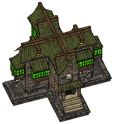

# 死灵法师（Necromancer）

每次战斗一次，你死后，恢复健康，杀死所有附近的敌人

[原文与贡献者记录](https://ballxpit.wiki.gg/wiki/Necromancer) · [修订 3374](https://ballxpit.wiki.gg/index.php?oldid=3374) · [返回目录](../%E7%90%83%E6%AF%94%E4%BC%A6%E6%88%98%E8%AE%B0%20Wiki.md)

#### 信息（Information）

##### 分类（Category）

战争

##### 子类（Subcategory）

总

##### 蓝图位置（Blueprint location）

[FUNGALxFOREST](The_FUNGALxFOREST.md)

##### 基础资源消耗（Base resource cost）

 500  10  10

##### 建造点消耗（Build point cost）

80

建造Necromancer将使玩家的角色能够在每场战斗中一次复兴。在一个级别运行的第一场死亡时，玩家将被要求恢复角色。如果玩家选择是，那么在 {TODO: 有多少牌?}} 的小范围内所有玩家的敌人( 不包括老板和小老板和小老板) {TODA: 多少牌?} } 当他们死亡时， 玩家字符的敌人会立即被杀死( 提供所有正常的滴滴或田间清理奖金， 仿佛他们正常被杀了 ) , 并且字符被恢复， 但没有完全恢复健康， 因为游戏恢复正常。通过建筑升级，可以增加恢复的健康水平。即使复活被接受，第一次死亡仍然会引发 [陵墓的](Mausoleum.md) 死亡奖金 (提供) [暗影](The_Shade.md)  没有解锁能力)，这意味着奖金可以在一次运行中得到两次。

被动效果与升级

| 等级 | 图片 | 描述 | 资源消耗 | 建造点消耗 | 拆除 |
| --- | --- | --- | --- | --- | --- |
| 1 |  | 每次战斗一次，你死后，恢复25%的健康，杀死所有附近的敌人 |  500  10  10 | 80 |  500  10  10 |
| 2 |  | 每次战斗一次，你死后，恢复50%的健康，杀死所有附近的敌人。 |  800  10  30 | 80 |  1,300  20  40 |
| 3 |  | 每次战斗一次，你死后，恢复75%的健康，杀死所有附近的敌人 |  1,200  15  45 | 240 |  2,500  35  85 |

[共享导航](../navigation/nav-d4956b01aa56.md)

**分类**　[分类 · 建筑](../categories/Buildings.md) · [分类 · 战争](../categories/Warfare.md) · [分类 · 总](../categories/General.md) · [分类 · 页面有导航框](../categories/Pages_with_navboxes.md)

[返回总入口](../%E7%90%83%E6%AF%94%E4%BC%A6%E6%88%98%E8%AE%B0%20Wiki.md) · [返回本分目录](%E7%9B%AE%E5%BD%95.md)
