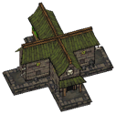
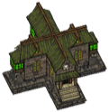
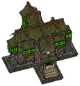

# 死灵法师（Necromancer）

每场战斗中，当你死亡时，将以较低的生命值复活，并杀死所有附近的敌人

[原文与贡献者记录](https://ballxpit.wiki.gg/wiki/Necromancer) · [修订 3374](https://ballxpit.wiki.gg/index.php?oldid=3374) · [返回目录](../%E7%90%83%E6%AF%94%E4%BC%A6%E6%88%98%E8%AE%B0%20Wiki.md)

## 信息（Information）

### 分类（Category）

战争

### 子类（Subcategory）

将军

### 蓝图位置（Blueprint location）

[FUNGALxFOREST](The_FUNGALxFOREST.md)

### 基础资源消耗（Base resource cost）

 500  10  10

### 建造点消耗（Build point cost）

80

建造亡灵法师将赋予玩家每场战斗复活一次角色的能力。在首次死亡时，系统会提示玩家复活角色。如果玩家选择“是”，那么角色死亡时周围{TODO: 多少格？}范围内的所有敌人（不包括首领和小型首领）将立即死亡（如同正常死亡一样，并获得所有普通掉落或战场通关加成），角色虽被复活，但生命值将低于满值，游戏将继续按正常方式进行。通过升级可以提升复活时的生命值。请注意，即使接受了复活，首次死亡仍会触发[陵墓的](Mausoleum.md)死亡金加buff（前提是[暗影](The_Shade.md)  已解锁该能力），这意味着同一场游戏中可以实际获得两次该加成。

被动效果与升级

| 等级 | 图片 | 说明 | 资源消耗 | 建造点消耗 | 拆除 |
| --- | --- | --- | --- | --- | --- |
| 1 |  | 每场战斗死亡一次后，以25%的生命值复活，并消灭所有附近的敌人 |  500  10  10 | 80 |  500  10  10 |
| 2 |  | 每场战斗中，当你死亡时，将以50%的生命值复活，并消灭所有附近的敌人 |  800  10  30 | 80 |  1,300  20  40 |
| 3 |  | 每场战斗中，当你死亡时，以75%的生命值复活，并消灭所有附近的敌人 |  1,200  15  45 | 240 |  2,500  35  85 |

[共享导航](../navigation/nav-d4956b01aa56.md)

**分类**　[分类 · 建筑](../categories/Buildings.md) · [分类 · 战争](../categories/Warfare.md) · [分类 · 通用](../categories/General.md) · [分类 · 带有导航框的页面](../categories/Pages_with_navboxes.md)

[返回总入口](../%E7%90%83%E6%AF%94%E4%BC%A6%E6%88%98%E8%AE%B0%20Wiki.md) · [返回本分目录](%E7%9B%AE%E5%BD%95.md)
