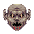
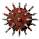

# 诺斯法拉图（Nosferatu）

吸血鬼蝙蝠飞向一个随机敌人，在击中时造成132-176/156-224/180-272的伤害，变成了吸血鬼主。

[原文与贡献者记录](https://ballxpit.wiki.gg/wiki/Nosferatu) · [修订 4127](https://ballxpit.wiki.gg/index.php?oldid=4127) · [返回目录](../%E7%90%83%E6%AF%94%E4%BC%A6%E6%88%98%E8%AE%B0%20Wiki.md)

#### 一般信息

##### 由

[吸血鬼主](Vampire_Lord.md)  + [蜘蛛女王](Spider_Queen.md)  + [蚊子王](Mosquito_King.md) 

##### 开始的性格

-

##### 状态效果（Status Effects）

繁殖的吸血鬼蝙蝠

##### 由于状态影响

上上下， 上盎司产卵

#### 进化配方

|  |  |  |  |  |  |  |  |  |  |  |  |  |  |  |  |  |  |  |  |  |  |  |
| --- | --- | --- | --- | --- | --- | --- | --- | --- | --- | --- | --- | --- | --- | --- | --- | --- | --- | --- | --- | --- | --- | --- |
|  |  |  |  |  |  |  |  |  |  |  |  |  |  |  |  |  |  |  |  |  |  |  |
| [吸血鬼（Vampire）](Vampire.md)  |  |  |  | [流血（Bleed）](Bleed.md)  或是 [黑暗（Dark）](Dark.md)  清除骨院 |  |  |  | [育巢母体（Brood Mother）](Brood_Mother.md)  |  |  |  | [蛋袋（Egg Sac）](Egg_Sac.md)  |  |  |  | [吸血鬼（Vampire）](Vampire.md)  |  |  |  | [育巢母体（Brood Mother）](Brood_Mother.md)  |  |  |
|  |  |  |  |  |  |  |  |  |  |  |  |  |  |  |  |  |  |  |  |  |  |  |
|  |  | [吸血鬼主（Vampire Lord）](Vampire_Lord.md)  |  |  |  |  |  |  |  | [蜘蛛女王（Spider Queen）](Spider_Queen.md)  |  |  |  |  |  |  |  | [蚊子王（Mosquito King）](Mosquito_King.md)  |  |  |  |  |
|  |  |  |  |  |  |  |  |  |  |  |  |  |  |  |  |  |  |  |  |  |  |  |
|  |  |  |  |  |  |  |  |  |  | 诺斯法拉图（Nosferatu） |  |  |  |  |  |  |  |  |  |  |  |  |

#### 关卡

| 等级 | 伤害 | 影响 |
| --- | --- | --- |
| 1 |  x(5.4至10.4) | 每次跳起，吸血鬼蝙蝠飞向一个随机的敌人， 造成132-176的伤害, ／ |
| 2 |  x(5.4至10.4) | 每一次跳动，吸血鬼蝙蝠飞向一个随机的敌人，在击中时造成156-224伤害，变成吸血鬼主。 ／ |
| 3 |  x(5.4至10.4) | 每次跳动，吸血鬼蝙蝠飞向一个随机的敌人，在击中时造成180-272伤害，变成吸血鬼主。 ／ |

#### 发展情况

*这个球不能进一步发展。*

#### 策略

#### 更新记录

#### 冷知识

#### 图片库

[共享导航](../navigation/nav-63012059ef49.md)

**分类**　[分类 · 进化圆球](../categories/Evolved_Balls.md) · [分类 · 圆球](../categories/Balls.md) · [分类 · 页面有导航框](../categories/Pages_with_navboxes.md)

[返回总入口](../%E7%90%83%E6%AF%94%E4%BC%A6%E6%88%98%E8%AE%B0%20Wiki.md) · [返回本分目录](%E7%9B%AE%E5%BD%95.md)
