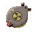
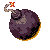

# 核弹（Nuclear Bomb）

击中敌人时爆炸，对附近的敌人造成 300-500/400-700/400-700 的伤害，并无限期地向在场所有人施加 1 层辐射（最多 5 层）。每层辐射使受到的伤害分别增加 10%/10%/15%。冷却时间为 3 秒。

[原文与贡献者记录](https://ballxpit.wiki.gg/wiki/Nuclear_Bomb) · [修订 4279](https://ballxpit.wiki.gg/index.php?oldid=4279) · [返回目录](../%E7%90%83%E6%AF%94%E4%BC%A6%E6%88%98%E8%AE%B0%20Wiki.md)

## 基本信息

### 由……创建

[炸弹](Bomb.md)  + [中毒](Poison.md) 

### 初始角色（Starting Character）

-

### 命中效果（On-Hit Effects）

自爆

### 状态效果（Status Effects）

[辐射](https://ballxpit.wiki.gg/wiki/Status_Effects?action=edit&redlink=1)

### 由状态效果触发

命中时，全屏范围效果

## 进化配方

|  |  |  |  |  |  |  |  |  |  |  |  |  |  |  |
| --- | --- | --- | --- | --- | --- | --- | --- | --- | --- | --- | --- | --- | --- | --- |
|  |  |  |  |  |  |  |  |  |  |  |  |  |  |  |
| [灼烧（Burn）](Burn.md)  |  |  |  | [铁（Iron）](Iron.md)  |  |  |  |  |  |  |  |  |  |  |
|  |  |  |  |  |  |  |  |  |  |  |  |  |  |  |
|  |  | [炸弹（Bomb）](Bomb.md)  |  |  |  |  |  |  |  | [中毒（Poison）](Poison.md)  |  |  |  |  |
|  |  |  |  |  |  |  |  |  |  |  |  |  |  |  |
|  |  |  |  |  |  | 核弹（Nuclear Bomb） |  |  |  |  |  |  |  |  |

## 关卡

| 等级 | 伤害 | 效果 |
| --- | --- | --- |
| 1 |  x(4.2 至 8.0) | 击中敌人时爆炸，对附近的敌人造成 300-500 点伤害，并无限期地向所有在场人员施加 1 层辐射（最多 5 层）。每层辐射使受到的伤害增加 10%。冷却时间为 3 秒。 |
| 2 |  x(4.2 至 8.0) | 击中敌人时爆炸，对附近的敌人造成 400-700 点伤害，并无限期地向所有在场人员施加 1 层辐射（最多 5 层）。每层辐射会使受到的伤害增加 10%。冷却时间为 3 秒。 |
| 3 |  x(4.2 至 8.0) | 击中敌人时爆炸，对附近的敌人造成 400-700 点伤害，并无限期地向所有在场人员施加 1 层辐射（最多 5 层）。每层辐射会使受到的伤害增加 15%。冷却时间为 3 秒。 |

## 进化

*这个球无法进一步进化。*

## 策略

与细胞融合会生成多个核弹球。

## 更新记录

## 冷知识

## 图片库

[共享导航](../navigation/nav-63012059ef49.md)

**分类**　[分类 · 进化圆球](../categories/Evolved_Balls.md) · [分类 · 圆球](../categories/Balls.md) · [分类 · 带有导航框的页面](../categories/Pages_with_navboxes.md)

[返回总入口](../%E7%90%83%E6%AF%94%E4%BC%A6%E6%88%98%E8%AE%B0%20Wiki.md) · [返回本分目录](%E7%9B%AE%E5%BD%95.md)
