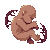
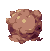

# 后代（Offspring）

在4/5/6次的击中中分为克隆。

[原文与贡献者记录](https://ballxpit.wiki.gg/wiki/Offspring) · [修订 4130](https://ballxpit.wiki.gg/index.php?oldid=4130) · [返回目录](../%E7%90%83%E6%AF%94%E4%BC%A6%E6%88%98%E8%AE%B0%20Wiki.md)

#### 一般信息

##### 由

[细胞](Cell.md)  + [肉类](Flesh.md) 

##### 开始的性格

-

##### 命中效果（On-Hit Effects）

生成

##### 状态效果（Status Effects）

生成分身

##### 由于状态影响

命中时、生成时

#### 进化配方

|  |  |  |  |  |  |  |
| --- | --- | --- | --- | --- | --- | --- |
|  |  |  |  |  |  |  |
| [细胞（Cell）](Cell.md)  清除 FUNGALxforforest |  |  |  | [肉类（Flesh）](Flesh.md)  清除了灰色的土地 |  |  |
|  |  |  |  |  |  |  |
|  |  | 后代（Offspring） |  |  |  |  |

#### 关卡

| 等级 | 伤害 | 影响 |
| --- | --- | --- |
| 1 |  x(3.6至6.8) | 在击中4次时分为克隆。 ／ |
| 2 |  x(3.6至6.8) | 在击中5次时分为克隆。 ／ |
| 3 |  x(3.6至6.8) | 在击中6次时分为克隆。 ／ |

#### 发展情况

*这个球不能进一步发展。*

#### 策略

#### 更新记录

#### 冷知识

#### 图片库

[共享导航](../navigation/nav-63012059ef49.md)

**分类**　[分类 · 进化圆球](../categories/Evolved_Balls.md) · [分类 · 圆球](../categories/Balls.md) · [分类 · 页面有导航框](../categories/Pages_with_navboxes.md)

[返回总入口](../%E7%90%83%E6%AF%94%E4%BC%A6%E6%88%98%E8%AE%B0%20Wiki.md) · [返回本分目录](%E7%9B%AE%E5%BD%95.md)
