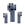
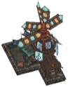

# 派对之家（Party House）

[原文与贡献者记录](https://ballxpit.wiki.gg/wiki/Party_House) · [修订 3406](https://ballxpit.wiki.gg/index.php?oldid=3406) · [返回目录](../%E7%90%83%E6%AF%94%E4%BC%A6%E6%88%98%E8%AE%B0%20Wiki.md)

[畅饮者](The_Carouser.md)  的住宅。

## 信息（Information）

### 分类（Category）

住房

### 子类（Subcategory）

住房

### 蓝图位置（Blueprint location）

[浩瀚虚空](The_VASTxVOID.md) 

### 基础资源消耗（Base resource cost）

 800  150

### 建造点消耗（Build point cost）

30

**派对之家**是角色在*[球比伦战记](Ball_x_Pit.md)*中的[建筑](Buildings.md)，作为[皇家更新](https://ballxpit.wiki.gg/wiki/Regal_Update?action=edit&redlink=1)的一部分而添加。建造派对之家可解锁[畅饮者](The_Carouser.md)  作为可玩的[角色](Characters.md)。一旦该[角色获得足够的经验值](Character_Level_Mechanics.md)达到4级，该建筑将解锁一项被动能力，即所有可玩角色的 [领导力](https://ballxpit.wiki.gg/wiki/Leadership?action=edit&redlink=1)属性都会获得加成。通过直接提升角色等级而非直接升级建筑本身，可以进一步提升该建筑的能力。请注意，拆除角色的宅邸将使该角色在收获模式或等级提升中无法使用，并将其从任何建筑任务中移除，直到其宅邸重建为止（尽管该角色仍保留之前的所有进度）。

被动效果与升级

| 等级 | 图片 | 说明 | 资源消耗 | 建造点消耗 | 拆除 | 角色等级要求 |
| --- | --- | --- | --- | --- | --- | --- |
| 1 |  | 一个适合疯狂玩家的房子。 |  800  150 | 30 |  800  150 | - |
| 1 | - | 一个适合疯狂玩家的房子。 所有角色获得 +1 加成  [领导力](https://ballxpit.wiki.gg/wiki/Leadership?action=edit&redlink=1)。这会影响你拥有的小球数量以及它们造成的伤害。 | - | - |  800  150 | 4 |
| 2 | - | 一个适合疯狂玩家的房子。 所有角色获得 +2 的额外加成  [领导力](https://ballxpit.wiki.gg/wiki/Leadership?action=edit&redlink=1)。这会影响你拥有的小球数量以及它们造成的伤害。 | - | - |  800  150 | 7 |
| 3 | - | 一个适合疯狂玩家的房子。 所有角色均可获得 +3 的额外  [领导力](https://ballxpit.wiki.gg/wiki/Leadership?action=edit&redlink=1) 加成。这会影响你拥有的小球数量以及它们造成的伤害。 | - | - |  800  150 | 9 |

[共享导航](../navigation/nav-d4956b01aa56.md)

**分类**　[分类 · 建筑](../categories/Buildings.md) · [分类 · 住房](../categories/Housing.md) · [分类 · 带有导航框的页面](../categories/Pages_with_navboxes.md)

[返回总入口](../%E7%90%83%E6%AF%94%E4%BC%A6%E6%88%98%E8%AE%B0%20Wiki.md) · [返回本分目录](%E7%9B%AE%E5%BD%95.md)
