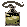
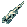
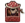
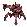
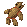
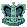
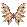

# 被动道具（Passives）

[原文与贡献者记录](https://ballxpit.wiki.gg/wiki/Passives) · [修订 3256](https://ballxpit.wiki.gg/index.php?oldid=3256) · [返回目录](../%E7%90%83%E6%AF%94%E4%BC%A6%E6%88%98%E8%AE%B0%20Wiki.md)

被动道具（Passives）是在单局中取得的特殊强化，各有独特效果，最多可升至 3 级。和[圆球](Balls.md)一样，部分被动道具可在[融合反应堆](Fusion_Reactor.md)中进化。被动道具本身无法融合。游戏初始已有若干被动道具解锁，通关特定[关卡](Levels.md)可解锁更多。

## 被动类型

被动道具分为 2 类：**基础被动道具（Base Passives）**和**进化被动道具（Evolved Passives）**。

### 基础被动道具

单局升级时，已解锁的基础被动道具可能出现在可选项中。部分特定的基础被动道具可组合成进化被动道具。游戏目前有 54 种基础被动道具。

只要还有空余的被动道具栏位，升级时就可能出现大多数基础被动道具。少数道具还有额外要求，尤其是和特定[状态效果](https://ballxpit.wiki.gg/wiki/Status_Effects?action=edit&redlink=1)有关的道具。要让此类道具出现，通常需要先拥有能给敌人施加相应状态效果的圆球。

*部分解锁要求仍在由社区验证，以下信息可能有误。*

| 名称 | 图标 | 说明 | 外观要求 | 解锁条件 |
| --- | --- | --- | --- | --- |
| [弓箭手雕像（Archer's Effigy）](Archer_s_Effigy.md) |  | 每7到12行生成一名生命值为160的石弓手。石弓手对球类伤害免疫，并向敌人射出箭矢，每箭造成10到20点伤害。 | 不适用 | 通关 [白雪海岸（The SNOWYxSHORES）](The_SNOWYxSHORES.md)  |
| [人工心脏（Artificial Heart）](Artificial_Heart.md) |  | 友方棋子生命值增加 100% | 玩家至少需要拥有另一个能赋予他们“友好棋子”的被动技能（例如弓箭手的雕像）。 | 不适用 （默认解锁） |
| [婴儿摇铃（Baby Rattle）](Baby_Rattle.md) |  | 获得1.5倍的小球，但命中率会下降。 | 不适用 | 不适用 （默认解锁） |
| [绷带卷（Bandage Roll）](Bandage_Roll.md) |  | 每次恢复时射击1-2个小球 | 不适用 | 不适用 （默认解锁） |
| [瓶装龙卷风（Bottled Tornado）](Bottled_Tornado.md) |  | 当你接到特殊小球时，会自动向随机方向发射1-3个新的小球。 | 不适用 | 不适用 （默认解锁） |
| [胸甲（Breastplate）](Breastplate.md) |  | 伤害减少10% | 不适用 | 不适用 （默认解锁） |
| [荆棘王冠（Crown of Thorns）](Crown_of_Thorns.md) |  | 受到近距离攻击时，消灭最近的 2 名敌人。 | 不适用 | 不适用 （默认解锁） |
| [诅咒灵药（Cursed Elixir）](Cursed_Elixir.md) |  | 当中毒的敌人死亡时，有 10% 的概率会以僵尸形态复活，拥有 240 点生命值，并继续在棋盘上移动与敌人战斗。 | 玩家需要拥有一个能施加中毒效果的球。 | 通关 [骸骨墓园（The BONExYARD）](The_BONExYARD.md)  |
| [神射手护符（Deadeye's Amulet）](Deadeye_s_Amulet.md) |  | 暴击命中可获得10-15点额外伤害 | 不适用 | 通关 [边境沙漠（The LIMINALxDESERT）](The_LIMINALxDESERT.md)  |
| [钻石柄匕首（Diamond Hilted Dagger）](Diamond_Hilted_Dagger.md) |  | 当击中前方敌人时，暴击率提高至20% | 不适用 | 不适用 （默认解锁） |
| [炸药（Dynamite）](Dynamite.md) |  | 每 5-10 行生成一个附有炸药敌人的敌人。摧毁它们将对附近的敌人造成 200-500 点伤害。 | 不适用 | 通关 [阴燃深渊（The SMOLDERINGxDEPTHS）](The_SMOLDERINGxDEPTHS.md)  |
| [翡翠柄匕首（Emerald Hilted Dagger）](Emerald_Hilted_Dagger.md) |  | 当击中敌人右侧时，暴击率增加至20% | 不适用 | 不适用 （默认解锁） |
| [虚灵斗篷（Ethereal Cloak）](Ethereal_Cloak.md) |  | 球会穿透敌人，并在击中场地后方之前持续造成25%的额外伤害。 | 不适用 | 不适用 （默认解锁） |
| [永流之杯（Everflowing Goblet）](Everflowing_Goblet.md) |  | 你可以以20%的效率治疗超过生命值上限的状态 | 不适用 | 不适用 （默认解锁） |
| [观者之眼（Eye of the Beholder）](Eye_of_the_Beholder.md) |  | 有10%的概率闪避来袭攻击 | 不适用 | 不适用 （默认解锁） |
| [飞毛腿（Fleet Feet）](https://ballxpit.wiki.gg/wiki/Fleet_Feet?action=edit&redlink=1) |  | 射击时，速度提升10%，并以全速移动。 | 不适用 | 不适用 （默认解锁） |
| [冰冻尖刺（Frozen Spike）](https://ballxpit.wiki.gg/wiki/Frozen_Spike?action=edit&redlink=1) |  | 当敌人被冻结时，他们会向附近的敌人释放寒意，造成 10-20 点伤害。 | 玩家需要拥有一个能施加冻结效果的球 | 不适用 （默认解锁） |
| [Gemspring](https://ballxpit.wiki.gg/wiki/Gemspring?action=edit&redlink=1) |  | 每 7-11 行生成一个宝石泉。对它们造成伤害会导致它们掉落数量递增的经验值宝石。 | 不适用 | 通关 [阴燃深渊（The SMOLDERINGxDEPTHS）](The_SMOLDERINGxDEPTHS.md)  |
| [幽灵紧身衣](https://ballxpit.wiki.gg/wiki/Ghostly_Corset?action=edit&redlink=1) |  | 球体会穿透敌人，从侧面击中时造成20%的额外伤害 | 不适用 | 通关 [天堂之门（The HEAVENLYxGATES）](The_HEAVENLYxGATES.md)  |
| [幽灵护盾](https://ballxpit.wiki.gg/wiki/Ghostly_Shield?action=edit&redlink=1) |  | 球会穿透盟友并恢复他们2点生命值。 | 玩家至少需要拥有另一个能赋予他们“盟友”效果的被动技能（例如弓箭手的雕像）。 | 通关 [天堂之门（The HEAVENLYxGATES）](The_HEAVENLYxGATES.md)  |
| [金牛座](https://ballxpit.wiki.gg/wiki/Golden_Bull?action=edit&redlink=1) |  | 每 7-11 行，生成一个生命值为 400 的金牛。金牛每分钟会获得 10 金币。它们还会在场上移动，阻挡并攻击途中的敌人。 | 不适用 | 通关 [白雪海岸（The SNOWYxSHORES）](The_SNOWYxSHORES.md)  |
| [手扇](https://ballxpit.wiki.gg/wiki/Hand_Fan?action=edit&redlink=1) |  | 使与你同列敌人身速降低50% | 不适用 | 通关 [血腥草原（The GORYxGRASSLANDS）](The_GORYxGRASSLANDS.md)  |
| [手镜](https://ballxpit.wiki.gg/wiki/Hand_Mirror?action=edit&redlink=1) |  | 投射物在击中你时有 50% 的反射几率，如果击中敌人，则造成 20-40 点伤害。 | 不适用 | 通关 [血腥草原（The GORYxGRASSLANDS）](The_GORYxGRASSLANDS.md)  |
| [治疗者的雕像](https://ballxpit.wiki.gg/wiki/Healer%27s_Effigy?action=edit&redlink=1) |  | 每7到12行，生成一名生命值100的石质治疗者站在你这边，该治疗者在场时每分钟恢复10点生命值。治疗者免疫球体的伤害，并向前移动，阻挡并攻击途中的敌人。 | 不适用 | 通关 [白雪海岸（The SNOWYxSHORES）](The_SNOWYxSHORES.md)  |
| [沙漏（Hourglass）](Hourglass.md) |  | 球类武器造成150%的伤害，但每次反弹时伤害会衰减30%（最低衰减50%）。 | 不适用 | 不适用 （默认解锁） |
| [铁制连体衣（Iron Onesie）](Iron_Onesie.md) |  | 每有一个小球在场内，球类武器造成的伤害将增加0.5%。 | 不适用 | 不适用 （默认解锁） |
| [死亡之吻](https://ballxpit.wiki.gg/wiki/Kiss_of_Death?action=edit&redlink=1) |  | 被附魔的敌人有 10% 的存活几率会在恢复后死亡。 | 玩家需要拥有一个能施加魅惑的球 | 不适用 （默认解锁） |
| [恋人的箭袋（Lover's Quiver）](https://ballxpit.wiki.gg/wiki/Lover%27s_Quiver?action=edit&redlink=1) |  | 投射物有 40% 的概率为你恢复 1 点生命值，效果取代原有伤害。 | 不适用 | 通关 [血腥草原（The GORYxGRASSLANDS）](The_GORYxGRASSLANDS.md)  |
| [魔杖（Magic Staff）](Magic_Staff.md) |  | 使范围伤害（如地震、激光和闪电）增加 20% | 不适用 | 不适用 （默认解锁） |
| [磁石（Magnet）](Magnet.md) |  | 拾取物品和接球的范围增加 1.0 格。 | 不适用 | 不适用 （默认解锁） |
| [午夜灯油（Midnight Oil）](Midnight_Oil.md) |  | 击中燃烧敌人的球会点燃敌人，并在下一次攻击时额外造成 10-20 点火焰伤害 | 玩家需要拥有一个具有灼烧效果的球。 | 不适用 （默认解锁） |
| [铂金哑铃（Platinum Dumbbell）](Platinum_Dumbbell.md) |  | 球在击中场地后方之前，会施加12%的额外伤害。 | 不适用 | 通关？ |
| [压力阀（Pressure Valve）](Pressure_Valve.md) |  | 敌人死亡时会爆炸，对附近的敌人造成 20-30 点伤害。 | 不适用 | 通关 [骸骨墓园（The BONExYARD）](The_BONExYARD.md)  |
| [防护魅惑](https://ballxpit.wiki.gg/wiki/Protective_Charm?action=edit&redlink=1) |  | 获得一个可以阻挡接下来所受伤害的护盾。60秒后自动恢复。 | 不适用 | 通关 [真菌森林（The FUNGALxFOREST）](The_FUNGALxFOREST.md)  |
| [耀光羽毛（Radiant Feather）](https://ballxpit.wiki.gg/wiki/Radiant_Feather?action=edit&redlink=1) |  | 球发射速度增加 20%，但每次射球时都会被稍微击回一点。 | 不适用 | 不适用 （默认解锁） |
| [伸刺长矛（Reacher's Spear）](Reacher_s_Spear.md) |  | 当击中与你同列线的敌人时，暴击率增加至20% | 不适用 | 不适用 （默认解锁） |
| [橡胶头带（Rubber Headband）](https://ballxpit.wiki.gg/wiki/Rubber_Headband?action=edit&redlink=1) |  | 球初始速度为70%，每次反弹速度增加20%（最高可达200%）。 | 不适用 | 不适用 （默认解锁） |
| [红宝石柄匕首（Ruby Hilted Dagger）](Ruby_Hilted_Dagger.md) |  | 当击中敌人背部时，暴击率增加至15% | 不适用 | 不适用 （默认解锁） |
| [蓝宝石柄匕首（Sapphire Hilted Dagger）](Sapphire_Hilted_Dagger.md) |  | 当击中敌人左侧时，暴击率增加至30% | 不适用 | 不适用 （默认解锁） |
| [短弓（Shortbow）](Shortbow.md) |  | 发射频率提高15% | 不适用 | 不适用 （默认解锁） |
| [银色蒙眼](https://ballxpit.wiki.gg/wiki/Silver_Blindfold?action=edit&redlink=1) |  | 击中致盲的敌人时，暴击率提高至20% | 不适用 | 通关 [边境沙漠（The LIMINALxDESERT）](The_LIMINALxDESERT.md)  |
| [银弹（Silver Bullet）](Silver_Bullet.md) |  | 球在击中墙壁之前，会施加20%的额外伤害。 | 不适用 | 不适用 （默认解锁） |
| [弹弓（Slingshot）](Slingshot.md) |  | 拾取宝石时有25%的概率发射一颗小球。 | 不适用 | 不适用 （默认解锁） |
| [尖刺项圈（Spiked Collar）](https://ballxpit.wiki.gg/wiki/Spiked_Collar?action=edit&redlink=1) |  | 当你首次进入敌人的近战攻击范围时，会对敌人造成30-50点伤害。 | 不适用 | 通关 [真菌森林（The FUNGALxFOREST）](The_FUNGALxFOREST.md)  |
| [石雕像（Stone Effigy）](https://ballxpit.wiki.gg/wiki/Stone_Effigy?action=edit&redlink=1) |  | 每7-12行生成一名生命值为200的石兵站在你这边。石兵对球类的伤害免疫，并向前移动，阻挡并攻击途中的敌人。 | 不适用 | 不适用 （默认解锁） |
| [破剑者（Sword Breaker）](Sword_Breaker.md) |  | 球类武器造成的伤害减少40%，但每有一个敌人存在，伤害就会增加1%。 | 不适用 | ? |
| [叛徒斗篷（Traitor's Cowl）](Traitor_s_Cowl.md) |  | 石制盟友现在会受到你的球类的伤害，但当球击中它们时，你会恢复2点生命值。 | 玩家至少需要拥有另一个能赋予他们“石制盟友”的被动技能（例如弓箭手的雕像）。 | 通关 [天堂之门（The HEAVENLYxGATES）](The_HEAVENLYxGATES.md)  |
| [炮塔（Turret）](Turret.md) |  | 每2.0秒在角色周围游荡，并向敌人发射小球 | 不适用 | 不适用 （默认解锁） |
| [翻转砍刀](https://ballxpit.wiki.gg/wiki/Upturned_Hatchet?action=edit&redlink=1) |  | 当球击到场地后方时，球会造成80%更高的伤害；否则，伤害会降低20%。 | 不适用 | 不适用 （默认解锁） |
| [吸血剑（Vampiric Sword）](Vampiric_Sword.md) |  | 每次击杀可让你恢复5点生命值，但每次被击中都会让你受到2点伤害 | 不适用 | 通关 [边境沙漠（The LIMINALxDESERT）](The_LIMINALxDESERT.md)  |
| [巫毒娃娃（Voodoo Doll）](Voodoo_Doll.md) |  | Curse有10%的概率杀死敌人。 | 玩家需要拥有一颗能够施加诅咒的球 | 通关 [骸骨墓园（The BONExYARD）](The_BONExYARD.md)  |
| [Wagon Wheel](https://ballxpit.wiki.gg/wiki/Wagon_Wheel?action=edit&redlink=1) |  | 每次球击中墙壁，下一次命中将额外造成30%的伤害。 | 不适用 | 通关 [阴燃深渊（The SMOLDERINGxDEPTHS）](The_SMOLDERINGxDEPTHS.md)  |
| [战争号角（War Horn）](War_Horn.md) |  | 所有小球造成的伤害增加 20% | 不适用 | 不适用 （默认解锁） |
| [可怜洋葱（Wretched Onion）](https://ballxpit.wiki.gg/wiki/Wretched_Onion?action=edit&redlink=1) |  | 每秒对距离不超过2格的敌人造成6-12点伤害 | 不适用 | 通关 [真菌森林（The FUNGALxFOREST）](The_FUNGALxFOREST.md)  |

### 进化被动道具

进化被动道具是通过在[融合反应堆](Fusion_Reactor.md)中组合2个或更多特定的基础被动道具而生成的。这些被动道具拥有新的名称、图标和效果。

目前游戏中共有17种进化被动道具。

| 名称 | 图标 | 说明 | 组合 |
| --- | --- | --- | --- |
| [炽热轮胎（Ardent Tire）](Ardent_Tire.md) |  | 每次反弹会使球速增加10%，伤害增加5% |  [Wagon Wheel](https://ballxpit.wiki.gg/wiki/Wagon_Wheel?action=edit&redlink=1) +  [橡胶头带（Rubber Headband）](https://ballxpit.wiki.gg/wiki/Rubber_Headband?action=edit&redlink=1) |
| [银质秒表（Argent Stopwatch）](Argent_Stopwatch.md) |  | 球类武器造成200%的伤害，但每次反弹时伤害会衰减20%（下限为100%）。 | [沙漏（Hourglass）](Hourglass.md)  + [银弹（Silver Bullet）](Silver_Bullet.md)  |
| [命运之箭（Arrow of Fate）](Arrow_of_Fate.md) |  | 投射物不再对你造成伤害。被投射物击中时，发射1-2个小球。 |  [恋人的箭袋（Lover's Quiver）](https://ballxpit.wiki.gg/wiki/Lover%27s_Quiver?action=edit&redlink=1) +  [手镜](https://ballxpit.wiki.gg/wiki/Hand_Mirror?action=edit&redlink=1) |
| [丰饶之角（Cornucopia）](Cornucopia.md) |  | 每次生成小球时，额外生成 0-1 个小球。 | [婴儿摇铃（Baby Rattle）](Baby_Rattle.md)  + [战争号角（War Horn）](War_Horn.md)  |
| [神射手十字架（Deadeye's Cross）](Deadeye_s_Cross.md) |  | 暴击率提升至60% | [钻石柄匕首（Diamond Hilted Dagger）](Diamond_Hilted_Dagger.md)  + [蓝宝石柄匕首（Sapphire Hilted Dagger）](Sapphire_Hilted_Dagger.md)  + [红宝石柄匕首（Ruby Hilted Dagger）](Ruby_Hilted_Dagger.md)  + [翡翠柄匕首（Emerald Hilted Dagger）](Emerald_Hilted_Dagger.md)  |
| [神射手穿刺矛（Deadeye's Impaler）](Deadeye_s_Impaler.md) |  | 暴击率提高至5%。暴击会立即杀死非首领敌人。 | [神射手十字架（Deadeye's Cross）](Deadeye_s_Cross.md)  + [仁慈穿刺者（Gracious Impaler）](Gracious_Impaler.md)  |
| [全金属细剑（Full Metal Rapier）](Full_Metal_Rapier.md) |  | 每个场上的小球和敌人都会使伤害增加1%。 | [铁制连体衣（Iron Onesie）](Iron_Onesie.md)  + [破剑者（Sword Breaker）](Sword_Breaker.md)  |
| [仁慈穿刺者（Gracious Impaler）](Gracious_Impaler.md) |  | 命中敌人时，有5%的概率立即将其杀死 | [伸刺长矛（Reacher's Spear）](Reacher_s_Spear.md)  + [神射手护符（Deadeye's Amulet）](Deadeye_s_Amulet.md)  |
| [怪异火炮（Grotesque Artillery）](Grotesque_Artillery.md) |  | 每 8.0 秒在角色周围飞行，并向敌人发射一个随机的 1 级未进化特殊球。 | [炮塔（Turret）](Turret.md)  +  [手扇](https://ballxpit.wiki.gg/wiki/Hand_Fan?action=edit&redlink=1) |
| [无名战锤（Inglorious Hammer）](Inglorious_Hammer.md) |  | 当球击中墙壁或场地后部时，会随机击中一名敌人，并使其获得50%的额外伤害。 | [铂金哑铃（Platinum Dumbbell）](Platinum_Dumbbell.md)  +  [上翻折刀](https://ballxpit.wiki.gg/wiki/Upturned_Hatchet?action=edit&redlink=1) |
| [恶臭外壳（Odiferous Shell）](Odiferous_Shell.md) |  | 当你触碰敌人时，他们有 50% 的概率立即死亡。 |  [可怜洋葱（Wretched Onion）](https://ballxpit.wiki.gg/wiki/Wretched_Onion?action=edit&redlink=1) + [胸甲（Breastplate）](Breastplate.md)  |
| [幻影战袍（Phantom Regalia）](Phantom_Regalia.md) |  | 球会穿过敌人，直到撞到后墙。当穿过敌人时，球的伤害会增加 50%。 |  [幽灵紧身衣](https://ballxpit.wiki.gg/wiki/Ghostly_Corset?action=edit&redlink=1) + [虚灵斗篷（Ethereal Cloak）](Ethereal_Cloak.md)  |
| [遥控起爆器（Remote Detonator）](Remote_Detonator.md) |  | 敌人死亡时生成一颗 1 级炸弹球。 | [压力阀（Pressure Valve）](Pressure_Valve.md)  + [磁石（Magnet）](Magnet.md)  |
| [灵魂掠夺者（Soul Reaver）](Soul_Reaver.md) |  | 每次击杀恢复 1 点生命值。可以超过生命上限，超出部分按 30% 的效率恢复。 | [吸血剑（Vampiric Sword）](Vampiric_Sword.md)  + [永流之杯（Everflowing Goblet）](Everflowing_Goblet.md)  |
| [折磨者面具（Tormenters Mask）](Tormenters_Mask.md) |  | 敌人首次检测到你时，有10%的概率立即死亡。 |  [尖刺项圈（Spiked Collar）](https://ballxpit.wiki.gg/wiki/Spiked_Collar?action=edit&redlink=1) + [荆棘王冠（Crown of Thorns）](Crown_of_Thorns.md)  |
| [风织者（Windweaver）](Windweaver.md) |  | 每拾取一枚宝石，发射一颗 1 级风球。 | [瓶装龙卷风（Bottled Tornado）](Bottled_Tornado.md)  + [弹弓（Slingshot）](Slingshot.md)  |
| [受膏之翼（Wings of the Anointed）](Wings_of_the_Anointed.md) |  | 球移动速度提高 40%，你移动速度提高 20%。你不再受到地面环境障碍的影响。 |  [耀光羽毛（Radiant Feather）](https://ballxpit.wiki.gg/wiki/Radiant_Feather?action=edit&redlink=1) +  [飞毛腿（Fleet Feet）](https://ballxpit.wiki.gg/wiki/Fleet_Feet?action=edit&redlink=1) |

**分类**　[分类 · 解锁内容](../categories/Unlocks.md)

[返回总入口](../%E7%90%83%E6%AF%94%E4%BC%A6%E6%88%98%E8%AE%B0%20Wiki.md) · [返回本分目录](%E7%9B%AE%E5%BD%95.md)
