# 被动道具（Passives）

[原文与贡献者记录](https://ballxpit.wiki.gg/wiki/Passives) · [修订 3256](https://ballxpit.wiki.gg/index.php?oldid=3256) · [返回目录](../%E7%90%83%E6%AF%94%E4%BC%A6%E6%88%98%E8%AE%B0%20Wiki.md)

被动式是您在运行中可以获得的特殊升级，可以被升级到3级，具有独特的效果，有些也可以使用该特性进行进化。 [聚合反应堆](Fusion_Reactor.md)像是 [圆球](Balls.md)玩家开始打开一些被动的东西, [的水平](Levels.md)更多的被动产品成为可用。

#### 动态类型

被动有2种:**Base Passives**和**Evolved Passives**.

##### 基本被动

基本被动可以提供给玩家，只要他们解锁，只要他们升级，一些特定的基本被动可以结合在一起，创造进化被动。目前游戏中有54个基本被动。

大多数基本被动可以提供只要玩家有可用的被动插槽，然而，一些被动确实有额外的要求，主要是 (但不限于) 相关的被动 [状态效果](https://ballxpit.wiki.gg/wiki/Status_Effects?action=edit&redlink=1)需要一个球可以对敌人进行特定状态效应,

*(注意:社区仍在发现一些要求，因此部分信息可能是错误的)。*

| 名称 | 标志 | 描述 | 外观要求 | 解锁状态 |
| --- | --- | --- | --- | --- |
| [弓箭手雕像（Archer's Effigy）](Archer_s_Effigy.md) |  | 每7到12行，你就会生出一个拥有160个健康的石箭手。石箭手免受球伤害，向敌人射箭，每一个打10到20分。 | 标签 | 清晰 [白雪海岸（The SNOWYxSHORES）](The_SNOWYxSHORES.md)  |
| [人工心脏（Artificial Heart）](Artificial_Heart.md) | [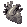](Artificial_Heart.md) | 善良的小块能获得100%的健康。 | 玩家需要至少有一种其他被动的东西，让他们得到"友好的碎片" (例如弓箭手的效果) | 标签 (默认解锁) |
| [婴儿摇铃（Baby Rattle）](Baby_Rattle.md) |  | 你得到了1.5倍的球，但你的目标变得分散。 | 标签 | 标签 (默认解锁) |
| [绷带卷（Bandage Roll）](Bandage_Roll.md) | [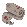](Bandage_Roll.md) | 每当你愈合时，就射出1到2个婴儿球 | 标签 | 标签 (默认解锁) |
| [瓶装龙卷风（Bottled Tornado）](Bottled_Tornado.md) | [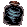](Bottled_Tornado.md) | 当你抓住一个特殊的球时，自动射出1到3个新的婴儿球 | 标签 | 标签 (默认解锁) |
| [胸罩（Breastplate）](Breastplate.md) |  | 减少10%的伤害 | 标签 | 标签 (默认解锁) |
| [棘的冠冕（Crown of Thorns）](Crown_of_Thorns.md) |  | 受到近距离攻击时，消灭最近的 2 名敌人。 | 标签 | 标签 (默认解锁) |
| [诅咒的精液（Cursed Elixir）](Cursed_Elixir.md) |  | 当一个被毒死的敌人死后，他们有10%的机会回到一个有240个健康的僵尸身边， 将身体移到板子上与敌人战斗 | 玩家需要一个用毒药的球 | 清晰 [骸骨墓园（The BONExYARD）](The_BONExYARD.md)  |
| [死亡眼睛的宝藏（Deadeye's Amulet）](Deadeye_s_Amulet.md) |  | 关键打击交易 10-15额外伤害 | 标签 | 清晰 [边境沙漠（The LIMINALxDESERT）](The_LIMINALxDESERT.md)  |
| [钻石钻头（Diamond Hilted Dagger）](Diamond_Hilted_Dagger.md) |  | 在前面击中敌人时，可增加20%。 | 标签 | 标签 (默认解锁) |
| [动力石（Dynamite）](Dynamite.md) | [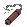](Dynamite.md) | 每5至10行，就产下一个敌人， 上面有炸药，摧毁它们就会给附近的敌人造成200至500的伤害 | 标签 | 清晰 [阴燃深渊（The SMOLDERINGxDEPTHS）](The_SMOLDERINGxDEPTHS.md)  |
| [翡翠光光闪闪（Emerald Hilted Dagger）](Emerald_Hilted_Dagger.md) |  | 在右侧击中敌人时，可增加20%。 | 标签 | 标签 (默认解锁) |
| [虚灵斗篷（Ethereal Cloak）](Ethereal_Cloak.md) | [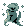](Ethereal_Cloak.md) | 球通过敌人，损坏25%的奖金，直到他们击中后面的场。 | 标签 | 标签 (默认解锁) |
| [一直流动的杯子（Everflowing Goblet）](Everflowing_Goblet.md) |  | 你可以在20%的效率下治愈你的最大健康 | 标签 | 标签 (默认解锁) |
| [观察者的眼睛（Eye of the Beholder）](Eye_of_the_Beholder.md) |  | 10%的机会避开接入的攻击 | 标签 | 标签 (默认解锁) |
| [舰队脚](https://ballxpit.wiki.gg/wiki/Fleet_Feet?action=edit&redlink=1) | [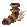](https://ballxpit.wiki.gg/wiki/Fleet_Feet) | 提高10%的运动速度，并在拍摄时以全速移动 | 标签 | 标签 (默认解锁) |
| [冰冻尖刺（Frozen Spike）](https://ballxpit.wiki.gg/wiki/Frozen_Spike?action=edit&redlink=1) |  | 当敌人被冷冻后，他们向附近的敌人发出寒冷，造成10到20的伤害 | 玩家需要有一个球来应用冻结 | 标签 (默认解锁) |
| [宝石之春](https://ballxpit.wiki.gg/wiki/Gemspring?action=edit&redlink=1) | [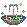](https://ballxpit.wiki.gg/wiki/Gemspring) | 每7至11行就会产生一个宝石。 造成它们的损坏导致它们丢掉越来越多的经验值宝石 | 标签 | 清晰 [阴燃深渊（The SMOLDERINGxDEPTHS）](The_SMOLDERINGxDEPTHS.md)  |
| [幽灵的皮套](https://ballxpit.wiki.gg/wiki/Ghostly_Corset?action=edit&redlink=1) | [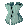](https://ballxpit.wiki.gg/wiki/Ghostly_Corset) | 球通过敌人，当从侧面击中他们时损坏20%的奖金。 | 标签 | 清晰 [天堂之门（The HEAVENLYxGATES）](The_HEAVENLYxGATES.md)  |
| [幽灵盾牌](https://ballxpit.wiki.gg/wiki/Ghostly_Shield?action=edit&redlink=1) |  | 球通过盟国治愈它们2次健康 | 玩家需要至少有一种其他被动，让他们得到"盟友" (例如射击器的效果图) | 清晰 [天堂之门（The HEAVENLYxGATES）](The_HEAVENLYxGATES.md)  |
| [黄金牛](https://ballxpit.wiki.gg/wiki/Golden_Bull?action=edit&redlink=1) |  | 每7到11排，你就会生出一个金牛，你身边有400个健康。金牛每分钟积累了10个金牛。 | 标签 | 清晰 [白雪海岸（The SNOWYxSHORES）](The_SNOWYxSHORES.md)  |
| [手机风扇](https://ballxpit.wiki.gg/wiki/Hand_Fan?action=edit&redlink=1) |  | 放慢与你同列的敌人50%。 | 标签 | 清晰 [血腥草原（The GORYxGRASSLANDS）](The_GORYxGRASSLANDS.md)  |
| [手镜](https://ballxpit.wiki.gg/wiki/Hand_Mirror?action=edit&redlink=1) |  | 弹药有50%的机会反思击中你，如果他们击中敌人，造成20-40的伤害 | 标签 | 清晰 [血腥草原（The GORYxGRASSLANDS）](The_GORYxGRASSLANDS.md)  |
| [医生的效果](https://ballxpit.wiki.gg/wiki/Healer%27s_Effigy?action=edit&redlink=1) |  | 每7到12行，就会产生一个石头治疗师，你的侧面有100个健康，这在球场上每分钟就会给你10个健康。治疗师对球损伤免疫, | 标签 | 清晰 [白雪海岸（The SNOWYxSHORES）](The_SNOWYxSHORES.md)  |
| [砂钟（Hourglass）](Hourglass.md) |  | 球能处理150%的损伤，但每次弹跳时损坏衰减30%(至少50%) | 标签 | 标签 (默认解锁) |
| [铁制连体衣（Iron Onesie）](Iron_Onesie.md) | [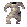](Iron_Onesie.md) | 球对球场上的每个婴儿球造成了0.5%的伤害。 | 标签 | 标签 (默认解锁) |
| [死亡的吻](https://ballxpit.wiki.gg/wiki/Kiss_of_Death?action=edit&redlink=1) |  | 迷人的敌人在恢复后有10%的死亡机会 | 玩家需要一个用魔术的球 | 标签 (默认解锁) |
| [恋人的箭袋（Lover's Quiver）](https://ballxpit.wiki.gg/wiki/Lover%27s_Quiver?action=edit&redlink=1) |  | 投射物有 40% 的概率为你恢复 1 点生命值，效果取代原有伤害。 | 标签 | 清晰 [血腥草原（The GORYxGRASSLANDS）](The_GORYxGRASSLANDS.md)  |
| [魔术人员（Magic Staff）](Magic_Staff.md) | [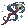](Magic_Staff.md) | 增加影响区域伤害 (如地震，激光和闪电) 20% | 标签 | 标签 (默认解锁) |
| [磁铁（Magnet）](Magnet.md) | [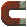](Magnet.md) | 增加范围， 使您用 1.0瓷砖来拾取物品和抓球 | 标签 | 标签 (默认解锁) |
| [午夜油（Midnight Oil）](Midnight_Oil.md) | [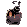](Midnight_Oil.md) | 击中火焰的敌人火焰，在下一次击中造成10到20次火灾损失。 | 玩家需要一个球来应用Burn | 标签 (默认解锁) |
| [哑铃（Platinum Dumbbell）](Platinum_Dumbbell.md) | [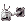](Platinum_Dumbbell.md) | 球只会造成12%的损失，直到他们击中后面的球场。 | 标签 | 清晰吗? |
| [压力阀（Pressure Valve）](Pressure_Valve.md) |  | 敌人在死亡中爆炸，对邻近的敌人造成20-30的伤害 | 标签 | 清晰 [骸骨墓园（The BONExYARD）](The_BONExYARD.md)  |
| [保护的魅力](https://ballxpit.wiki.gg/wiki/Protective_Charm?action=edit&redlink=1) |  | 换个屏蔽，挡住你接下来的损伤,60秒后充电 | 标签 | 清晰 [真菌森林（The FUNGALxFOREST）](The_FUNGALxFOREST.md)  |
| [发光的羽毛](https://ballxpit.wiki.gg/wiki/Radiant_Feather?action=edit&redlink=1) |  | 每次打球，会让球速率提高20%。 | 标签 | 标签 (默认解锁) |
| [射手的矛（Reacher's Spear）](Reacher_s_Spear.md) |  | 在与你相同的列中击中敌人时，将危机的可能性提高到20%。 | 标签 | 标签 (默认解锁) |
| [橡胶头带（Rubber Headband）](https://ballxpit.wiki.gg/wiki/Rubber_Headband?action=edit&redlink=1) |  | 球开始以70%的速度，但每次跳动增加20% (最高200%) | 标签 | 标签 (默认解锁) |
| [Ruby 闪亮的弹跳器（Ruby Hilted Dagger）](Ruby_Hilted_Dagger.md) |  | 在后面击中敌人时，增加15%的危险机会 | 标签 | 标签 (默认解锁) |
| [Sapphire 欢笑大算器（Sapphire Hilted Dagger）](Sapphire_Hilted_Dagger.md) | [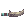](Sapphire_Hilted_Dagger.md) | 在左侧击中敌人时，将危险机会提高到30%。 | 标签 | 标签 (默认解锁) |
| [短弓（Shortbow）](Shortbow.md) | [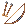](Shortbow.md) | 增加15%的火灾率 | 标签 | 标签 (默认解锁) |
| [银眼罩](https://ballxpit.wiki.gg/wiki/Silver_Blindfold?action=edit&redlink=1) | [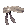](https://ballxpit.wiki.gg/wiki/Silver_Blindfold) | 在击中失明的敌人时，可增加20%。 | 标签 | 清晰 [边境沙漠（The LIMINALxDESERT）](The_LIMINALxDESERT.md)  |
| [银子子弹（Silver Bullet）](Silver_Bullet.md) | [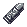](Silver_Bullet.md) | 球只会带来20%的损失，直到他们撞到墙上。 | 标签 | 标签 (默认解锁) |
| [弹弓（Slingshot）](Slingshot.md) | [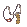](Slingshot.md) | 当你拿起宝石时，有25%的机会发射宝贝球。 | 标签 | 标签 (默认解锁) |
| [尖刺项圈（Spiked Collar）](https://ballxpit.wiki.gg/wiki/Spiked_Collar?action=edit&redlink=1) |  | 你第一次进入他们的战斗攻击范围时，给敌人提供30-50。 | 标签 | 清晰 [真菌森林（The FUNGALxFOREST）](The_FUNGALxFOREST.md)  |
| [石雕像（Stone Effigy）](https://ballxpit.wiki.gg/wiki/Stone_Effigy?action=edit&redlink=1) | [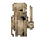](https://ballxpit.wiki.gg/wiki/Stone_Effigy) | 每7-12行，产下一名身体健康200人的石兵，石兵对球损伤免疫，向上运动田野，阻拦和攻击敌人的方式。 | 标签 | 标签 (默认解锁) |
| [剑打破者（Sword Breaker）](Sword_Breaker.md) | [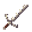](Sword_Breaker.md) | 球损伤减少了40%，但对每一个敌人损伤的损伤是1%。 | 标签 | ? |
| [叛徒的外套（Traitor's Cowl）](Traitor_s_Cowl.md) |  | 石头的盟友现在可以被你的球损坏，但是当球击中一个你会治愈2个健康 | 玩家需要至少拥有一个其他的被动给予他们“ 基石盟友”(例如,Archer's Effigy) | 清晰 [天堂之门（The HEAVENLYxGATES）](The_HEAVENLYxGATES.md)  |
| [塔楼（Turret）](Turret.md) |  | 绕着你的性格，每2.0秒就向敌人射一个小球 | 标签 | 标签 (默认解锁) |
| [翻转的斧头](https://ballxpit.wiki.gg/wiki/Upturned_Hatchet?action=edit&redlink=1) | [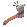](https://ballxpit.wiki.gg/wiki/Upturned_Hatchet) | 球在击中后面的球会造成80%更多的伤害，否则伤害会减少20% | 标签 | 标签 (默认解锁) |
| [吸血鬼剑（Vampiric Sword）](Vampiric_Sword.md) | [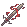](Vampiric_Sword.md) | 每次杀伤都会给你带来5个伤害，但每次射击都会给你带来2个伤害。 | 标签 | 清晰 [边境沙漠（The LIMINALxDESERT）](The_LIMINALxDESERT.md)  |
| [伏都娃娃（Voodoo Doll）](Voodoo_Doll.md) |  | 诅咒有10%的机会杀死敌人。 | 玩家需要一个使用诅咒的球 | 清晰 [骸骨墓园（The BONExYARD）](The_BONExYARD.md)  |
| [车轮](https://ballxpit.wiki.gg/wiki/Wagon_Wheel?action=edit&redlink=1) |  | 每当球撞到墙壁时，它在下一次击中造成30%的额外伤害 | 标签 | 清晰 [阴燃深渊（The SMOLDERINGxDEPTHS）](The_SMOLDERINGxDEPTHS.md)  |
| [战争角（War Horn）](War_Horn.md) | [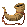](War_Horn.md) | 所有婴儿球都造成了20%的伤害。 | 标签 | 标签 (默认解锁) |
| [可怜洋葱（Wretched Onion）](https://ballxpit.wiki.gg/wiki/Wretched_Onion?action=edit&redlink=1) |  | 2块内每秒向敌人发6- 12张 | 标签 | 清晰 [真菌森林（The FUNGALxFOREST）](The_FUNGALxFOREST.md)  |

##### 进化被动

进化被动器是通过将2个或多个特定的基被动器结合在一起在[聚合反应堆](Fusion_Reactor.md)中创建的。这些被动器具有新的名称，图标和效果。

目前游戏中有17个进化被动。

| 名称 | 标志 | 描述 | 组合 |
| --- | --- | --- | --- |
| [燃烧的轮胎（Ardent Tire）](Ardent_Tire.md) | [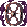](Ardent_Tire.md) | 每次跳动，球速增加10%和损伤增加5% |  [车轮](https://ballxpit.wiki.gg/wiki/Wagon_Wheel?action=edit&redlink=1) +  [橡胶头带（Rubber Headband）](https://ballxpit.wiki.gg/wiki/Rubber_Headband?action=edit&redlink=1) |
| [阿根廷止时钟（Argent Stopwatch）](Argent_Stopwatch.md) | [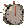](Argent_Stopwatch.md) | 球能处理200%的破坏，但每次弹跳时破坏衰减20%(至少100%)。 | [砂钟（Hourglass）](Hourglass.md)  + [银子子弹（Silver Bullet）](Silver_Bullet.md)  |
| [命运的箭（Arrow of Fate）](Arrow_of_Fate.md) | [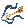](Arrow_of_Fate.md) | 弹药不再伤害你，当弹药击中你就会射出1-2个婴儿球。 |  [恋人的箭袋（Lover's Quiver）](https://ballxpit.wiki.gg/wiki/Lover%27s_Quiver?action=edit&redlink=1) +  [手镜](https://ballxpit.wiki.gg/wiki/Hand_Mirror?action=edit&redlink=1) |
| [黄斑（Cornucopia）](Cornucopia.md) | [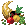](Cornucopia.md) | 每次创造婴儿球， 产生 0-1个额外的婴儿球 | [婴儿摇铃（Baby Rattle）](Baby_Rattle.md)  + [战争角（War Horn）](War_Horn.md)  |
| ["死眼之十字架"（Deadeye's Cross）](Deadeye_s_Cross.md) |  | 增加临床撞击的可能性到60% | [钻石钻头（Diamond Hilted Dagger）](Diamond_Hilted_Dagger.md)  + [Sapphire 欢笑大算器（Sapphire Hilted Dagger）](Sapphire_Hilted_Dagger.md)  + [Ruby 闪亮的弹跳器（Ruby Hilted Dagger）](Ruby_Hilted_Dagger.md)  + [翡翠光光闪闪（Emerald Hilted Dagger）](Emerald_Hilted_Dagger.md)  |
| [死眼的硬化剂（Deadeye's Impaler）](Deadeye_s_Impaler.md) |  | 增加到5%的关键击中机会。 | ["死眼之十字架"（Deadeye's Cross）](Deadeye_s_Cross.md)  + [慈悲不仁者（Gracious Impaler）](Gracious_Impaler.md) [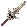](Gracious_Impaler.md) |
| [全金属光谱机（Full Metal Rapier）](Full_Metal_Rapier.md) | [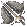](Full_Metal_Rapier.md) | 每个球和敌人在球场上，球会造成1%的伤害。 | [铁制连体衣（Iron Onesie）](Iron_Onesie.md)  + [剑打破者（Sword Breaker）](Sword_Breaker.md)  |
| [慈悲不仁者（Gracious Impaler）](Gracious_Impaler.md) |  | 关键的击中有5%的机会立即杀死敌人 | [射手的矛（Reacher's Spear）](Reacher_s_Spear.md)  + [死亡眼睛的宝藏（Deadeye's Amulet）](Deadeye_s_Amulet.md)  |
| [怪异的炮兵（Grotesque Artillery）](Grotesque_Artillery.md) | [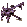](Grotesque_Artillery.md) | 每8.0秒就会向敌人发射一个随机的1级未发达特殊球。 | [塔楼（Turret）](Turret.md)  +  [手机风扇](https://ballxpit.wiki.gg/wiki/Hand_Fan?action=edit&redlink=1) |
| [光荣锤（Inglorious Hammer）](Inglorious_Hammer.md) | [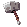](Inglorious_Hammer.md) | 当球击中墙壁或后面的球场，他们击中一个随机的敌人 50%的奖金伤害。 | [哑铃（Platinum Dumbbell）](Platinum_Dumbbell.md)  +  [翻转的斧头](https://ballxpit.wiki.gg/wiki/Upturned_Hatchet?action=edit&redlink=1) |
| [恶臭外壳（Odiferous Shell）](Odiferous_Shell.md) | [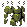](Odiferous_Shell.md) | 当你碰到敌人时，他们有50%的机会立即死亡。 |  [可怜洋葱（Wretched Onion）](https://ballxpit.wiki.gg/wiki/Wretched_Onion?action=edit&redlink=1) + [胸罩（Breastplate）](Breastplate.md)  |
| [鬼魂雷加利亚（Phantom Regalia）](Phantom_Regalia.md) |  | 球通过敌人，直到他们撞到后墙。球通过敌人造成50%更多的伤害。 |  [幽灵的皮套](https://ballxpit.wiki.gg/wiki/Ghostly_Corset?action=edit&redlink=1) + [虚灵斗篷（Ethereal Cloak）](Ethereal_Cloak.md)  |
| [远程发射器（Remote Detonator）](Remote_Detonator.md) | [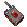](Remote_Detonator.md) | 敌人死亡时生成一颗 1 级炸弹球。 | [压力阀（Pressure Valve）](Pressure_Valve.md)  + [磁铁（Magnet）](Magnet.md)  |
| [灵魂收获者（Soul Reaver）](Soul_Reaver.md) | [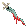](Soul_Reaver.md) | 每一次杀伤都能治愈你1个，你可以以30%的效率治愈你的最大健康。 | [吸血鬼剑（Vampiric Sword）](Vampiric_Sword.md)  + [一直流动的杯子（Everflowing Goblet）](Everflowing_Goblet.md)  |
| [折磨者面具（Tormenters Mask）](Tormenters_Mask.md) | [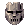](Tormenters_Mask.md) | 敌人第一次发现你就有10%的机会立即死亡 |  [尖刺项圈（Spiked Collar）](https://ballxpit.wiki.gg/wiki/Spiked_Collar?action=edit&redlink=1) + [棘的冠冕（Crown of Thorns）](Crown_of_Thorns.md)  |
| [风织机（Windweaver）](Windweaver.md) |  | 每拾取一枚宝石，发射一颗 1 级风球。 | [瓶装龙卷风（Bottled Tornado）](Bottled_Tornado.md)  + [弹弓（Slingshot）](Slingshot.md)  |
| [油膏者的翅膀（Wings of the Anointed）](Wings_of_the_Anointed.md) |  | 球运动速度快40%，你运动速度快20%。 |  [发光的羽毛](https://ballxpit.wiki.gg/wiki/Radiant_Feather?action=edit&redlink=1) +  [舰队脚](https://ballxpit.wiki.gg/wiki/Fleet_Feet?action=edit&redlink=1) |

**分类**　[分类 · 解锁条件](../categories/Unlocks.md)

[返回总入口](../%E7%90%83%E6%AF%94%E4%BC%A6%E6%88%98%E8%AE%B0%20Wiki.md) · [返回本分目录](%E7%9B%AE%E5%BD%95.md)
