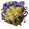

# 中毒（Poison）

施用1堆毒药(最大5/5/8堆)，毒药持续6/6/9秒，每堆处理1-4/2-5/2-5次损坏每秒

[原文与贡献者记录](https://ballxpit.wiki.gg/wiki/Poison) · [修订 4214](https://ballxpit.wiki.gg/index.php?oldid=4214) · [返回目录](../%E7%90%83%E6%AF%94%E4%BC%A6%E6%88%98%E8%AE%B0%20Wiki.md)

#### 一般信息

##### 开始的性格

[潜伏者](The_Embedded.md) 

##### 解锁

默认解锁

##### 状态效果（Status Effects）

[中毒](https://ballxpit.wiki.gg/wiki/Status_Effects?action=edit&redlink=1)

##### 由于状态影响

命中时

#### 发展情况（Evolutions）

##### 演变为

[硫磺](Brimstone.md) 、 [危害性](Noxious.md) 、 [核弹](Nuclear_Bomb.md) 、 [辐射束](Radiation_Beam.md) 、 [沼泽](Swamp.md) 、 [毒药](Venom.md) 、 [病毒](Virus.md) 

**中毒** 是一个 [基球](Balls.md#%E5%9F%BA%E7%A1%80%E5%9C%86%E7%90%83) 在基本游戏版本中推出了 *[球比伦战记](Ball_x_Pit.md)*它是首发的球。 [潜伏者](The_Embedded.md) .

#### 关卡

| 等级 | 伤害 | 影响 |
| --- | --- | --- |
| 1 |  x(3.5至6.5) | 施用1堆毒药(最大5堆)，毒药持续6秒，每堆1-4个损坏每秒 ／ |
| 2 |  x(3.5至6.5) | 施用1堆毒药(最大5堆)。毒药持续6秒，每堆毒药每秒处理2-5个损坏。 ／ |
| 3 |  x(3.5至6.5) | 施用1堆毒药(最大8堆)，毒药持续9秒，每堆毒药每秒处理2-5个损坏 ／ |

#### 发展情况

| 组合 | 进化 |
| --- | --- |
|  中毒（Poison） + [灼烧（Burn）](Burn.md)  | [硫磺（Brimstone）](Brimstone.md)  |
|  中毒（Poison） + [风（Wind）](Wind.md)  | [危害性（Noxious）](Noxious.md)  |
|  中毒（Poison） + [炸弹（Bomb）](Bomb.md)  | [核弹（Nuclear Bomb）](Nuclear_Bomb.md)  |
|  中毒（Poison） + [激光 (水平)（Laser (Horizontal)）](Laser_Horizontal.md)  ／  中毒（Poison） + [激光 (垂直)（Laser (Vertical)）](Laser_Vertical.md)  | [辐射束（Radiation Beam）](Radiation_Beam.md) （\*） |
|  中毒（Poison） + [地震（Earthquake）](Earthquake.md)  | [沼泽（Swamp）](Swamp.md)  |
|  中毒（Poison） + [冻结（Freeze）](Freeze.md)  | [毒药（Venom）](Venom.md)  |
|  中毒（Poison） + [细胞（Cell）](Cell.md)  ／  中毒（Poison） + [鬼魂（Ghost）](Ghost.md)  | [病毒（Virus）](Virus.md)  |

* 可以进一步发展。

#### 策略

#### 更新记录

#### 冷知识

#### 图片库

[共享导航](../navigation/nav-63012059ef49.md)

**分类**　[分类 · 基础圆球](../categories/Base_Balls.md) · [分类 · 圆球](../categories/Balls.md) · [分类 · 页面有导航框](../categories/Pages_with_navboxes.md)

[返回总入口](../%E7%90%83%E6%AF%94%E4%BC%A6%E6%88%98%E8%AE%B0%20Wiki.md) · [返回本分目录](%E7%9B%AE%E5%BD%95.md)
