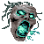

# 收获者（Reaper）

有10%/15%/15%的机会在撞击时杀死敌人，为了5/5/7的健康而治愈你。

[原文与贡献者记录](https://ballxpit.wiki.gg/wiki/Reaper) · [修订 4311](https://ballxpit.wiki.gg/index.php?oldid=4311) · [返回目录](../%E7%90%83%E6%AF%94%E4%BC%A6%E6%88%98%E8%AE%B0%20Wiki.md)

#### 一般信息

##### 由

[吸血鬼](Soul_Sucker.md)  + [吞心者](Heart_Swallower.md) 

##### 开始的性格

-

##### 状态效果（Status Effects）

立即杀死

##### 由于状态影响

命中时

这不仅限于普通的敌人，因为它可以杀死老板。

#### 进化配方

|  |  |  |  |  |  |  |  |  |  |  |  |  |  |  |
| --- | --- | --- | --- | --- | --- | --- | --- | --- | --- | --- | --- | --- | --- | --- |
|  |  |  |  |  |  |  |  |  |  |  |  |  |  |  |
| [吸血鬼（Vampire）](Vampire.md)  |  |  |  | [鬼魂（Ghost）](Ghost.md)  |  |  |  | [流血（Bleed）](Bleed.md)  |  |  |  | [鬼魂（Ghost）](Ghost.md)  |  |  |
|  |  |  |  |  |  |  |  |  |  |  |  |  |  |  |
|  |  | [吸血鬼（Soul Sucker）](Soul_Sucker.md)  |  |  |  |  |  |  |  | [吞心者（Heart Swallower）](Heart_Swallower.md)  |  |  |  |  |
|  |  |  |  |  |  |  |  |  |  |  |  |  |  |  |
|  |  |  |  |  |  | 收获者（Reaper） |  |  |  |  |  |  |  |  |

#### 关卡

| 等级 | 伤害 | 影响 |
| --- | --- | --- |
| 1 |  x(3.6至6.8) | 有10%的机会在撞击时杀死敌人， 治愈你为5个健康。 ／ |
| 2 |  x(3.6至6.8) | 有15%的机会在撞击时杀死敌人， 治愈你为5个健康。 ／ |
| 3 |  x(3.6至6.8) | 有15%的机会在撞击时杀死敌人， 治愈你7个健康。 ／ |

#### 发展情况

*这个球不能进一步发展。*

#### 策略

* 使用 [闪光](Flash.md) 的引信死伤者是一个非常强大的组合。虽然在引信弹的描述上不会这么说，但闪光的伤害效应将有可能对它所击中的每个敌人产生即时致命效果。

#### 更新记录

#### 冷知识

#### 图片库

[共享导航](../navigation/nav-63012059ef49.md)

**分类**　[分类 · 进化圆球](../categories/Evolved_Balls.md) · [分类 · 圆球](../categories/Balls.md) · [分类 · 页面有导航框](../categories/Pages_with_navboxes.md)

[返回总入口](../%E7%90%83%E6%AF%94%E4%BC%A6%E6%88%98%E8%AE%B0%20Wiki.md) · [返回本分目录](%E7%9B%AE%E5%BD%95.md)
