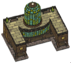

# 遗迹收集者（建筑）（Relic Collector (Building)）

[原文与贡献者记录](https://ballxpit.wiki.gg/wiki/Relic_Collector_%28Building%29) · [修订 1786](https://ballxpit.wiki.gg/index.php?oldid=1786) · [返回目录](../%E7%90%83%E6%AF%94%E4%BC%A6%E6%88%98%E8%AE%B0%20Wiki.md)

## 遗物收集者

新被动道具均从 2 级开始生效

## 信息（Information）

### 分类（Category）

战争

### 子类（Subcategory）

将军

### 蓝图位置（Blueprint location）

[HEAVENLYxGATES](The_HEAVENLYxGATES.md)

### 基础资源消耗（Base resource cost）

 1,500

### 建造点消耗（Build point cost）

75

建造遗物收集者时，所有在单局游戏过程中通过升级获得的被动道具，将从 1 级开始，改为从 2 级开始。请注意，这不会影响通过 [古董店](Antique_Shop.md)获得的加成被动道具的初始等级，也无法进一步升级此建筑或加成效果。建造此建筑将获得遗物收集者成就。

被动效果与升级

| 等级 | 图片 | 说明 | 资源消耗 | 建造点消耗 | 拆除 |
| --- | --- | --- | --- | --- | --- |
| 1 |  | 新被动道具均从 2 级开始生效 |  1,500 | 75 |  1,500 |

**分类**　[分类 · 建筑](../categories/Buildings.md) · [分类 · 战争](../categories/Warfare.md) · [分类 · 通用](../categories/General.md)

[返回总入口](../%E7%90%83%E6%AF%94%E4%BC%A6%E6%88%98%E8%AE%B0%20Wiki.md) · [返回本分目录](%E7%9B%AE%E5%BD%95.md)
