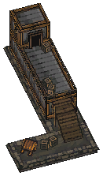

# 道路守护者（Road Keeper）

在收获期间增加字符运动速度。

[原文与贡献者记录](https://ballxpit.wiki.gg/wiki/Road_Keeper) · [修订 3341](https://ballxpit.wiki.gg/index.php?oldid=3341) · [返回目录](../%E7%90%83%E6%AF%94%E4%BC%A6%E6%88%98%E8%AE%B0%20Wiki.md)

#### 信息（Information）

##### 分类（Category）

经济

##### 子类（Subcategory）

收获升级

##### 蓝图位置（Blueprint location）

[真菌森林](The_FUNGALxFOREST.md) 

##### 基础资源消耗（Base resource cost）

 20  5

##### 建造点消耗（Build point cost）

5

其他 **道路守护者** 是一个收获升级 [建筑物](Buildings.md) 在 *[球比伦战记](Ball_x_Pit.md)*. 建设路守护者在收获期间增加了所有字符的起步移动速度，这些字符的数量可以通过建筑升级增加。 [收藏家的小屋](Gatherer_s_Hut.md)这种奖金与从 [角色](Characters.md) 在  [冲刺运动员](https://ballxpit.wiki.gg/wiki/Sprinter?action=edit&redlink=1) [收获升级](Harvest_Upgrades_Character_Bonus.md) 及适用的从 [鬼鬼之家](Haunted_House.md) 一次 [忏悔者](The_Repentant.md)  已经解锁了能力。

被动效果与升级

| 等级 | 图片 | 描述 | 资源消耗 | 建造点消耗 | 拆除 |
| --- | --- | --- | --- | --- | --- |
| 1 |  | 在收获期间增加10%的移动速度 |  20  5 | 5 |  20  5 |
| 2 |  | 在收获期间增加20%的移动速度 |  30  5 | 5 |  50  10 |
| 3 |  | 在收获期间增加30%的移动速度 |  45  8 | 15 |  95  18 |

[共享导航](../navigation/nav-d4956b01aa56.md)

**分类**　[分类 · 建筑](../categories/Buildings.md) · [分类 · 经济](../categories/Economy.md) · [分类 · 收获升级](../categories/Harvest_Upgrades.md) · [分类 · 页面有导航框](../categories/Pages_with_navboxes.md)

[返回总入口](../%E7%90%83%E6%AF%94%E4%BC%A6%E6%88%98%E8%AE%B0%20Wiki.md) · [返回本分目录](%E7%9B%AE%E5%BD%95.md)
