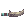

# Sapphire 欢笑大算器（Sapphire Hilted Dagger）

[原文与贡献者记录](https://ballxpit.wiki.gg/wiki/Sapphire_Hilted_Dagger) · [修订 4274](https://ballxpit.wiki.gg/index.php?oldid=4274) · [返回目录](../%E7%90%83%E6%AF%94%E4%BC%A6%E6%88%98%E8%AE%B0%20Wiki.md)

#### 关卡

| 等级 | 影响 |
| --- | --- |
| 1 | 在左侧击中敌人时，将危险机会提高到30%。 |
| 2 | 在击中敌人的左侧时，可能会增加到45%。 |
| 3 | 在左侧击中敌人时，可增加到60%的危险机会。 |

#### 发展情况

| 组合 | 进化 |
| --- | --- |
| **Sapphire 欢笑大算器** +  [钻石钻头（Diamond Hilted Dagger）](Diamond_Hilted_Dagger.md) + [Ruby 闪亮的弹跳器（Ruby Hilted Dagger）](Ruby_Hilted_Dagger.md) + [翡翠光光闪闪（Emerald Hilted Dagger）](Emerald_Hilted_Dagger.md) | ["死眼之十字架"（Deadeye's Cross）](Deadeye_s_Cross.md) |

[返回总入口](../%E7%90%83%E6%AF%94%E4%BC%A6%E6%88%98%E8%AE%B0%20Wiki.md) · [返回本分目录](%E7%9B%AE%E5%BD%95.md)
