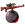
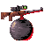

# 霰弹枪（Shotgun）

击中墙壁后，发射3-7/4-8/5-9个铁质小球。铁质小球以200%的速度移动，但一旦碰到任何物体就会被摧毁。

[原文与贡献者记录](https://ballxpit.wiki.gg/wiki/Shotgun) · [修订 4139](https://ballxpit.wiki.gg/index.php?oldid=4139) · [返回目录](../%E7%90%83%E6%AF%94%E4%BC%A6%E6%88%98%E8%AE%B0%20Wiki.md)

## 基本信息

### 由……创建

[铁](Iron.md)  + [卵囊](Egg_Sac.md) 

### 初始角色（Starting Character）

-

### 状态效果（Status Effects）

生成铁球 [小球](Baby_Ball.md)

### 由状态效果触发

命中时生成，反弹时生成

## 进化（Evolutions）

### 进化成

[狙击手](Sniper.md) 

## 进化配方

|  |  |  |  |  |  |  |
| --- | --- | --- | --- | --- | --- | --- |
|  |  |  |  |  |  |  |
| [铁（Iron）](Iron.md)  |  |  |  | [卵囊（Egg Sac）](Egg_Sac.md)  |  |  |
|  |  |  |  |  |  |  |
|  |  | 霰弹枪（Shotgun） |  |  |  |  |

## 关卡

| 等级 | 伤害 | 效果 |
| --- | --- | --- |
| 1 |  x(3.6 至 6.8) | 击打墙壁后，发射3-7个铁球小球。铁球小球以200%的速度移动，但一旦碰到任何物体就会被摧毁。 |
| 2 |  x(3.6 至 6.8) | 击打墙壁后，用4-8号铁杆发射小球。小球以200%的速度移动，但一旦碰到任何物体就会被摧毁。 |
| 3 |  x(3.6 至 6.8) | 击打墙壁后，发射5-9个铁球小球。铁球小球以200%的速度移动，但一旦碰到任何物体就会被摧毁。 |

## 进化

| 组合 | 进化 |
| --- | --- |
|  霰弹枪（Shotgun） + [刺客（Assassin）](Assassin.md)  | [狙击手（Sniper）](Sniper.md)  |

## 策略

## 更新记录

## 冷知识

## 图片库

[共享导航](../navigation/nav-63012059ef49.md)

**分类**　[分类 · 进化圆球](../categories/Evolved_Balls.md) · [分类 · 圆球](../categories/Balls.md) · [分类 · 带有导航框的页面](../categories/Pages_with_navboxes.md)

[返回总入口](../%E7%90%83%E6%AF%94%E4%BC%A6%E6%88%98%E8%AE%B0%20Wiki.md) · [返回本分目录](%E7%9B%AE%E5%BD%95.md)
