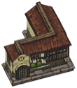

# 独栋住宅（Single Family Home）

[原文与贡献者记录](https://ballxpit.wiki.gg/wiki/Single_Family_Home) · [修订 3399](https://ballxpit.wiki.gg/index.php?oldid=3399) · [返回目录](../%E7%90%83%E6%AF%94%E4%BC%A6%E6%88%98%E8%AE%B0%20Wiki.md)

[空巢者](The_Empty_Nester.md)  的房子。

## 信息（Information）

### 分类（Category）

住房

### 子类（Subcategory）

住房

### 蓝图位置（Blueprint location）

[白雪海岸](The_SNOWYxSHORES.md) 

### 基础资源消耗（Base resource cost）

 50  30

### 建造点消耗（Build point cost）

15

**独栋住宅** 是 *[球比伦战记](Ball_x_Pit.md)* 中的角色住房类 [建筑](Buildings.md)。建造独栋住宅会解锁 [空巢者](The_Empty_Nester.md)  作为可游玩的 [角色](Characters.md)。当 [角色获得足够的经验值](Character_Level_Mechanics.md) 达到 4 级后，这座建筑会解锁一项被动能力，届时独栋住宅将具备被动收获的能力：  小麦每 6 分钟从相邻的麦田收取一次；与大多数 [采集](Buildings.md#%E6%94%B6%E9%9B%86) 类建筑不同，该建筑不需要指派角色即可运作。该建筑还能享受 [工人工会](Worker_s_Guild_Building.md) 提供的离线收获加成。该建筑的能力可以通过以下方式进一步提升：不直接升级建筑本身，而是继续提升角色等级。注意，拆除角色的房屋将使该角色在收获模式或关卡对局中无法使用，并使其从所有建筑任务中移除，直到其房屋重建为止（尽管该角色仍会保留之前的所有进度）。

被动效果与升级

| 等级 | 图片 | 说明 | 资源消耗 | 建造点消耗 | 拆除 | 角色等级要求 |
| --- | --- | --- | --- | --- | --- | --- |
| 1 |  | 一个适合“空巢族”的房子。 |  50  30 | 15 |  50  30 | - |
| 1 | - | 一个适合“空巢族”的房子。 收获  每 6 分钟从相邻的小麦田中收获 1 次。 | - | - |  50  30 | 4 |
| 2 | - | 一个适合“空巢族”的房子。 每6分钟从相邻的小麦田中收获一次  2。 | - | - |  50  30 | 7 |
| 3 | - | 一个适合“空巢族”的房子。 收获  每6分钟从相邻的小麦田中收获3个。 | - | - |  50  30 | 8 |

[共享导航](../navigation/nav-d4956b01aa56.md)

**分类**　[分类 · 建筑](../categories/Buildings.md) · [分类 · 住房](../categories/Housing.md) · [分类 · 带有导航框的页面](../categories/Pages_with_navboxes.md)

[返回总入口](../%E7%90%83%E6%AF%94%E4%BC%A6%E6%88%98%E8%AE%B0%20Wiki.md) · [返回本分目录](%E7%9B%AE%E5%BD%95.md)
