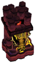

# 阴燃深渊奖杯（Smoldering Trophy）

每当有一名角色通关一次阴燃深渊对局，所有角色都会获得小球伤害加成。

[原文与贡献者记录](https://ballxpit.wiki.gg/wiki/Smoldering_Trophy) · [修订 3369](https://ballxpit.wiki.gg/index.php?oldid=3369) · [返回目录](../%E7%90%83%E6%AF%94%E4%BC%A6%E6%88%98%E8%AE%B0%20Wiki.md)

## 信息（Information）

### 分类（Category）

战争

### 子类（Subcategory）

通关奖励

### 蓝图位置（Blueprint location）

[阴燃深渊](The_SMOLDERINGxDEPTHS.md) 

### 基础资源消耗（Base resource cost）

 600  24

### 建造点消耗（Build point cost）

22

**阴燃深渊奖杯**是八座通关奖励建筑之一。首次通关[阴燃深渊](The_SMOLDERINGxDEPTHS.md) 即可获得蓝图，普通敌人不会掉落。奖杯为所有角色提供小球伤害加成。不同角色先后通关同一关卡时，奖杯加成会自动提高。每名角色以普通速度通关基础关卡时，增加一份基础加成。以快速至快速＋9 通关基础关卡，以及以普通、快速至快速＋9 通关新游戏＋至新游戏＋9 时，每名角色每完成一档均增加基础加成的 1/10。理论上限为基础加成的 238 倍。PC 版玩家启用 Twitch 扩展并使用[伪救世主](The_False_Messiah.md) 后，上限提升至基础加成的 249.9 倍。建成可解锁「奖杯」（Trophy）成就。

被动效果与升级

| 图片 | 说明 | 资源消耗 | 建造点消耗 | 拆除 | 基础加成 | 最大奖励 | 使用 Twitch 扩展程序的 Max 奖励 |
| --- | --- | --- | --- | --- | --- | --- | --- |
|  | 每有一个角色完成 SMOLDERINGxDEPTHS，小球伤害增加 +1。此外，每完成一个快速等级（或新游戏+等级），每个角色还会额外获得 +0.1 的加成。 |  600  24 | 22 |  600  24 | +1 小球伤害 | +238 小球伤害 | +249.9 小球伤害 |

[共享导航](../navigation/nav-d4956b01aa56.md)

**分类**　[分类 · 建筑](../categories/Buildings.md) · [分类 · 战争](../categories/Warfare.md) · [分类 · 通关奖励](../categories/Completion_Bonus.md) · [分类 · 带有导航框的页面](../categories/Pages_with_navboxes.md)

[返回总入口](../%E7%90%83%E6%AF%94%E4%BC%A6%E6%88%98%E8%AE%B0%20Wiki.md) · [返回本分目录](%E7%9B%AE%E5%BD%95.md)
