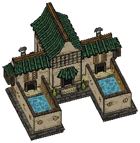

# 温泉浴场（Spa）

立即使用金币进行多次收获。

[原文与贡献者记录](https://ballxpit.wiki.gg/wiki/Spa) · [修订 3344](https://ballxpit.wiki.gg/index.php?oldid=3344) · [返回目录](../%E7%90%83%E6%AF%94%E4%BC%A6%E6%88%98%E8%AE%B0%20Wiki.md)

## 信息（Information）

### 分类（Category）

经济

### 子类（Subcategory）

其他信息

### 蓝图位置（Blueprint location）

[边境沙漠](The_LIMINALxDESERT.md) 

### 基础资源消耗（Base resource cost）

 500  10  2

### 建造点消耗（Build point cost）

5

**温泉浴场**是 *[球比伦战记](Ball_x_Pit.md)* 中的一项杂项经济类 [建筑](Buildings.md)。建成后的对局中，玩家在使用一次免费的初始收获后，将获得再次收获的选项，代价为支付  金币。此操作可以反复进行，每次的花费都会增加，而通过建筑升级可以降低费用的增长幅度。如果在基础界面等待足够长的时间，仍然可以获得一次额外的免费收获，但后续每次收获的花费将保持在同一水平，直到玩家重新开始一局对局（即使游戏已关闭并重新启动，这一状态也会保留）。

被动效果与升级

| 等级 | 图片 | 说明 | 资源消耗 | 建造点消耗 | 拆除 | 每获得一次额外收获，成本增加 |
| --- | --- | --- | --- | --- | --- | --- |
| 1 |  | 立即使用金币进行多次收获。 |  500  10  2 | 5 |  500  10  2 |  +425 |
| 2 |  | 立即使用金币进行多次收获。 |  100  5 | 5 |  600  10  7 |  +340 |
| 3 |  | 立即使用金币进行多次收获。 |  150  8 | 15 |  750  10  15 |  +255 |

[共享导航](../navigation/nav-d4956b01aa56.md)

**分类**　[分类 · 建筑](../categories/Buildings.md) · [分类 · 经济](../categories/Economy.md) · [分类 · 其他信息](../categories/Miscellaneous.md) · [分类 · 带有导航框的页面](../categories/Pages_with_navboxes.md)

[返回总入口](../%E7%90%83%E6%AF%94%E4%BC%A6%E6%88%98%E8%AE%B0%20Wiki.md) · [返回本分目录](%E7%9B%AE%E5%BD%95.md)
