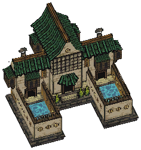

# 热水池（Spa）

直接花更多的金钱来收获。

[原文与贡献者记录](https://ballxpit.wiki.gg/wiki/Spa) · [修订 3344](https://ballxpit.wiki.gg/index.php?oldid=3344) · [返回目录](../%E7%90%83%E6%AF%94%E4%BC%A6%E6%88%98%E8%AE%B0%20Wiki.md)

#### 信息（Information）

##### 分类（Category）

经济

##### 子类（Subcategory）

多种类型

##### 蓝图位置（Blueprint location）

[边境沙漠](The_LIMINALxDESERT.md) 

##### 基础资源消耗（Base resource cost）

 500  10  2

##### 建造点消耗（Build point cost）

5

其他 **热水池** 是一个多元经济 [建筑物](Buildings.md) 在 *[球比伦战记](Ball_x_Pit.md)*玩家在使用免费的初始收获模式后，获得了重新收获的选择，以换取  黄金。这可以多次进行，每次金价增加，并且通过建筑升级可以减少这种成本增加的速度。虽然在基幕上等待足够长的时间仍然可以为您提供额外的免费收获，但后续收获的成本将保持在相同的水平，直到尝试另一个坑 (即便游戏关闭并重新启动)。

被动效果与升级

| 等级 | 图片 | 描述 | 资源消耗 | 建造点消耗 | 拆除 | 每次额外收获的成本增加 |
| --- | --- | --- | --- | --- | --- | --- |
| 1 |  | 直接花更多的金钱来收获。 |  500  10  2 | 5 |  500  10  2 |  +425 |
| 2 |  | 直接花更多的金钱来收获。 |  100  5 | 5 |  600  10  7 |  +340 |
| 3 |  | 直接花更多的金钱来收获。 |  150  8 | 15 |  750  10  15 |  +255 |

[共享导航](../navigation/nav-d4956b01aa56.md)

**分类**　[分类 · 建筑](../categories/Buildings.md) · [分类 · 经济](../categories/Economy.md) · [分类 · 多种类型](../categories/Miscellaneous.md) · [分类 · 页面有导航框](../categories/Pages_with_navboxes.md)

[返回总入口](../%E7%90%83%E6%AF%94%E4%BC%A6%E6%88%98%E8%AE%B0%20Wiki.md) · [返回本分目录](%E7%9B%AE%E5%BD%95.md)
