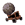
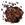
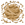
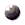

# 石头（Stone）

初始造成 300% / 350% / 400% 的伤害。每次击中敌人后伤害衰减 40% / 35% / 30%，最低为 50%。

[原文与贡献者记录](https://ballxpit.wiki.gg/wiki/Stone) · [修订 4232](https://ballxpit.wiki.gg/index.php?oldid=4232) · [返回目录](../%E7%90%83%E6%AF%94%E4%BC%A6%E6%88%98%E8%AE%B0%20Wiki.md)

## 基本信息

### 初始角色（Starting Character）

-

### 解锁

通关《雪原之战》

### 状态效果（Status Effects）

-

## 进化（Evolutions）

### 进化成

[硫磺](Brimstone.md) , [投石机](Catapult.md) , [冰川](Glacier.md) , [山崩](Landslide.md) , [石化](Petrify.md) , [沙暴](Sandstorm.md) , [钢铁](Steel.md) 

:   *关于资源，请参阅 [石料（资源 / resource）](Stone_resource.md).*

**石头** 是 [基础圆球](Balls.md#%E5%9F%BA%E7%A1%80%E5%9C%86%E7%90%83) 在游戏中引入 [皇家更新](https://ballxpit.wiki.gg/wiki/The_Regal_Update?action=edit&redlink=1) 的 *[球比伦战记](Ball_x_Pit.md)*. 通过通关即可解锁。 [白雪海岸](The_SNOWYxSHORES.md).

## 关卡

| 等级 | 伤害 | 效果 |
| --- | --- | --- |
| 1 |  x(3.5 至 6.5) | 初始造成300%的伤害。每次击中敌人，伤害减少40%（下限为50%）。 |
| 2 |  x(3.5 至 6.5) | 初始造成 350% 的伤害。每次击中敌人，伤害减少 35%（下限为 50%）。 |
| 3 |  x(3.5 至 6.5) | 初始造成 400% 的伤害。每次击中敌人，伤害减少 30%（下限为 50%）。 |

## 进化

| 组合 | 进化 |
| --- | --- |
|  石头（Stone） + [灼烧（Burn）](Burn.md)  | [硫磺（Brimstone）](Brimstone.md)  |
|  石头（Stone） + [卵囊（Egg Sac）](Egg_Sac.md)  | [投石机（Catapult）](Catapult.md)  |
|  石头（Stone） + [冻结（Freeze）](Freeze.md)  | [冰川（Glacier）](Glacier.md)  |
|  石头（Stone） + [地震（Earthquake）](Earthquake.md)  | [山崩（Landslide）](Landslide.md)  |
|  石头（Stone） + [肉身（Flesh）](Flesh.md)  | [石化（Petrify）](Petrify.md)  |
|  石头（Stone） + [风（Wind）](Wind.md)  | [沙暴（Sandstorm）](Sandstorm.md)  |
|  石头（Stone） + [铁（Iron）](Iron.md)  | [钢铁（Steel）](Steel.md) （\*） |

* 可以进一步进化。

## 策略

伟大融合：石 + 侵蚀（融合时先选择石）：造成敌人生命值400%的伤害。（侵蚀 + 石：仅造成5%的伤害。）

## 更新记录

## 冷知识

## 图片库

[共享导航](../navigation/nav-63012059ef49.md)

**分类**　[分类 · 基础圆球](../categories/Base_Balls.md) · [分类 · 圆球](../categories/Balls.md) · [分类 · 带有导航框的页面](../categories/Pages_with_navboxes.md)

[返回总入口](../%E7%90%83%E6%AF%94%E4%BC%A6%E6%88%98%E8%AE%B0%20Wiki.md) · [返回本分目录](%E7%9B%AE%E5%BD%95.md)
