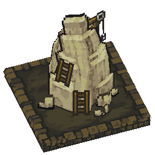

# 石矿场（Stone Mine）

在此分配一个角色来从相邻的巨石中收获 。

[原文与贡献者记录](https://ballxpit.wiki.gg/wiki/Stone_Mine) · [修订 3337](https://ballxpit.wiki.gg/index.php?oldid=3337) · [返回目录](../%E7%90%83%E6%AF%94%E4%BC%A6%E6%88%98%E8%AE%B0%20Wiki.md)

## 信息（Information）

### 分类（Category）

经济

### 子类（Subcategory）

收集

### 蓝图位置（Blueprint location）

[白雪海岸](The_SNOWYxSHORES.md) 

### 基础资源消耗（Base resource cost）

 100  5

### 建造点消耗（Build point cost）

5

**石矿场**是*[《球比伦战记》](Ball_x_Pit.md)*的一种采集[建筑](Buildings.md)。派驻角色后，会自动从与作用范围相交的[巨石](Boulder.md)和[花岗岩板](Granite_Slab.md)采集石材，升级可以加快采集速度。它的范围比[农场](Farm.md)和[伐木场](Lumberyard.md)小，向四周及对角线各延伸 1 小格。派驻的[角色](Characters.md)仍可以在手动收获时使用。建成[工人工会](Worker_s_Guild_Building.md)后，关闭游戏期间也能采集。只要基地有空地且资源充足，石矿场和其他资源、采集建筑均可多次建造。

被动效果与升级

| 等级 | 图片 | 说明 | 资源消耗 | 建造点消耗 | 拆除 | 收集的资源 | 收集率 |
| --- | --- | --- | --- | --- | --- | --- | --- |
| 1 |  | 在此分配一个角色，每10分钟从每个相邻的巨石场收获最多1个。 |  100  5 | 5 |  100  5 |  石头 |  1/10分钟 |
| 2 |  | 在此分配一个角色，每9分钟从每个相邻的巨石场中收获最多2个。 |  200  10 | 5 |  300  15 |  石头 |  2 / 9分钟 |
| 3 |  | 在此分配一个角色，每8分钟从每个相邻的巨石场收获最多3个。 |  300  15 | 15 |  600  30 |  石头 |  3 / 8分钟 |

[共享导航](../navigation/nav-d4956b01aa56.md)

**分类**　[分类 · 建筑](../categories/Buildings.md) · [分类 · 经济](../categories/Economy.md) · [分类 · 收集](../categories/Gathering.md) · [分类 · 带有导航框的页面](../categories/Pages_with_navboxes.md)

[返回总入口](../%E7%90%83%E6%AF%94%E4%BC%A6%E6%88%98%E8%AE%B0%20Wiki.md) · [返回本分目录](%E7%9B%AE%E5%BD%95.md)
