# 骸骨墓园（The BONExYARD）

[原文与贡献者记录](https://ballxpit.wiki.gg/wiki/The_BONExYARD) · [修订 3722](https://ballxpit.wiki.gg/index.php?oldid=3722) · [返回目录](../%E7%90%83%E6%AF%94%E4%BC%A6%E6%88%98%E8%AE%B0%20Wiki.md)

#### 一般信息

##### 解锁所需齿轮（Gears to unlock）

标签

##### 建筑蓝图（Blueprints）

11

##### 解锁条件（Unlocks）

* [黑暗（Dark）](Dark.md) 
* [诅咒的精液（Cursed Elixir）](Cursed_Elixir.md) [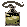](Cursed_Elixir.md)
* [伏都娃娃（Voodoo Doll）](Voodoo_Doll.md) [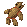](Voodoo_Doll.md)
* [压力阀（Pressure Valve）](Pressure_Valve.md) 

**骸骨墓园** 是第一个 [的水平](Levels.md) 在 *[球比伦战记](Ball_x_Pit.md)*它默认解锁，这是游戏的唯一可用的级别。

#### 解锁条件

清除此级别将使玩家能够解锁以下项目:

* [黑暗（Dark）](Dark.md) 
* [诅咒的精液（Cursed Elixir）](Cursed_Elixir.md) 
* [伏都娃娃（Voodoo Doll）](Voodoo_Doll.md) 
* [压力阀（Pressure Valve）](Pressure_Valve.md) 

#### 建筑蓝图

玩家可以在此关卡中获取以下 [建筑](Buildings.md) 的蓝图 :

* [诊所（Clinic）](Clinic.md) 
* [兵营（Barracks）](Barracks.md) 
* [鞋匠（Shoemaker）](Shoemaker.md) 
* [领事馆（Consulate）](Consulate.md) 
* [校园（Schoolhouse）](Schoolhouse.md) 
* [枪手（Gunsmith）](Gunsmith.md) 
* [驱魔者（Exorcist）](Exorcist.md) 
* [舒适的家（Cozy Home）](Cozy_Home.md) [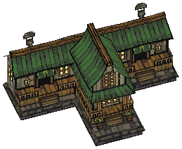](Cozy_Home.md)
* [警长办公室（Sheriff's Office）](Sheriff_s_Office.md) 
* [鬼鬼之家（Haunted House）](Haunted_House.md) 
* [骸骨墓园奖杯（Boneyard Trophy）](Boneyard_Trophy.md) [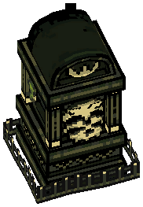](Boneyard_Trophy.md)

#### 敌人

以下是在此级别上可遇到的[enemies](Enemies.md)列表:

* [骨架战士（Skeleton Warrior）](Skeleton_Warrior.md) [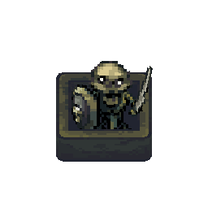](Skeleton_Warrior.md)
* [骸骨蛮兵（Skeletal Brute）](Skeletal_Brute.md) 
* [骸骨野兽（Skeletal Beast）](Skeletal_Beast.md) [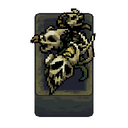](Skeletal_Beast.md)
* [骸骨主教（Skeletal Bishop）](Skeletal_Bishop.md) [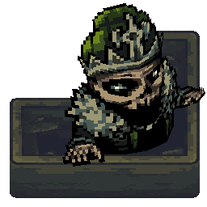](Skeletal_Bishop.md)
* [骸骨堡垒（Skeletal Bastion）](Skeletal_Bastion.md) [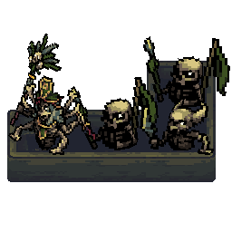](Skeletal_Bastion.md)
* [骨架弓箭手（Skeleton Archer）](Skeleton_Archer.md) [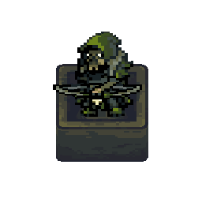](Skeleton_Archer.md)
* [骨贝赫莫特（Bone Behemoth）](Bone_Behemoth.md) [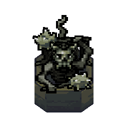](Bone_Behemoth.md)
* [骨架旅队（Skeletal Brigade）](Skeletal_Brigade.md) [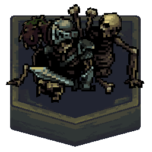](Skeletal_Brigade.md)
* [骨球ista（Bone Ballista）](Bone_Ballista.md) [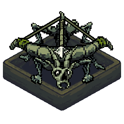](Bone_Ballista.md)
* [骨架国王（Skeleton King）](Skeleton_King.md) [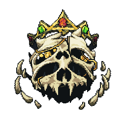](Skeleton_King.md)

[共享导航](../navigation/nav-47f674e55b3c.md)

**分类**　[分类 · 关卡](../categories/Levels.md) · [分类 · 页面有导航框](../categories/Pages_with_navboxes.md)

[返回总入口](../%E7%90%83%E6%AF%94%E4%BC%A6%E6%88%98%E8%AE%B0%20Wiki.md) · [返回本分目录](%E7%9B%AE%E5%BD%95.md)
