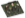
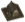
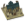
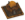
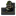
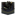

# 骸骨墓园（The BONExYARD）

[原文与贡献者记录](https://ballxpit.wiki.gg/wiki/The_BONExYARD) · [修订 3722](https://ballxpit.wiki.gg/index.php?oldid=3722) · [返回目录](../%E7%90%83%E6%AF%94%E4%BC%A6%E6%88%98%E8%AE%B0%20Wiki.md)

## 基本信息

### 解锁所需齿轮（Gears to unlock）

不适用

### 建筑蓝图（Blueprints）

11

### 解锁内容（Unlocks）

* [黑暗（Dark）](Dark.md) 
* [诅咒灵药](Cursed_Elixir.md) 
* [巫毒娃娃（Voodoo Doll）](Voodoo_Doll.md) 
* [压力阀](Pressure_Valve.md) 

**骸骨墓园** 是 *[球比伦战记](Ball_x_Pit.md)* 的第一个 [关卡](Levels.md)。该关卡默认解锁，是游戏试玩版中唯一可用的关卡。

## 解锁内容

通关本关卡后，玩家将解锁以下物品：

* [黑暗（Dark）](Dark.md) 
* [诅咒灵药](Cursed_Elixir.md) 
* [巫毒娃娃（Voodoo Doll）](Voodoo_Doll.md) 
* [压力阀](Pressure_Valve.md) 

## 建筑蓝图

玩家可以在本关卡中获得以下 [建筑](Buildings.md)的建筑蓝图：

* [诊所（Clinic）](Clinic.md) 
* [兵营（Barracks）](Barracks.md) 
* [鞋匠（Shoemaker）](Shoemaker.md) 
* [领事馆（Consulate）](Consulate.md) 
* [学堂（Schoolhouse）](Schoolhouse.md) 
* [枪匠（Gunsmith）](Gunsmith.md) 
* [驱魔人（Exorcist）](Exorcist.md) 
* [舒适的家（Cozy Home）](Cozy_Home.md) 
* [警长办公室](Sheriff_s_Office.md) 
* [鬼屋](Haunted_House.md) 
* [骸骨墓园奖杯](Boneyard_Trophy.md) 

## 敌人

本关卡可能遇到下列[敌人](Enemies.md)。

* [骷髅战士](Skeleton_Warrior.md) 
* [骸骨蛮兵](Skeletal_Brute.md) 
* [骸骨野兽](Skeletal_Beast.md) 
* [骸骨主教](Skeletal_Bishop.md) 
* [骸骨堡垒](Skeletal_Bastion.md) 
* [骷髅弓箭手](Skeleton_Archer.md) 
* [白骨巨兽](Bone_Behemoth.md) 
* [骸骨军团](Skeletal_Brigade.md) 
* [白骨弩炮](Bone_Ballista.md) 
* [骷髅王](Skeleton_King.md) 

[共享导航](../navigation/nav-47f674e55b3c.md)

**分类**　[分类 · 关卡](../categories/Levels.md) · [分类 · 带有导航框的页面](../categories/Pages_with_navboxes.md)

[返回总入口](../%E7%90%83%E6%AF%94%E4%BC%A6%E6%88%98%E8%AE%B0%20Wiki.md) · [返回本分目录](%E7%9B%AE%E5%BD%95.md)
