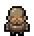
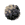
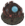
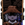
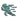

# 持球者（The Ballbearer）

[原文与贡献者记录](https://ballxpit.wiki.gg/wiki/The_Ballbearer) · [修订 4324](https://ballxpit.wiki.gg/index.php?oldid=4324) · [返回目录](../%E7%90%83%E6%AF%94%E4%BC%A6%E6%88%98%E8%AE%B0%20Wiki.md)

## 传递者 

瞄准目标。

## 基本信息

### 圆球（Ball）

[石头](Stone.md) 

### 解锁

建造 [圆球屋](Ball_House.md) 

### 能力

拥有两倍的球槽数量，但没有被动技能槽。

**持球者**是 *[球比伦战记](Ball_x_Pit.md)* 中的可玩 [角色](Characters.md)，由 [自然主义者更新](https://ballxpit.wiki.gg/wiki/The_Naturalist_Update?action=edit&redlink=1) 引入。通过建造 [圆球屋](Ball_House.md)  即可解锁该角色，其蓝图可在 [浩瀚虚空](The_VASTxVOID.md)  中找到。他们的初始球为 [石头](Stone.md) 。

## 能力机制

持球者的[特殊圆球](Balls.md#%E7%89%B9%E6%AE%8A%E5%9C%86%E7%90%83)栏位是其他角色的两倍，无法装备[被动道具](Passives.md)。

## 策略

[点击此处添加策略！](https://ballxpit.wiki.gg/wiki/The_Ballbearer?action=edit&section=new)

## [匹配机](Matchmaker.md) 配对 

### 好

### 坏

### 不兼容

* [白发囤积者](The_Hoary_Hoarder.md) 

## 基础属性

| 属性 | 属性 |
| --- | --- |
|  耐力 | 生命值未知 |
|  力量 | 基础伤害 - ? |
|  领导力 | 小球数量 - ?；小球伤害 - ? |
|  速度 | 球速 - ?；移动速度 - ? |
|  敏捷 | 暴击率 - ?；发射频率 - ? |
|  智力 | 范围效果强度 – 待确认；状态效果强度 - ?；被动效果强度 – 待确认 |

## 角色等级进展

[角色等级提升奖励](Character_Level_Mechanics.md)

| 角色等级 | 总经验值 | 升级奖励 | 选择项 |
| --- | --- | --- | --- |
| TBA | TBA | TBA | TBA |

## 冷知识

* “Ballbearer”这个名称很可能是“ball bearing”和“pallbearer”两个词的混合体。

## 图片库

待完善

*此条目为 [待完善](../categories/Stubs.md). 你可以通过帮助 BALL x PIT 维基贡献一份力量。 [补充内容](https://ballxpit.wiki.gg/wiki/The_Ballbearer?action=edit).*

[共享导航](../navigation/nav-334e23d2914f.md)

**分类**　[分类 · 角色](../categories/Characters.md) · [分类 · 待完善](../categories/Stubs.md) · [分类 · 带有导航框的页面](../categories/Pages_with_navboxes.md)

[返回总入口](../%E7%90%83%E6%AF%94%E4%BC%A6%E6%88%98%E8%AE%B0%20Wiki.md) · [返回本分目录](%E7%9B%AE%E5%BD%95.md)
