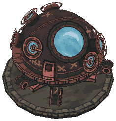

# 持球者（The Ballbearer）

 

关注奖励。

[原文与贡献者记录](https://ballxpit.wiki.gg/wiki/The_Ballbearer) · [修订 4324](https://ballxpit.wiki.gg/index.php?oldid=4324) · [返回目录](../%E7%90%83%E6%AF%94%E4%BC%A6%E6%88%98%E8%AE%B0%20Wiki.md)

#### 一般信息

##### 圆球（Ball）

[石头](Stone.md) 

##### 解锁

建筑物 [球场](Ball_House.md) 

##### 能力

有两倍的球槽，但没有被动的槽。

**持球者** 是一个可玩的 [性格](Characters.md) 在 *[球比伦战记](Ball_x_Pit.md)*已在 [自然主义者更新](https://ballxpit.wiki.gg/wiki/The_Naturalist_Update?action=edit&redlink=1)它们通过构建 [球场](Ball_House.md)  据报道, [浩瀚虚空](The_VASTxVOID.md)  他们的起始球是 [石头](Stone.md) .

#### 能力的机械

球轴承器具有其他每个字符的 [特殊球](Balls.md#%E7%89%B9%E6%AE%8A%E5%9C%86%E7%90%83)插槽的两倍，尽管有缺点，它们不能装备 [被动道具](Passives.md).

#### 策略

[单击这里，添加一个策略!](https://ballxpit.wiki.gg/wiki/The_Ballbearer?action=edit&section=new)

#### [匹配机](Matchmaker.md) 配对 

##### 很好。

##### 坏的

##### 不兼容

* [白发囤积者（The Hoary Hoarder）](The_Hoary_Hoarder.md) 

#### 基本数据

| 属性 | 属性 |
| --- | --- |
|  耐力 | - 什么意思? |
|  力量 | 基地损坏? |
|  领导力 | 宝贝球计数?；婴儿球损伤? |
|  速度 | 球速?；移动速度? |
|  敏捷 | 关键机会?；发生火灾率? |
|  智力 | 公司发动力?；状态效应功率 - ?；动力? |

#### 性格水平的进步

[性格升级奖励](Character_Level_Mechanics.md)

| 性格水平 | 总经验值 | 提高奖励水平 | 选择 |
| --- | --- | --- | --- |
| TBA | TBA | TBA | TBA |

#### 冷知识

* 球轴承的名称可能是"球轴承"和"球轴承"的组合。

#### 图片库

待补充条目

*这是一个 [待补充条目](../categories/Stubs.md)你可以帮助BALL xPIT Wiki通过 [补充此条目](https://ballxpit.wiki.gg/wiki/The_Ballbearer?action=edit).*

[共享导航](../navigation/nav-334e23d2914f.md)

**分类**　[分类 · 角色](../categories/Characters.md) · [分类 · 坚力](../categories/Stubs.md) · [分类 · 页面有导航框](../categories/Pages_with_navboxes.md)

[返回总入口](../%E7%90%83%E6%AF%94%E4%BC%A6%E6%88%98%E8%AE%B0%20Wiki.md) · [返回本分目录](%E7%9B%AE%E5%BD%95.md)
