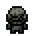
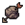

# 沉思者（The Cogitator）

[原文与贡献者记录](https://ballxpit.wiki.gg/wiki/The_Cogitator) · [修订 4323](https://ballxpit.wiki.gg/index.php?oldid=4323) · [返回目录](../%E7%90%83%E6%AF%94%E4%BC%A6%E6%88%98%E8%AE%B0%20Wiki.md)

待完善

*此条目为 [待完善](../categories/Stubs.md). 你可以通过帮助 BALL x PIT 维基贡献一份力量。 [补充内容](https://ballxpit.wiki.gg/wiki/The_Cogitator?action=edit).*

## 沉思者 

一位才华横溢的哲学家，沉浸在思考中。

## 基本信息

### 圆球（Ball）

[激光（垂直）](Laser_Vertical.md) 

### 解锁

建造 [别墅](Villa.md)

### 能力

自动选择升级项目。

**沉思者** 是 *[球比伦战记](Ball_x_Pit.md)* 中一名可解锁的可玩 [角色](Characters.md)。建造 [别墅](Villa.md) 即可解锁，其蓝图会在 [白雪海岸](The_SNOWYxSHORES.md)  中随机掉落。其显著特点是，升级、进化与融合选项由系统自动选择，而非由玩家手动决定。当玩家在等级提升过程中可以选择使用升级点时（无论是自动在等级提升时，还是玩家手动选择进入升级界面时），或者在拾取 [融合反应堆](Fusion_Reactor.md) 时，沉思者会暂时接管玩家的控制权，并随机自动选择其中一个可用选项。虽然玩家仍然可以看到通常可用的选项，但沉思者既不能重掷，也不能放逐升级。与 [激进者](The_Radical.md)  不同，玩家仍然可以正常控制游戏中的所有其他操作。起始圆球为 [激光（垂直）(Laser (Vertical))](Laser_Vertical.md) 。

## 策略

失去选择升级、进化或融合的能力，使得这个角色在策略制定上比大多数角色要困难得多。因为虽然他们会尝试选择彼此协同作用的球和被动道具[[1]](https://www.reddit.com/r/xbox/comments/1o7kkrt/comment/nk09f3c/?utm_source=share&utm_medium=web3x&utm_name=web3xcss&utm_term=1&utm_content=share_button)，但结果并不稳定。因此，这个角色无法被依赖来形成特定的构建、球或被动道具的趋势。通过尽可能延迟获取融合反应堆的时间，可以一定程度上减少次优选择，从而最大化获得的经验值/等级，并升级球和被动道具，进而拥有更多/更好的选择。此外，启用不自动进入等级提升界面的选项，可以让玩家将升级点数储存起来，直到获得所需的进化并升级，或者通过融合反应堆释放球/被动道具的槽位，而不是将这些点数浪费在终局资源选项上。

## [匹配机](Matchmaker.md) 配对 

### 好

### 坏

## 关卡

[角色等级提升奖励](Character_Level_Mechanics.md)

| 角色等级 | 总经验值 | 升级奖励 | 选择项 |
| --- | --- | --- | --- |
| 3 | 857 | [收获升级](Harvest_Upgrades_Character_Bonus.md) |  [Builder](https://ballxpit.wiki.gg/wiki/Builder?action=edit&redlink=1) 或  [Time Keeper](https://ballxpit.wiki.gg/wiki/Time_Keeper?action=edit&redlink=1) |
| 4 | 1,472 | [住房能力获取](Buildings.md#%E4%BD%8F%E6%88%BF) | 附近的麦田再生速度提高 25%。 |
| 6 | 3,574 | [收获升级](Harvest_Upgrades_Character_Bonus.md) |  [时间守护者](https://ballxpit.wiki.gg/wiki/Time_Keeper?action=edit&redlink=1) 或  [石凿者](https://ballxpit.wiki.gg/wiki/Stonepiercer?action=edit&redlink=1) |
| 7 | 5,262 | [住房能力升级](Buildings.md#%E4%BD%8F%E6%88%BF) | 附近的麦田再生速度提高 35%。 |
| 9 | 10,409 | [住房能力升级](Buildings.md#%E4%BD%8F%E6%88%BF) | 附近的麦田再生速度提高 45%。 |
| 10 | 14,069 | [收获升级](Harvest_Upgrades_Character_Bonus.md) |  [短跑手](https://ballxpit.wiki.gg/wiki/Sprinter?action=edit&redlink=1) 或  [小麦收割机](https://ballxpit.wiki.gg/wiki/Wheat_Harvester?action=edit&redlink=1) |
| ... | ... | ... |  |

## 冷知识

## 图片库

[共享导航](../navigation/nav-334e23d2914f.md)

**分类**　[分类 · 待完善](../categories/Stubs.md) · [分类 · 角色](../categories/Characters.md) · [分类 · 带有导航框的页面](../categories/Pages_with_navboxes.md)

[返回总入口](../%E7%90%83%E6%AF%94%E4%BC%A6%E6%88%98%E8%AE%B0%20Wiki.md) · [返回本分目录](%E7%9B%AE%E5%BD%95.md)
