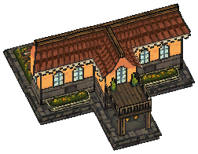

# 沉思者（The Cogitator）

 

一个聪明的哲学家，迷失了思想。

[原文与贡献者记录](https://ballxpit.wiki.gg/wiki/The_Cogitator) · [修订 4323](https://ballxpit.wiki.gg/index.php?oldid=4323) · [返回目录](../%E7%90%83%E6%AF%94%E4%BC%A6%E6%88%98%E8%AE%B0%20Wiki.md)

待补充条目

*这是一个 [待补充条目](../categories/Stubs.md)你可以帮助BALL xPIT Wiki通过 [补充此条目](https://ballxpit.wiki.gg/wiki/The_Cogitator?action=edit).*

#### 一般信息

##### 圆球（Ball）

[激光 （垂直 / Vertical）](Laser_Vertical.md) 

##### 解锁

构建 [别墅](Villa.md)

##### 能力

自动选择升级。

**沉思者** 是一个可以解锁的可播放 [角色](Characters.md) 在 *[球比伦战记](Ball_x_Pit.md)*它们通过构建 [别墅](Villa.md), 图案被发现是随机落入的 [白雪海岸](The_SNOWYxSHORES.md) .它们的定义特点是，它们自动选择升级，演变和融合，而不是玩家。当玩家有选择在级别运行期间使用升级点 (无论是自动升级时，还是玩家手动选择进入升级屏幕时) [聚合反应堆](Fusion_Reactor.md),Cogitator将暂时从玩家手中控制并自动随机选择可用的选项之一。与玩家通常相同的选项仍然会出现，但Cogitator不能重新滚动或驱逐升级。 [激进者](The_Radical.md)  玩家仍然正常控制游戏中的其他行动。 [激光 （垂直 / Vertical）](Laser_Vertical.md) .

#### 策略

失去选择升级，演变或合并的能力使得这个角色比大多数人更难策略，因为他们会尝试选择与彼此协同的球和被动。 [[1]](https://www.reddit.com/r/xbox/comments/1o7kkrt/comment/nk09f3c/?utm_source=share&utm_medium=web3x&utm_name=web3xcss&utm_term=1&utm_content=share_button)结果不一致。因此，不能依赖这种特征来趋向任何特定的构建，球或被动。尽可能拖延核聚变反应堆回收机，以最大限度地提高经验值/水平和升级蛋球/被动剂，从而提供更多/更好的选择，可以在一定程度上减轻亚最佳选择。此外，允许不自动进入升级屏幕的选项，可以替代地银行升级点，直到获得所需的演变，并且可以升级，或者通过融合反应堆释放了球/被动槽，而不是浪费这些点在游戏终端资源选项上。

#### [匹配机](Matchmaker.md) 配对 

##### 很好。

##### 坏的

#### 关卡

[性格升级奖励](Character_Level_Mechanics.md)

| 性格水平 | 总经验值 | 提高奖励水平 | 选择 |
| --- | --- | --- | --- |
| 3 | 857 | [提高收获](Harvest_Upgrades_Character_Bonus.md) |  [建筑师](https://ballxpit.wiki.gg/wiki/Builder?action=edit&redlink=1) 或是  [时间守护者](https://ballxpit.wiki.gg/wiki/Time_Keeper?action=edit&redlink=1) |
| 4 | 1,472 | [住房能力增长](Buildings.md#%E4%BD%8F%E6%88%BF) | 在附近的小麦田地增长25%。 |
| 6 | 3,574 | [提高收获](Harvest_Upgrades_Character_Bonus.md) |  [时间守护者](https://ballxpit.wiki.gg/wiki/Time_Keeper?action=edit&redlink=1) 或是  [石头破碎者](https://ballxpit.wiki.gg/wiki/Stonepiercer?action=edit&redlink=1) |
| 7 | 5,262 | [提高住房能力](Buildings.md#%E4%BD%8F%E6%88%BF) | 在附近的小麦田地增长了35%。 |
| 9 | 10,409 | [提高住房能力](Buildings.md#%E4%BD%8F%E6%88%BF) | 附近的小麦田地增长了45%。 |
| 10 | 14,069 | [提高收获](Harvest_Upgrades_Character_Bonus.md) |  [冲刺运动员](https://ballxpit.wiki.gg/wiki/Sprinter?action=edit&redlink=1) 或是  [麦机](https://ballxpit.wiki.gg/wiki/Wheat_Harvester?action=edit&redlink=1) |
| ... | ... | ... |  |

#### 冷知识

#### 图片库

[共享导航](../navigation/nav-334e23d2914f.md)

**分类**　[分类 · 坚力](../categories/Stubs.md) · [分类 · 角色](../categories/Characters.md) · [分类 · 页面有导航框](../categories/Pages_with_navboxes.md)

[返回总入口](../%E7%90%83%E6%AF%94%E4%BC%A6%E6%88%98%E8%AE%B0%20Wiki.md) · [返回本分目录](%E7%9B%AE%E5%BD%95.md)
