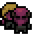
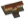
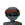
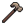

# 同居者（The Cohabitants）

[原文与贡献者记录](https://ballxpit.wiki.gg/wiki/The_Cohabitants) · [修订 4322](https://ballxpit.wiki.gg/index.php?oldid=4322) · [返回目录](../%E7%90%83%E6%AF%94%E4%BC%A6%E6%88%98%E8%AE%B0%20Wiki.md)

待完善

*此条目为 [待完善](../categories/Stubs.md). 你可以通过帮助 BALL x PIT 维基贡献一份力量。 [补充内容](https://ballxpit.wiki.gg/wiki/The_Cohabitants?action=edit).*

## 同居者 

有一对有很多很多孩子的夫妇。

## 基本信息

### 圆球（Ball）

[育巢母体](Brood_Mother.md) 

### 解锁

构筑 [舒适的家](Cozy_Home.md)

### 能力

每发射一颗球，就会在镜像方向发射一颗。这些球会造成一半的伤害。

**同居者** 是 *[球比伦战记](Ball_x_Pit.md)* 中一名可解锁的可玩 [角色](Characters.md)。建造 [舒适的家](Cozy_Home.md) 即可解锁，其蓝图会在 [骸骨墓园](The_BONExYARD.md)  中随机掉落。其显著特性是，所有圆球发射时都会朝左右镜像方向发射第二个相同圆球，但所有圆球的伤害只有正常伤害的一半。此外，所有特殊圆球必须等两个副本都返回之后才能再次发射。起始圆球为 [育巢母体](Brood_Mother.md) 。

## 策略

## [匹配机](Matchmaker.md) 配对 

### 好

* [自笞者](The_Flagellant.md) ：由于鞭笞者能让球从屏幕底部反弹，因此它与共生体搭配得很好。这使得球能在屏幕上停留更长时间，这与共生体能发射双倍球数的能力完美契合。

### 坏

### 不兼容

* [临时西西弗斯](The_Makeshift_Sisyphus.md) 
* [挥霍者](The_Spendthrift.md) 
* [杂耍者（The Juggler）](The_Juggler.md) 
* [驯鹰人](The_Falconer.md) 
* [文件：The Recollector.png](https://ballxpit.wiki.gg/wiki/Special%3AUpload?wpDestFile=The_Recollector.png) [回忆者](https://ballxpit.wiki.gg/wiki/The_Recollector?action=edit&redlink=1)

## 关卡

[角色等级提升奖励](Character_Level_Mechanics.md)

| 角色等级 | 总经验值 | 升级奖励 | 选择项 |
| --- | --- | --- | --- |
| 3 | 857 | [收获升级](Harvest_Upgrades_Character_Bonus.md) |  [Builder](https://ballxpit.wiki.gg/wiki/Builder?action=edit&redlink=1) 或  [Time Keeper](https://ballxpit.wiki.gg/wiki/Time_Keeper?action=edit&redlink=1) |
| 4 | 1,472 | [住房能力获取](Buildings.md#%E4%BD%8F%E6%88%BF) | 收获  每 9 分钟从相邻森林中收获 1 次。 |
| 6 | 3,574 | [收获升级](Harvest_Upgrades_Character_Bonus.md) |  [石匠](https://ballxpit.wiki.gg/wiki/Stonepiercer?action=edit&redlink=1) 或  [啄木鸟（Woodpecker）](https://ballxpit.wiki.gg/wiki/Woodpecker?action=edit&redlink=1) |
| 7 | 5,262 | [住房能力升级](Buildings.md#%E4%BD%8F%E6%88%BF) | 每9分钟从相邻森林收获  2。 |
| 9 | 10,409 | [住房能力升级](Buildings.md#%E4%BD%8F%E6%88%BF) | 收获  每9分钟从相邻森林中收获3个。 |
| 10 | 14,069 | [收获升级](Harvest_Upgrades_Character_Bonus.md) |  [短跑手](https://ballxpit.wiki.gg/wiki/Sprinter?action=edit&redlink=1) 或  [小麦收割机](https://ballxpit.wiki.gg/wiki/Wheat_Harvester?action=edit&redlink=1) |
| ... | ... | ... |  |

## 冷知识

* 他们是仅由两人组成的角色。
* “Cohabitants”的设计参考了那幅标志性的1930年画作。 *[美国哥特式](https://en.wikipedia.org/wiki/American_Gothic)* 由格兰特·伍德创作，描绘了一位中西部农民和他的女儿，她们有着完全相同的发型与服装。
* 通过 [匹配机](Matchmaker.md)  与另一个角色配对时，两个共生者中的一方将替换为另一方，具体取决于先选择哪个角色（如果先选择了另一个角色，则替换为女孩；如果先选择了共生者，则替换为老人）。

## 图片库

[共享导航](../navigation/nav-334e23d2914f.md)

**分类**　[分类 · 待完善](../categories/Stubs.md) · [分类 · 角色](../categories/Characters.md) · [分类 · 文件链接失效的页面](../categories/Pages_with_broken_file_links.md) · [分类 · 带有导航框的页面](../categories/Pages_with_navboxes.md)

[返回总入口](../%E7%90%83%E6%AF%94%E4%BC%A6%E6%88%98%E8%AE%B0%20Wiki.md) · [返回本分目录](%E7%9B%AE%E5%BD%95.md)
