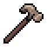
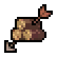

# 同居者（The Cohabitants）

 

一对夫妇有很多孩子。

[原文与贡献者记录](https://ballxpit.wiki.gg/wiki/The_Cohabitants) · [修订 4322](https://ballxpit.wiki.gg/index.php?oldid=4322) · [返回目录](../%E7%90%83%E6%AF%94%E4%BC%A6%E6%88%98%E8%AE%B0%20Wiki.md)

待补充条目

*这是一个 [待补充条目](../categories/Stubs.md)你可以帮助BALL xPIT Wiki通过 [补充此条目](https://ballxpit.wiki.gg/wiki/The_Cohabitants?action=edit).*

#### 一般信息

##### 圆球（Ball）

[育巢母体](Brood_Mother.md) 

##### 解锁

建立一个 [舒适的家](Cozy_Home.md)

##### 能力

每个发射的球，一本副本都发射在反射方向。

**同居者** 是一个可以解锁的可播放 [角色](Characters.md) 在 *[球比伦战记](Ball_x_Pit.md)*它们通过构建 [舒适的家](Cozy_Home.md), 蓝图可以找到作为一个随机落入 [骸骨墓园](The_BONExYARD.md) .它们的定义能力是，当所有球发射时，将在左到右反射方向发射第二个副本的球,此外，所有特殊球都必须在再次射击之前返回两种副本。他们的起始球是 [育巢母体](Brood_Mother.md) .

#### 策略

#### [匹配机](Matchmaker.md) 配对 

##### 很好。

* [自笞者（The Flagellant）](The_Flagellant.md)  由于他能够让球弹出屏幕底部，这使得球在屏幕上停留更长时间，这与同居的射击能力完美相结合。

##### 坏的

##### 不兼容

* [临时西西弗斯（The Makeshift Sisyphus）](The_Makeshift_Sisyphus.md) 
* [挥霍者（The Spendthrift）](The_Spendthrift.md) 
* [杂耍者（The Juggler）](The_Juggler.md) 
* [驯鹰人（The Falconer）](The_Falconer.md) 
* [File:The Recollector.png](https://ballxpit.wiki.gg/wiki/Special%3AUpload?wpDestFile=The_Recollector.png) [记忆者](https://ballxpit.wiki.gg/wiki/The_Recollector?action=edit&redlink=1)

#### 关卡

[性格升级奖励](Character_Level_Mechanics.md)

| 性格水平 | 总经验值 | 提高奖励水平 | 选择 |
| --- | --- | --- | --- |
| 3 | 857 | [提高收获](Harvest_Upgrades_Character_Bonus.md) |  [建筑师](https://ballxpit.wiki.gg/wiki/Builder?action=edit&redlink=1) 或是  [时间守护者](https://ballxpit.wiki.gg/wiki/Time_Keeper?action=edit&redlink=1) |
| 4 | 1,472 | [住房能力增长](Buildings.md#%E4%BD%8F%E6%88%BF) | 收获  每9分钟就有1个来自邻近的森林。 |
| 6 | 3,574 | [提高收获](Harvest_Upgrades_Character_Bonus.md) |  [石头破碎者](https://ballxpit.wiki.gg/wiki/Stonepiercer?action=edit&redlink=1) 或是  [啄木鸟（Woodpecker）](https://ballxpit.wiki.gg/wiki/Woodpecker?action=edit&redlink=1) |
| 7 | 5,262 | [提高住房能力](Buildings.md#%E4%BD%8F%E6%88%BF) | 收获  每9分钟有2次来自相邻森林。 |
| 9 | 10,409 | [提高住房能力](Buildings.md#%E4%BD%8F%E6%88%BF) | 收获  每9分钟就有3个来自邻近的森林。 |
| 10 | 14,069 | [提高收获](Harvest_Upgrades_Character_Bonus.md) |  [冲刺运动员](https://ballxpit.wiki.gg/wiki/Sprinter?action=edit&redlink=1) 或是  [麦机](https://ballxpit.wiki.gg/wiki/Wheat_Harvester?action=edit&redlink=1) |
| ... | ... | ... |  |

#### 冷知识

* 他们是唯一由两个人组成的角色。
* 共同居住者的设计是引用1930年的标志性画 *[美国哥特式](https://en.wikipedia.org/wiki/American_Gothic)* 格兰特·伍德的作品， 描绘了一个中西部农民和他的女儿,
* 当与另一个字符通过 [匹配机（Matchmaker）](Matchmaker.md)  根据哪个字符首先被选择 (如果另一个字符被选择，女孩和老人，如果同住人被选得第一)。

#### 图片库

[共享导航](../navigation/nav-334e23d2914f.md)

**分类**　[分类 · 坚力](../categories/Stubs.md) · [分类 · 角色](../categories/Characters.md) · [分类 · 有破损文件链接的页面](../categories/Pages_with_broken_file_links.md) · [分类 · 页面有导航框](../categories/Pages_with_navboxes.md)

[返回总入口](../%E7%90%83%E6%AF%94%E4%BC%A6%E6%88%98%E8%AE%B0%20Wiki.md) · [返回本分目录](%E7%9B%AE%E5%BD%95.md)
