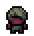
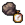

# 潜伏者（The Embedded）

[原文与贡献者记录](https://ballxpit.wiki.gg/wiki/The_Embedded) · [修订 4325](https://ballxpit.wiki.gg/index.php?oldid=4325) · [返回目录](../%E7%90%83%E6%AF%94%E4%BC%A6%E6%88%98%E8%AE%B0%20Wiki.md)

待完善

*此条目为 [待完善](../categories/Stubs.md). 你可以通过帮助 BALL x PIT 维基贡献一份力量。 [补充内容](https://ballxpit.wiki.gg/wiki/The_Embedded?action=edit).*

## 嵌入式 

在无数场战斗的洗礼下，他等待着下一个任务。

## 基本信息

### 圆球（Ball）

[中毒](Poison.md) 

### 解锁

构筑 [老兵小屋](Veteran_s_Hut.md)

### 能力

球始终会穿透敌人，直到它们撞到墙壁为止。

**潜伏者** 是 *[球比伦战记](Ball_x_Pit.md)* 中一名可解锁的可玩 [角色](Characters.md)。建造 [老兵小屋](Veteran_s_Hut.md) 即可解锁，其蓝图会在 [白雪海岸](The_SNOWYxSHORES.md)  中随机掉落。起始圆球为 [中毒](Poison.md) 。

## 能力机制

嵌入者的标志性能力就是 *全部* 他们发射的子弹会一直穿透敌人，直到击中任何一侧的墙壁为止（注意这一点） **不** 包括球场的前后场）。

## 策略

[点击此处添加策略！](https://ballxpit.wiki.gg/wiki/The_Embedded?action=edit&section=new)

## [匹配机](Matchmaker.md) 配对 

### 好

### 坏

### 不兼容

* [文件：The Recollector.png](https://ballxpit.wiki.gg/wiki/Special%3AUpload?wpDestFile=The_Recollector.png) [回忆者](https://ballxpit.wiki.gg/wiki/The_Recollector?action=edit&redlink=1)

## 关卡

[角色等级提升奖励](Character_Level_Mechanics.md)

| 角色等级 | 总经验值 | 升级奖励 | 选择项 |
| --- | --- | --- | --- |
| 3 | 857 | [收获升级](Harvest_Upgrades_Character_Bonus.md) |  [破坏者](https://ballxpit.wiki.gg/wiki/Demolitionist?action=edit&redlink=1) 或  [石匠大师](https://ballxpit.wiki.gg/wiki/Stone_Master?action=edit&redlink=1) |
| 4 | 1,472 | [住房能力获取](Buildings.md#%E4%BD%8F%E6%88%BF) | 附近房屋的居民可获得20%的经验加成。 |
| 6 | 3,574 | [收获升级](Harvest_Upgrades_Character_Bonus.md) |  [木材大师](https://ballxpit.wiki.gg/wiki/Wood_Master?action=edit&redlink=1) 或  [小麦大师](https://ballxpit.wiki.gg/wiki/Wheat_Master?action=edit&redlink=1) |
| 7 | 5,262 | [住房能力升级](Buildings.md#%E4%BD%8F%E6%88%BF) | 附近房屋的居民可获得25%的经验加成。 |
| 9 | 10,409 | [住房能力升级](Buildings.md#%E4%BD%8F%E6%88%BF) | 附近房屋的居民可获得30%的经验加成。 |
| 10 | 14,069 | [收获升级](Harvest_Upgrades_Character_Bonus.md) |  [建造者](https://ballxpit.wiki.gg/wiki/Builder?action=edit&redlink=1) 或  [小麦收割机](https://ballxpit.wiki.gg/wiki/Wheat_Harvester?action=edit&redlink=1) |
| ... | ... | ... |  |

## 冷知识

## 图片库

[共享导航](../navigation/nav-334e23d2914f.md)

**分类**　[分类 · 待完善](../categories/Stubs.md) · [分类 · 角色](../categories/Characters.md) · [分类 · 文件链接失效的页面](../categories/Pages_with_broken_file_links.md) · [分类 · 带有导航框的页面](../categories/Pages_with_navboxes.md)

[返回总入口](../%E7%90%83%E6%AF%94%E4%BC%A6%E6%88%98%E8%AE%B0%20Wiki.md) · [返回本分目录](%E7%9B%AE%E5%BD%95.md)
