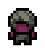
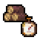
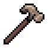

# 潜伏者（The Embedded）

 

随着无数的战斗，他等待他的下一个任务。

[原文与贡献者记录](https://ballxpit.wiki.gg/wiki/The_Embedded) · [修订 4325](https://ballxpit.wiki.gg/index.php?oldid=4325) · [返回目录](../%E7%90%83%E6%AF%94%E4%BC%A6%E6%88%98%E8%AE%B0%20Wiki.md)

待补充条目

*这是一个 [待补充条目](../categories/Stubs.md)你可以帮助BALL xPIT Wiki通过 [补充此条目](https://ballxpit.wiki.gg/wiki/The_Embedded?action=edit).*

#### 一般信息

##### 圆球（Ball）

[中毒](Poison.md) 

##### 解锁

建立一个 [退伍军人小屋](Veteran_s_Hut.md)

##### 能力

球总是穿过敌人，直到他们撞到墙上。

**潜伏者** 是一个可以解锁的可播放 [角色](Characters.md) 在 *[球比伦战记](Ball_x_Pit.md)*它们通过构建 [退伍军人小屋](Veteran_s_Hut.md), 蓝图可以找到作为一个随机落入 [白雪海岸](The_SNOWYxSHORES.md)  他们的起始球是 [中毒](Poison.md) .

#### 能力的机械

嵌入式的签名能力是，它们发射的*all*球会永远刺穿敌人，直到击中任何一面的侧壁(注意此操作的**不**包括球场的后部或前部)。

#### 策略

[单击这里，添加一个策略!](https://ballxpit.wiki.gg/wiki/The_Embedded?action=edit&section=new)

#### [匹配机](Matchmaker.md) 配对 

##### 很好。

##### 坏的

##### 不兼容

* [File:The Recollector.png](https://ballxpit.wiki.gg/wiki/Special%3AUpload?wpDestFile=The_Recollector.png) [记忆者](https://ballxpit.wiki.gg/wiki/The_Recollector?action=edit&redlink=1)

#### 关卡

[性格升级奖励](Character_Level_Mechanics.md)

| 性格水平 | 总经验值 | 提高奖励水平 | 选择 |
| --- | --- | --- | --- |
| 3 | 857 | [提高收获](Harvest_Upgrades_Character_Bonus.md) |  [拆除主义者](https://ballxpit.wiki.gg/wiki/Demolitionist?action=edit&redlink=1) 或是  [石头师](https://ballxpit.wiki.gg/wiki/Stone_Master?action=edit&redlink=1) |
| 4 | 1,472 | [住房能力增长](Buildings.md#%E4%BD%8F%E6%88%BF) | 在附近的房屋的居民获得20%的奖金体验。 |
| 6 | 3,574 | [提高收获](Harvest_Upgrades_Character_Bonus.md) |  [木材师](https://ballxpit.wiki.gg/wiki/Wood_Master?action=edit&redlink=1) 或是  [麦子主](https://ballxpit.wiki.gg/wiki/Wheat_Master?action=edit&redlink=1) |
| 7 | 5,262 | [提高住房能力](Buildings.md#%E4%BD%8F%E6%88%BF) | 附近的房屋居民获得25%的奖金体验。 |
| 9 | 10,409 | [提高住房能力](Buildings.md#%E4%BD%8F%E6%88%BF) | 附近的房屋居民获得30%的奖金体验。 |
| 10 | 14,069 | [提高收获](Harvest_Upgrades_Character_Bonus.md) |  [建筑师](https://ballxpit.wiki.gg/wiki/Builder?action=edit&redlink=1) 或是  [麦机](https://ballxpit.wiki.gg/wiki/Wheat_Harvester?action=edit&redlink=1) |
| ... | ... | ... |  |

#### 冷知识

#### 图片库

[共享导航](../navigation/nav-334e23d2914f.md)

**分类**　[分类 · 坚力](../categories/Stubs.md) · [分类 · 角色](../categories/Characters.md) · [分类 · 有破损文件链接的页面](../categories/Pages_with_broken_file_links.md) · [分类 · 页面有导航框](../categories/Pages_with_navboxes.md)

[返回总入口](../%E7%90%83%E6%AF%94%E4%BC%A6%E6%88%98%E8%AE%B0%20Wiki.md) · [返回本分目录](%E7%9B%AE%E5%BD%95.md)
